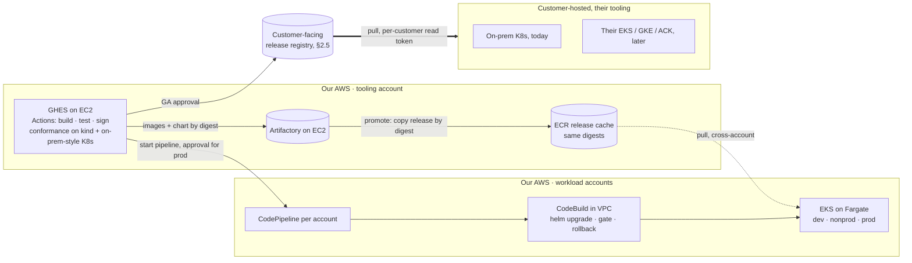
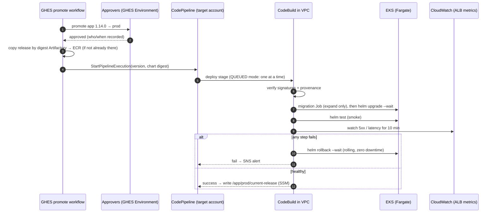

# Proposal: lean, zero-downtime delivery

**Status:** Proposed, for review  ·  **Date:** 2026-10-10

The recommended design, written to be read on its own. The rest of the repo
(requirements, IP model, options, open questions) is supporting detail.

---

## 1. The situation, and the answer in one page

| | **Our AWS accounts** (tooling, dev, nonprod, prod) | **Customer-hosted environments** |
|---|---|---|
| Who deploys | Our CI/CD | The customer, with their tools (Helm, their Argo CD/Flux, scripts) |
| Platform | EKS, AWS managed services allowed | Their EKS, GKE, ACK or on-prem Kubernetes. **No AWS services assumed.** |
| How they get releases | Copied by digest from Artifactory into an **ECR release cache** (§3.2) | **Pull from a customer-facing registry we expose** (§2.5) |
| Zero downtime comes from | The chart's built-in behaviour **plus** our pipeline gates | **The chart's built-in behaviour alone** |

The design:

1. **The product is portable; our pipeline doesn't need to be.** One signed OCI
   Helm chart pins all 8 image digests and has **no hard dependency on any cloud
   service** [PORT-07]. A customer's plain `helm upgrade` *and* `helm rollback`
   are **zero-downtime rolling updates** on any conformant Kubernetes [PORT-08].
2. **GHES and Artifactory run on EC2 in our tooling account.** GHES Actions
   builds, tests and signs. Artifactory is the system of record for every
   artefact.
3. **Workload accounts use AWS-native CI/CD with no deployment controllers in
   the cluster.**
   - A GHES approval promotes a release and starts **CodePipeline**.
   - A **CodeBuild step inside the VPC** runs `helm upgrade` through the same
     values interface customers use, gates on health and ALB metrics, and runs
     `helm rollback` automatically on failure.
4. **Rolling updates everywhere, forward and back.** It's the same path
   customers run, so every prod release also proves the customer upgrade and
   rollback.
5. **Releases are copied from Artifactory into ECR** at promotion time, with the
   same digests and signatures. Pod starts, scaling and rollbacks depend on
   managed ECR, not on the Artifactory EC2 instance.
6. **EKS with every pod on Fargate.** Each pod uses exactly one IP, with no node
   warm pools and no DaemonSets, and there are no nodes to patch. That's an
   estimated **~19 routable IPs at steady state and ~34 at the peak of a
   release**, with no secondary CIDR (§3.6).
7. **AWS managed services provide platform capabilities in our accounts only**:
   ALB, ACM, Route 53, Secrets Manager, CloudWatch, RDS. The app never requires
   them.



---

## 2. The product: what customers get

### 2.1 The release

```
oci://releases.<our-domain>/helm/app:1.14.0   signed (cosign), SBOM + provenance attached
├── values.schema.json                        the configuration contract
├── profiles/   minimal.yaml  standard.yaml  ha.yaml
├── adapters/   aws.yaml  gcp.yaml  alibaba.yaml  generic.yaml   (examples, all optional)
├── templates/                                8 services, digests pinned, zero-downtime rules (§2.3)
└── docs/       INSTALL.md  UPGRADE.md  ROLLBACK.md  COMPATIBILITY.md  RELEASE_NOTES.md
```

Built **once** in GHES. Promotion never rebuilds [REL-01]. Digests only, never
tags [REL-02]. One version identifies the whole stack [REL-03].

### 2.2 The hosting contract: what the app needs from wherever it runs

| Capability | App/chart interface | Our AWS accounts | Customer examples |
|---|---|---|---|
| HTTP exposure | Gateway API `HTTPRoute`, Ingress, or plain Service (values switch) | ALB via AWS Load Balancer Controller | GKE Gateway, Alibaba ALB, Envoy Gateway, Cilium, NGINX… |
| TLS | Terminated at the gateway/LB, or a referenced Secret | ACM | Cloud cert services, cert-manager, their own CA |
| Secrets | `existingSecret` name(s); the app reads K8s Secrets only | Secrets Manager, synced at deploy time | Vault, cloud secret stores, manual |
| Database | Connection settings via Secret | RDS | Cloud SQL, ApsaraDB, their Postgres |
| Metrics | `/metrics` (Prometheus format) + optional OTLP | CloudWatch / Amazon Managed Prometheus | Their Prometheus, GMP, ARMS, Datadog… |
| Logs | JSON on stdout | CloudWatch Logs (Fargate built-in log router) | Whatever their cluster collects |
| Workload identity | Optional, by values | IRSA (Pod Identity isn't supported on Fargate *(verify)*) | Not required |

### 2.3 Zero downtime built into the chart (upgrade **and** rollback)

`helm rollback` is just another rolling update to the previous version, so the
same rules make it zero-downtime too. Enforced by chart templates and CI lint:

| Rule | Why | Req |
|---|---|---|
| `maxUnavailable: 0`, `maxSurge: 1` | Never fewer serving pods than needed, in either direction | ZDT-01 |
| Readiness probe that checks the service can really serve, and fails first on shutdown | Traffic only goes to ready pods, and drains before a pod stops | ZDT-06 |
| `preStop` delay (~10 s) + grace period sized for the slowest request/websocket | Gives any load balancer time to deregister and drain | ZDT-06 |
| ≥ 2 replicas + `PodDisruptionBudget` in `standard`/`ha` | Infrastructure maintenance doesn't cause downtime either | ZDT-01 |
| **N/N+1 API compatibility** between services, **tested in CI** | Old and new pods coexist during upgrade *and* rollback | ZDT-04 |
| **Expand/contract migrations**: expand in release N, contract no earlier than N+2 | **The key to zero-downtime rollback.** Version N-1 must still run on N's schema, so a release must never contain a destructive schema change. | ZDT-05 |
| `helm test` smoke-test Job | A gate any customer can run, with no metrics system needed | ZDT-03 |
| LB readiness integration where it exists (AWS LB readiness gates, GKE NEG) | Closes a known cloud-LB race. Harmless where unused. | ZDT-07 |

A customer's `helm upgrade --install app oci://releases.<our-domain>/helm/app
--version 1.14.0 -f profiles/standard.yaml -f their-values.yaml --wait --atomic`
is zero-downtime, and `--atomic` rolls back automatically, also with zero
downtime, if pods don't become ready.

**Rollback limit.** A rollback has zero *downtime*, but it can't undo errors a
bad version already served. With rolling updates, a version whose bug passes
readiness and the smoke test takes a growing share of traffic until the
error-rate gate trips. That's typically a few minutes, and a fraction of
requests. We limit this with:
- the full test suite in dev and nonprod before prod;
- a strict smoke test;
- a tight error-rate gate.

If even that exposure is unacceptable, the remedy is a canary or blue/green
step, not a different rollback. This can be added later without changing the
chart contract (§4).

### 2.4 How we prove it (in our CI, not in customers' environments)

Every release, GHES runs a **conformance suite** on **kind**, using only
`helm`/`kubectl` with AWS adapters off, and with continuous load running
throughout:
1. Clean install.
2. **Upgrade N-1 → N: 0 failed requests.**
3. **Mixed-version test:** N-1 and N pods serving together.
4. **Rollback N → N-1: 0 failed requests**, including against N's schema.
5. A deliberately broken release auto-rolls back with 0 failed requests.

**On-prem Kubernetes is the customer platform that matters today**, so a
scheduled job repeats the suite on the on-prem distribution(s) customers
actually run (RKE2/k3s, OpenShift, Tanzu, kubeadm: Q20). It also covers the
on-prem realities:
- **No Gateway API or cloud LB assumed.** The Ingress and plain-Service
  exposure modes are tested.
- **OpenShift-style restricted security.** Pods run as an arbitrary non-root
  UID with a read-only root FS and no capabilities, so the chart works under
  the strictest common policy.
- **Private registry mirror.** Installs run from a mirror, with
  `global.registry` overridden [PORT-06].

[PORT-01/02] Each release ships a compatibility matrix [PORT-05].

### 2.5 Customer-facing release registry (decision needed)

Customers pull releases from a registry we expose. Only releases approved as
**GA** in GHES are copied there, by digest and with their cosign signatures.
Each customer gets a **read-only, revocable token**. Internal dev and nonprod
builds are never visible.

| Option | Customer experience | Security / ops | Cost |
|---|---|---|---|
| **A. A dedicated release repo on our Artifactory**, exposed through a public ALB + WAF | Best: standard registry login with long-lived scoped tokens. Works with any mirror tool. | Puts the build system's registry on the internet. Needs security sign-off, WAF, rate limits. The Artifactory EC2 instance's availability becomes customer-facing. | Low (existing licence) |
| **B. ECR in a dedicated "distribution" AWS account** | OK: ECR login tokens last 12 h, so customers need a credential helper or a mirror that refreshes (Harbor, Artifactory, Nexus and others support ECR as an upstream) | The build system stays private. Managed, highly available, IAM-scoped per customer, CloudTrail audit. | Very low |
| **C. A hosted registry with token auth** (e.g. a JFrog SaaS/edge instance, or Harbor in AWS) | Best | The build system stays private, but it's one more system to run or license | Medium |

**Recommendation: B**, unless security is comfortable exposing Artifactory. B
reuses the ECR copy step our own accounts already use (§3.2), keeps the build
system private, and costs almost nothing. Customer friction is limited because
we recommend customers **mirror into their own registry**, and on-prem
customers usually must anyway. If customer feedback says ECR auth is too
awkward, move to C without changing the release or the chart.

---

## 3. Our AWS accounts: CI/CD

### 3.1 Build (GHES → Artifactory)

GHES and its Actions runners run on **EC2 in the tooling account**, never in
workload clusters [NET-04]:

1. Build and test the 8 images.
2. Push them to Artifactory and record the digests.
3. Sign them, and attach the SBOM and provenance.
4. Package the chart with the digests and push it as OCI.
5. Run the conformance suite (§2.4).
6. Promote to dev automatically.

### 3.2 Image source for the runtime: ECR release cache

Fargate keeps no image cache, so **every pod start pulls its full image**.
Whatever registry Fargate pulls from is on the critical path for scale-up,
restarts and **rollback**.

| Option | Runtime dependency | Pull auth on Fargate | Network from workload VPCs | Verdict |
|---|---|---|---|---|
| **ECR release cache** *(chosen)* | ECR: managed, regional, highly available | Fargate pod execution role; no pull secrets | ECR API/endpoints only; no route to the tooling account | Chosen |
| Pull directly from Artifactory on EC2 | The Artifactory instance, on every pod start | `imagePullSecrets` in every namespace, rotated | Cross-account private route to the tooling VPC from every workload VPC | Only worth it if Artifactory is HA *and* already privately reachable from all workload VPCs |

**Design:**
- The GHES promote workflow, running on a runner in the tooling account,
  **copies the release by digest** from Artifactory into a central **ECR**
  (`crane`/`oras` copy). This covers the 8 images, the OCI chart, and the
  signatures/SBOM/provenance. Digests are unchanged, so "deploy by digest"
  still identifies exactly what Artifactory holds [REL-01/02].
- ECR lives in the tooling account.
  Workload accounts pull cross-account through a repository policy granting
  their Fargate pod-execution roles.
- The previous releases stay in ECR, so **rollback never needs Artifactory**.
  A lifecycle policy keeps, say, the last 10 releases.
- **Artifactory stays the source of truth.** ECR is a runtime cache, as allowed
  by ADR-0001 ("ECR … of Artifactory MAY be considered as an adapter if
  justified"). This will be recorded in its own ADR.

### 3.3 Promotion and deployment



| Concern | Design | Req |
|---|---|---|
| Trigger | A **promotion** in GHES, not an image push | DEP-03 |
| Approval | **GHES Environments** with required reviewers (nonprod, prod, GA/customer release). This is the single approval record. | DEP-02 |
| Identity | GHES → AWS via OIDC, to a role that can *only* start the pipeline. Only the CodeBuild role can write to the cluster. Dev and prod roles are separate. | DEP-04 |
| Network | GHES makes AWS API calls only. Nothing connects into the cluster from outside. CodeBuild runs in the VPC, reaches the private EKS endpoint, and pulls the chart from ECR. **Workload VPCs need no route to the tooling account.** | DEP-05 |
| One deploy at a time | CodePipeline V2 `QUEUED` execution mode | DEP-06 |
| Same interface as customers | CodeBuild runs `helm upgrade` with the chart + profile + `adapters/aws.yaml` + env values: the documented customer interface, wrapped with gates | DEP-01 |
| What's running where | CodePipeline history, CloudTrail, and SSM parameter `/app/<env>/current-release` | DEP-09 |
| Drift | Humans get **read-only** cluster access, with a break-glass role that's time-bound and alarmed. A nightly scheduled CodeBuild runs `helm diff` and alerts on any difference. | SEC-01, OPS-03 |

The gate, rollback and record logic lives in a small script in our **ops
repo**. It's internal automation around the customer interface, not part of the
product.

### 3.4 Release gate and rollback

- **Gate:** pods become ready (with ALB target health via readiness gates),
  `helm test` passes, and the ALB target group's 5xx rate and p95 latency stay
  within thresholds for 10 minutes.
- **Automatic rollback:** `helm rollback --wait` on any gate failure.
- **Manual rollback:** re-promote the previous version (the same pipeline, the
  same gates).
- Either way it's a rolling update: **zero downtime**, taking about 2–3 minutes
  to complete [ZDT-02].

### 3.5 Cluster, compute and managed services (our accounts only)

| Choice | Decision |
|---|---|
| Compute | **EKS with all pods on Fargate.** The app needs no EBS volumes or privileged containers. One ENI and one IP per pod, no warm pool, no DaemonSets, no nodes to patch or scale. |
| System pods | **CoreDNS** (EKS managed add-on, on Fargate) and the **AWS Load Balancer Controller** (2 pods, `ip` target mode). Those are the only platform pods. |
| Clusters | One per account/environment |
| Ingress / TLS / DNS | One shared ALB per environment (IngressGroup), ACM certificate, Route 53 records in IaC |
| Telemetry | ALB CloudWatch metrics (release gate). **Fargate's built-in Fluent Bit log router** → CloudWatch Logs, with no sidecars or DaemonSets. Optional Amazon Managed Prometheus scraper *(verify Fargate support)*. |
| Images | Pulled from the ECR release cache (§3.2) |
| Secrets / DB | Secrets Manager synced to K8s Secrets at deploy time; RDS |
| IaC | Terraform/OpenTofu (Q12): VPC wiring, cluster, Fargate profiles, access entries, pipeline, CodeBuild, OIDC trust, ALB/DNS, alarms |

#### Compute options (no secondary CIDR)

| Option | Peak routable IPs, minimal | Ops burden | Notes |
|---|---|---|---|
| **EKS + Fargate** *(chosen)* | **~34** | **Lowest**: no nodes | IPs are exactly predictable. Slower pod start (~30–60 s), which is fine for rolling. No privileged pods or EBS volumes. Per-pod sizing. |
| Managed node groups + VPC CNI with `WARM_IP_TARGET=1` | ~36–41 | Medium: node AMIs, add-ons, scaling | Warm IPs per node plus DaemonSet pods add up |
| EKS Auto Mode in primary subnets | uncertain | Low | IP allocation behaviour in small subnets *(verify)*. Can't be budgeted precisely yet. |

Fargate limits to respect: no DaemonSets, and fixed CPU/memory size
combinations. For cost at this size (≈ 10–12 small pods), Fargate is generally
comparable to 2–3 EC2 nodes *(estimate in Phase 1 with real pod sizes)*.

### 3.6 IP budget per workload account (no secondary CIDR, 2 AZs)

A Helm upgrade rolls all 8 Deployments at once, each surging by one pod, so the
app pod count doubles briefly at peak.

| Line | Minimal steady | Minimal peak | HA steady | HA peak |
|---|---|---|---|---|
| EKS control-plane ENIs | 4 | 4 | 4 | 4 |
| App pods (1 replica each; ha 2) | 8 | 16 | 16 | 24 |
| CoreDNS (2) + LB controller (2) | 4 | 4 | 4 | 4 |
| ALB (min 1/AZ, can scale to ~8) | 2 | 8 | 2 | 8 |
| RDS (single-AZ; ha Multi-AZ) | 1 | 1 | 2 | 2 |
| CodeBuild ENI (during deploys only) | 0 | 1 | 0 | 1 |
| VPC endpoints (not a constraint, Q14) | 0 | 0 | 0 | 0 |
| **Total routable** | **19** | **34** | **28** | **43** |

- Both profiles fit **NET-01 (≤ 50)**. In an **80-IP account** the minimal peak
  leaves ~57% free and the HA peak ~46% free [NET-02].
- The dev account also hosts the clean reference database
  (docs/proposal/local-development.md), which adds 1 IP there.
- GHES, Artifactory and the runners live in the tooling account and use none of
  the workload accounts' IPs.
- Prod cutover uses a fresh account or VPC and a DNS switch (§6, slice 5), so a
  constrained account never has to hold two stacks at once.

---

## 4. Options considered

### Delivery in our AWS accounts

Weights are from `docs/05-proposal-brief.md`; scale 1–5; total = Σ score × weight.

| Option | IP (25) | ZDT (20) | Simplicity (20) | Same interface as customers (15) | Security (10) | Cost (5) | Maturity (5) | **Total /500** |
|---|---|---|---|---|---|---|---|---|
| **Chosen: CodePipeline + in-VPC CodeBuild** | 5 | 4 | 5 | 5 | 5 | 5 | 4 | **475** |
| GHES Actions pushing directly to EKS | 5 | 4 | 4 | 5 | 3 | 5 | 4 | **435** |
| Flux pulling OCI from Artifactory | 4 | 4 | 3 | 4 | 5 | 5 | 5 | **400** |
| Argo CD + Argo Rollouts | 3 | 5 | 2 | 3 | 4 | 4 | 5 | **345** |

With the IP and ZDT weights swapped, the scores are 470 / 430 / 400 / 355. The
winner doesn't change.

### Release strategy

| Strategy | Downtime on upgrade | Downtime on rollback | Bad-version exposure | Extra cost | Verdict |
|---|---|---|---|---|---|
| **Rolling** *(chosen)* | 0 | 0 | A fraction of requests until the gate trips | +1 pod per service during a release | Default, everywhere. Matches customers. |
| Blue/green | 0 | 0 (instant flip) | Small (preview + weighted shift) | 2× app pods + edge release + switch logic | Not needed, since services can run at mixed versions |
| Canary (e.g. Argo Rollouts/Flagger) | 0 | 0 | Smallest | A controller + metrics analysis | Revisit only if bad-version exposure becomes a problem in practice |

---

## 5. Risks and assumptions

| # | Assumption | If wrong | Q |
|---|---|---|---|
| R1 | Services tolerate N/N+1 running together | The CI mixed-version test (§2.4) will catch it. Fix the API compatibility, or fall back to blue/green. | Q1 |
| R2 | AWS IAM can trust GHES OIDC tokens. IAM must fetch the issuer's discovery document over HTTPS, which a private GHES on EC2 may not expose. | Publish the OIDC discovery docs where IAM can reach them, or use runner instance roles in the tooling account to assume per-environment trigger roles | Q4 |
| R3 | DB changes can follow expand/contract, with no destructive change in the same release | **Required for zero-downtime rollback**, under any design. It's app work and must be planned. | Q7 |
| R4 | ECR auth friction is acceptable to customers (if option B is chosen) | Switch to option C (§2.5). Release and chart are unchanged. | Q19 |
| R5 | Customer on-prem clusters can reach our customer-facing registry, or mirror from it | Offer a signed offline bundle for air-gapped sites [PORT-06] | Q20 |

---

## 6. Delivery plan

| # | Slice | Proves | Size (1–2 engineers) |
|---|---|---|---|
| 1 | Chart with zero-downtime rules, digests, schema, adapters, signing. Conformance on kind: upgrade, **mixed-version** and **rollback** under load, broken-release auto-rollback. | ZDT-*, REL-*, PORT-01/07/08 | 2–3 wks |
| 2 | ECR release cache + Artifactory → ECR copy step. Dev account: EKS + Fargate profiles, LB controller, CodePipeline/CodeBuild, GHES promote workflow. **Measure IPs.** | DEP-*, NET-01, §3.2 | 2–3 wks |
| 3 | Nonprod with approvals, ALB-metric gate, auto-rollback, SSM record, drift job | DEP-02/09, ZDT-02/03, OPS-03 | 1 wk |
| 4 | Deploy into an ~80-IP account (or a deliberately constrained VPC) | NET-02 | 2–3 days |
| 5 | Prod: new stack in a fresh VPC/account, Route 53 weighted cutover | MIG-* | 1–2 wks |
| 6 | Customer-facing release registry (option per §2.5), per-customer tokens, GA promotion, customer docs, scheduled **on-prem-distro** conformance | PORT-02/05/06, §2.5 | 1–2 wks |

About **8–10 weeks** to prod cutover. The app work for graceful shutdown,
N/N+1 compatibility and expand/contract migrations is the main variable, and
it's needed for zero downtime under any design.

---

## 7. Remaining questions that matter

1. **Customer-facing registry:** may we expose a release repo on Artifactory
   (option A)? Or do we go with ECR in a distribution account (option B,
   recommended)? (§2.5, Q19)
2. **Which on-prem Kubernetes distributions** do customers run (RKE2/k3s,
   OpenShift, Tanzu, kubeadm…), and are any **air-gapped**? This sets the
   conformance target and whether we need an offline bundle. (Q20)
3. **What stateful services does the app use** (Postgres, Redis, queues,
   object storage)? This sets the customer adapters and the expand/contract
   migration work. (Q7)
