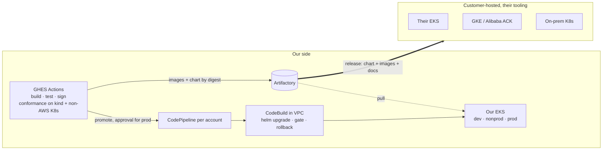
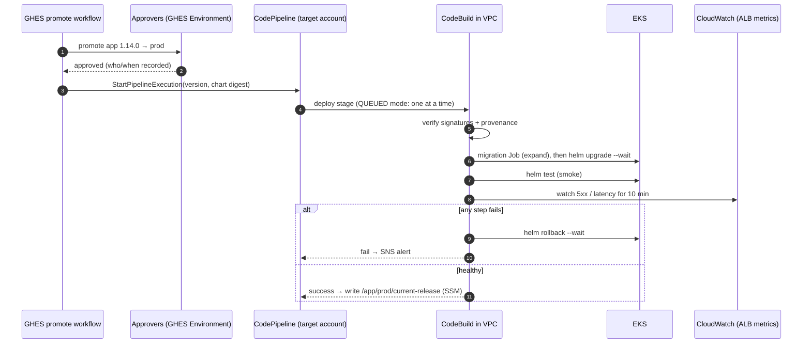

# Proposal: lean, zero-downtime delivery (v3)

**Status:** Proposed, for review  ·  **Date:** 2026-10-10

The recommended design, written to be read on its own. The rest of the repo
(requirements, IP model, options, open questions) is supporting detail.

> **Revision history.**
> v1 put everything on AWS, including what customers depend on at runtime.
> v2 wrongly assumed we run deployments in customer environments.
> **v3 reflects the actual situation:** we run CI/CD **only in our own AWS
> accounts**. Customers **host the app themselves** (their AWS, GKE, Alibaba,
> on-prem) and deploy it **with their own tooling**.

---

## 1. The situation, and the answer in one page

There are two different worlds with different requirements:

| | **Our AWS accounts** (dev, nonprod, prod) | **Customer-hosted environments** |
|---|---|---|
| Who deploys | Our CI/CD | The customer, with their tools (Helm, their Argo CD/Flux, scripts) |
| Platform | EKS, AWS managed services allowed | Their EKS, GKE, ACK or on-prem. **No AWS services assumed.** |
| What we provide | The whole pipeline | **The release only**: chart, images, docs |
| Zero downtime comes from | Our pipeline gates **plus** the chart's built-in behaviour | **The chart's built-in behaviour alone** |

The design follows directly from that split:

1. **The product is portable; our pipeline doesn't need to be.** One signed OCI
   Helm chart pins all 8 image digests. It has **no hard dependency on any cloud
   service**: load balancer, certificates, secrets, telemetry and database are
   optional adapters set by values [PORT-07]. A customer's plain `helm upgrade`
   is a **zero-downtime rolling upgrade** on any conformant Kubernetes [PORT-08].
2. **In our AWS accounts we use AWS-native CI/CD with no in-cluster controllers.**
   GHES builds, tests and publishes to Artifactory. A GHES approval promotes a
   release and starts **CodePipeline**. A **CodeBuild step inside the VPC** runs
   `helm upgrade` through the same values interface customers use, watches ALB
   metrics, and rolls back automatically on failure.
3. **Zero downtime uses the same rolling-upgrade path customers use**, so every
   release we ship to prod also proves the customer upgrade. **Blue/green is an
   optional switch** for prod if you want rollback within seconds (§3.4).
4. **EKS Auto Mode with pod IPs on a secondary non-routable CIDR.** An estimated
   **~8 routable IPs at steady state, ~16 during a release**, against ~130 today.
5. **Argo CD, ARC, the in-cluster Prometheus stack, cert-manager and
   external-dns are removed.** AWS managed services replace them, **in our
   accounts only**. The app itself never requires them.



---

## 2. The product: what customers get

### 2.1 The release

```
oci://<registry>/helm/app:1.14.0        signed (cosign), SBOM + provenance attached
├── values.schema.json                  the configuration contract
├── profiles/   minimal.yaml  standard.yaml  ha.yaml
├── adapters/   aws.yaml  gcp.yaml  alibaba.yaml  generic.yaml   (examples, all optional)
├── templates/                          8 services, digests pinned, zero-downtime rules (§2.3)
└── docs/       INSTALL.md  UPGRADE.md  COMPATIBILITY.md  RELEASE_NOTES.md
```

- Built **once** in GHES. Promotion never rebuilds [REL-01]. Digests only, never
  tags [REL-02]. One version identifies the whole stack [REL-03].
- Customers obtain it either by pulling from a customer-facing registry, or as a
  **signed offline bundle** of chart + images that they mirror into their own
  registry (air-gapped sites) [PORT-06]. See Q18.

### 2.2 The hosting contract: what the app needs from wherever it runs

The app depends only on Kubernetes primitives and standard protocols. Everything
else is a slot the host fills:

| Capability | App/chart interface | Our AWS accounts | Customer examples |
|---|---|---|---|
| HTTP exposure | Gateway API `HTTPRoute`, Ingress, or plain Service (values switch) | ALB via Auto Mode Ingress | GKE Gateway, Alibaba ALB, Envoy Gateway, Cilium, NGINX… |
| TLS | Terminated at the gateway/LB, or a referenced Secret | ACM | Cloud cert services, cert-manager, their own CA |
| Secrets | `existingSecret` name(s); the app reads K8s Secrets only | Secrets Manager, synced at deploy time | Vault, cloud secret stores, manual |
| Database | Connection settings via Secret | RDS | Cloud SQL, ApsaraDB, their Postgres |
| Metrics | `/metrics` (Prometheus format) + optional OTLP | CloudWatch / Amazon Managed Prometheus | Their Prometheus, GMP, ARMS, Datadog… |
| Logs | JSON on stdout | CloudWatch Logs | Whatever their cluster collects |
| Workload identity | Optional, by values | EKS Pod Identity | Not required |

### 2.3 Zero downtime built into the chart (works with plain `helm upgrade`)

These rules apply everywhere, enforced by chart templates and CI lint:

| Rule | Why | Req |
|---|---|---|
| `maxUnavailable: 0`, `maxSurge: 1` | Never fewer serving pods than needed | ZDT-01 |
| Readiness probe that checks the service can really serve, and fails first on shutdown | Traffic only goes to ready pods, and is drained before a pod stops | ZDT-06 |
| `preStop` delay (~10 s) + grace period sized for the slowest request/websocket | Gives any load balancer time to deregister and drain | ZDT-06 |
| ≥ 2 replicas + `PodDisruptionBudget` in `standard`/`ha` | Node drains and cluster upgrades also don't cause downtime | ZDT-01 |
| **N/N+1 compatibility** between services | Old and new pods coexist during a rolling upgrade | ZDT-04 |
| **Expand/contract migrations** as a pre-upgrade Job (expand only) | Old and new code both work on the current schema | ZDT-05 |
| `helm test` smoke-test Job | A gate any customer can run, with no metrics system needed | ZDT-03 |
| LB readiness integration where it exists (AWS LB readiness gates, GKE NEG) | Closes a known cloud-LB race. Harmless where unused. | ZDT-07 |

A customer running `helm upgrade --install app oci://…/app --version 1.14.0
-f profiles/standard.yaml -f their-values.yaml --wait --atomic` gets a
zero-downtime upgrade with automatic rollback on failure, using nothing of ours.
Customers on Argo CD or Flux point those tools at the same chart.

### 2.4 How we prove portability (in our CI, not in their environments)

On every release GHES runs a **conformance suite** on **kind**, using only
`helm`/`kubectl` with all AWS adapters off:
- clean install;
- upgrade N-1 → N **under load, 0 failed requests**;
- a deliberately broken release auto-rolls back.

A scheduled job repeats this on one non-AWS distribution (e.g. GKE or k3s)
[PORT-01/02]. Each release ships a compatibility matrix [PORT-05].

---

## 3. Our AWS accounts: CI/CD

### 3.1 Build (GHES → Artifactory)

GHES Actions on runners in a **tooling account** or on ephemeral compute,
**never in workload clusters** [NET-04]:

1. Build and test the 8 images.
2. Push them to Artifactory and record the digests.
3. Sign them, and attach the SBOM and provenance.
4. Package the chart with the digests and push it as OCI.
5. Run the conformance suite (§2.4).
6. Promote to dev automatically.

### 3.2 Promotion and deployment



| Concern | Design | Req |
|---|---|---|
| Trigger | A **promotion** in GHES, not an image push | DEP-03 |
| Approval | **GHES Environments** with required reviewers (nonprod, prod). This is the single approval record. | DEP-02 |
| Identity | GHES → AWS via OIDC, to a role that can *only* start the pipeline. Only the CodeBuild role can write to the cluster. Dev and prod roles are separate. | DEP-04 |
| Network | GHES makes outbound AWS API calls only. Nothing connects into the cluster from outside. CodeBuild runs in the VPC and reaches the private EKS endpoint and Artifactory. | DEP-05 |
| One deploy at a time | CodePipeline V2 `QUEUED` execution mode | DEP-06 |
| Same interface as customers | CodeBuild runs `helm upgrade` with the chart + profile + `adapters/aws.yaml` + env values: the documented customer interface, wrapped with gates | DEP-01 |
| What's running where | CodePipeline history, CloudTrail, and SSM parameter `/app/<env>/current-release` | DEP-09 |
| Drift | Humans get **read-only** cluster access, with a break-glass role that's time-bound and alarmed. A nightly scheduled CodeBuild runs `helm diff` and alerts on any difference. | SEC-01, OPS-03 |

The pipeline logic (gate, rollback, record) lives in a small script in our
**ops repo**, not in the product. It's internal automation around the customer
interface.

### 3.3 Release gate and rollback

- **Gate:** pods must become ready (with ALB target health via readiness gates),
  `helm test` must pass, and the ALB target group's 5xx count and p95 latency
  must stay within thresholds for 10 minutes.
- **Rollback:** automatic `helm rollback` on any gate failure, or manually by
  re-promoting the previous version. Both are rolling and zero-downtime, taking
  about 2–3 minutes [ZDT-02].

### 3.4 Blue/green: optional, for prod

Rolling is the default because it's the path customers run, so every prod
release proves it. If you want **rollback in seconds** or a **full-stack
preview before any user traffic** (Q2), switch prod to blue/green:

- Run two releases of the same chart (`app-blue`, `app-green`), plus a small
  `app-edge` release that holds only the Ingress/route with **weights**.
- The pipeline upgrades the idle colour, smoke-tests it on a preview hostname,
  shifts weight 10% → 100% while watching ALB metrics, and flips back on failure.
  The old colour is scaled to zero after a hold window.
- The edge release renders **ALB weighted target groups** in our accounts, or a
  **Gateway API `HTTPRoute`** with weights elsewhere. That means customers could
  use the same pattern if they ever want it.
- Cost: double the app pods during a switch (+8 pod-CIDR IPs, 0 routable).

Use blue/green rather than rolling if the services **can't** safely run at mixed
versions (Q1).

### 3.5 Cluster, network and managed services (our accounts only)

| Choice | Decision |
|---|---|
| Compute | **EKS Auto Mode.** AWS manages nodes, CNI, LB integration, storage and DNS, so there are no kube-system controllers for us to own. *(verify current price premium)* |
| Pod IPs | **Secondary CIDR `100.64.0.0/16`**, using pod subnets in the Auto Mode NodeClass *(verify)*. Fallback: **Fargate** (1 IP per pod). |
| Clusters | One per account/environment |
| Ingress / TLS / DNS | One shared ALB per environment (IngressGroup), ACM certificate, Route 53 records in IaC |
| Telemetry | ALB CloudWatch metrics (release gate), CloudWatch Logs via the Container Insights add-on, optional Amazon Managed Prometheus agentless scraper |
| Secrets / DB | Secrets Manager synced to K8s Secrets at deploy time; RDS |
| IaC | Terraform/OpenTofu (Q12): VPC wiring, cluster, access entries, pipeline, CodeBuild, OIDC trust, ALB/DNS, alarms |

### 3.6 IP budget (minimal profile, 2 AZs)

| Line | Steady (routable) | During release (routable) | Pod CIDR |
|---|---|---|---|
| EKS control-plane ENIs | 4 | 4 | — |
| Node primary IPs (2 → 3) | 2 | 3 | — |
| App pods (8; +1 surge rolling, 16 blue/green) | 0 | 0 | 8–16 |
| Platform pods we operate | 0 | 0 | 0 |
| ALB (min 1/AZ, can scale up) | 2 | up to 8 | — |
| CodeBuild ENI (during deploys only) | 0 | 1 | — |
| VPC endpoints (0 if centralised, ~10 if local) | 0–10 | 0–10 | — |
| **Total** | **8–18** | **16–26** | ≤ 20 of 65,536 |

**Fargate fallback** (no secondary CIDR allowed): 4 control plane + 9 app pods +
4 platform pods (CoreDNS, LB controller) + 8 ALB + 1 CodeBuild ≈ **26** routable
during a rolling release, ≈ **33** during blue/green. That's still under the 50 limit [NET-01] and
fits an 80-IP account. Today it's ~130.

---

## 4. What gets removed

| Today | Replaced by (our accounts) | What customers need instead |
|---|---|---|
| Argo CD stack | CodePipeline + CodeBuild (0 pods) | Nothing. They use their own tooling. |
| ARC runners in workload clusters | GHES runners in a tooling account | Nothing |
| kube-prometheus-stack | CloudWatch / AMP (managed) | Their own monitoring, scraping `/metrics` |
| cert-manager | ACM | Whatever they use for TLS |
| external-dns | Route 53 in IaC | Their DNS |
| Per-environment manifest forks | One chart + profile + adapter + env values | The same chart + their values |

---

## 5. Options considered (our AWS accounts)

Only our accounts need a delivery mechanism, so the options are scored for them.
Weights are from `docs/05-proposal-brief.md`; scale 1–5; total = Σ score × weight.

| Option | IP (25) | ZDT (20) | Simplicity (20) | Same interface as customers (15) | Security (10) | Cost (5) | Maturity (5) | **Total /500** |
|---|---|---|---|---|---|---|---|---|
| **Chosen: CodePipeline + in-VPC CodeBuild** | 5 | 4 | 5 | 5 | 5 | 5 | 4 | **475** |
| GHES Actions pushing directly to EKS | 5 | 4 | 4 | 5 | 3 | 5 | 4 | **435** |
| Flux pulling OCI from Artifactory | 4 | 4 | 3 | 4 | 5 | 5 | 5 | **400** |
| Slimmed Argo CD + Argo Rollouts | 3 | 5 | 2 | 3 | 4 | 4 | 5 | **345** |
| Keep current platform | 1 | 3 | 1 | 2 | 3 | 2 | 5 | **200** |

- **Sensitivity:** with the IP and ZDT weights swapped, the scores are 470 / 430 /
  400 / 355 / 210. The winner doesn't change.
- **GHES pushing directly** needs a network path from runners into private
  clusters, and puts prod-write credentials in CI. It's acceptable for dev only.
- **Flux** would only make sense if we wanted continuous drift *correction*.
  Read-only access plus nightly detection is enough when prod changes only
  through releases.

---

## 6. Risks and assumptions

| # | Assumption | If wrong | Q |
|---|---|---|---|
| R1 | Services tolerate N/N+1 running together during a rolling upgrade | Blue/green (§3.4) becomes the default in our accounts. Customers need the blue/green recipe or a short maintenance window. | Q1 |
| R2 | A secondary CIDR can be added to our VPCs | Fargate fallback | Q3 |
| R3 | CodeBuild in the VPC can reach Artifactory | Replicate releases to ECR as a read cache *(ADR needed)* | Q5 |
| R4 | AWS IAM can trust GHES OIDC tokens (the issuer must be reachable by AWS) | Runner instance roles in the tooling account assume the trigger role | Q4 |
| R5 | DB changes can follow expand/contract | Required by *any* zero-downtime design. It's app work and must be planned. | Q7 |
| R6 | Customers can pull from a registry we expose, or accept offline bundles | Decide the distribution channel | Q18 |
| R7 | Auto Mode supports pod subnets and ALB weighted actions | Managed node groups + custom networking + AWS LB Controller (2 pods) | *(verify)* |

---

## 7. Delivery plan

| # | Slice | Proves | Size (1–2 engineers) |
|---|---|---|---|
| 1 | Chart with zero-downtime rules, digests, schema, adapters, signing; conformance on kind (load test during upgrade, broken-release rollback) | ZDT-*, REL-*, PORT-01/07/08 | 2–3 wks |
| 2 | Dev account: Auto Mode + pod CIDR, CodePipeline/CodeBuild, GHES promote workflow. **Measure IPs.** | DEP-*, NET-01 | 2 wks |
| 3 | Nonprod with approvals, ALB-metric gate, auto-rollback, SSM record, drift job | DEP-02/09, ZDT-02/03, OPS-03 | 1 wk |
| 4 | Deploy into an ~80-IP account (or a deliberately constrained VPC) | NET-02 | 2–3 days |
| 5 | Prod migration: run both, Route 53 weighted cutover, decommission the old stack | MIG-* | 1–2 wks |
| 6 | Customer docs, offline bundle, compatibility matrix, scheduled non-AWS conformance run | PORT-02/05/06 | 1 wk |
| 7 | *(Optional)* blue/green profile for prod | §3.4 | 1 wk |

About **8–10 weeks** to prod cutover. The app work for graceful shutdown, N/N+1
compatibility and expand/contract migrations is the main variable, and it's
needed for zero downtime under any design.

---

## 8. Decisions needed from you

1. **Can the 8 services run at mixed versions during an upgrade?** (Q1) If not,
   blue/green becomes the default, and customer upgrades need that recipe too.
2. **Is rollback in ~2–3 minutes acceptable, or do you need seconds?** (Q2)
   That decides rolling vs blue/green in prod.
3. **Can we add a secondary CIDR to our VPCs?** (Q3)
4. **How do customers get releases today**: registry pull or offline bundle? (Q18)
