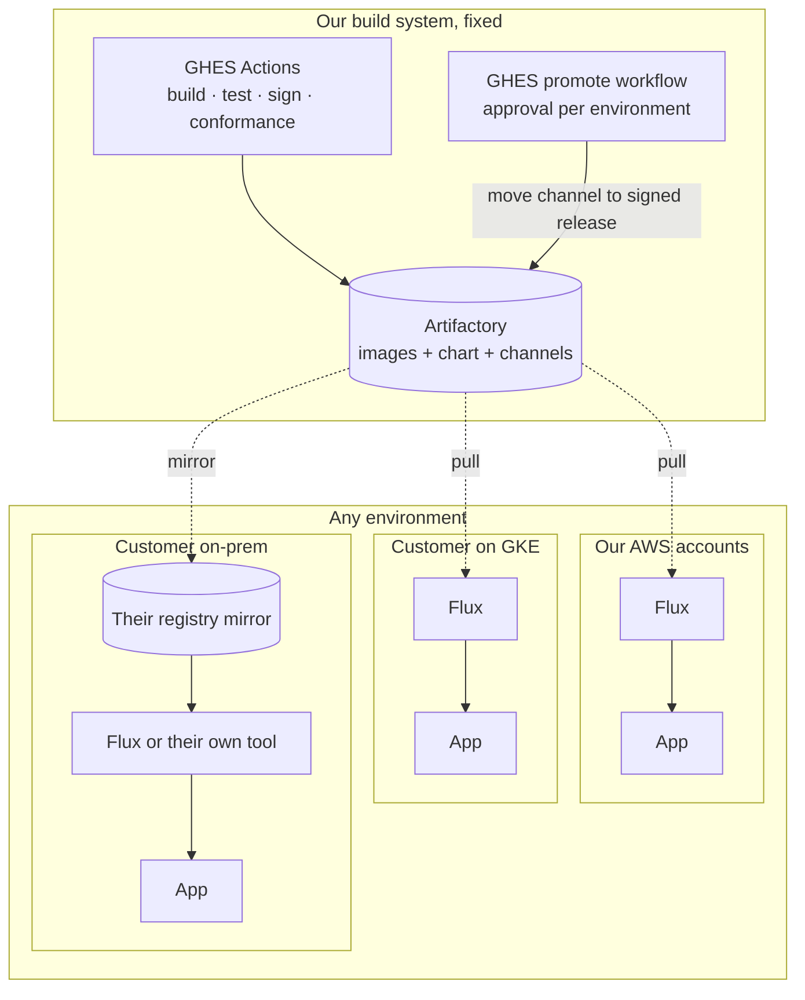
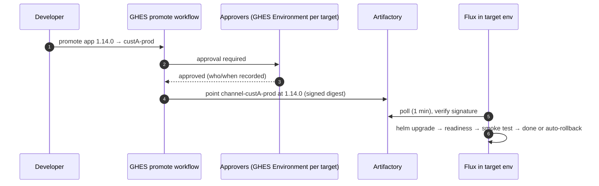

# Proposal: lean, portable, zero-downtime delivery (v2)

**Status:** Proposed, for review  ·  **Date:** 2026-10-10

This is the recommended design, written to be read on its own. The rest of the
repo (requirements, IP model, options, open questions) is supporting detail.

> **What changed from v1.** v1 made the *artefact* portable but relied on AWS
> for *how it's deployed, switched and monitored* (CodePipeline, ALB weights,
> CloudWatch gates). That fails the brief: we run the product for different
> customers on EKS, GKE, Alibaba Cloud and on-prem, and many of those places
> have no AWS services. v2 makes the **delivery and zero-downtime mechanisms
> identical on every platform**. AWS, GCP, Alibaba and on-prem services become
> interchangeable **adapters** behind a small contract.

---

## 1. The answer in one page

Split the system into three layers and only allow platform-specific choices in
the bottom one.

| Layer | What it is | Same everywhere? |
|---|---|---|
| **1. Product** | 8 images + one signed OCI Helm chart, with zero-downtime behaviour built into the app and chart | **Identical** |
| **2. Delivery** | A tiny pull-based reconciler (Flux: 2 pods) that pulls the approved release from a registry and performs a health-gated rolling upgrade with automatic rollback | **Identical** wherever we operate. Customers may swap in their own tool. |
| **3. Environment adapters** | Load balancer/Gateway, TLS, DNS, secrets store, telemetry backend, IP strategy, database | **Differs per platform**, chosen by Helm values |

**Zero downtime** comes from Kubernetes-native **rolling updates done
properly** (they work on any conformant cluster) plus application rules for
graceful shutdown, version compatibility and database migrations. **Blue/green
or canary is an optional add-on** for environments that need instant switch-back.
It uses the portable **Gateway API**, so it isn't tied to any cloud's load balancer.

The **only network path every environment must have is to a container
registry**: Artifactory, or the customer's mirror of it. That's what makes pull
the right model. Nothing needs to reach *into* a customer environment, and no
deploy credentials leave it.



---

## 2. Zero downtime, portably

This is the requirement that matters most, so it comes first. Zero downtime is
mostly **application and chart behaviour**, and that part is fully portable.
The traffic-switching mechanism is secondary.

### 2.1 Baseline: rolling update, works on every Kubernetes

These rules are enforced by the chart and CI. They apply in every environment.

| Rule | Why | Req |
|---|---|---|
| `maxUnavailable: 0`, `maxSurge: 1` (or 25%) | Never fewer serving pods than needed | ZDT-01 |
| `readinessProbe` that checks the service is truly able to serve, and **fails first on shutdown** | New pods get traffic only when ready. Old ones stop getting it before they stop. | ZDT-06 |
| `preStop` delay (~10 s) + `terminationGracePeriodSeconds` sized for the slowest request/websocket | Gives every load balancer (cloud LB, Gateway, kube-proxy) time to deregister and drain | ZDT-06 |
| `PodDisruptionBudget` and ≥ 2 replicas in `standard`/`ha` | Node drains and upgrades also don't cause downtime | ZDT-01 |
| **N / N+1 compatibility** between services and their APIs | During a rolling update, old and new versions coexist and must be able to call each other | ZDT-04 |
| **Expand/contract database migrations** (pre-upgrade Job, expand only; contract in a later release) | Old and new code both work against the current schema | ZDT-05 |
| Post-upgrade **smoke test Job** (`helm test`) | Portable release gate that needs no metrics backend | ZDT-03 |
| Automatic **rollback** if pods don't become ready or the smoke test fails (Flux remediation) | A broken release never takes traffic for long | ZDT-02/03 |
| Load-balancer readiness integration **where available**: AWS LB readiness gates, GKE NEG readiness gates (automatic) | Removes a known race on cloud LBs. It's an adapter, so it's ignored on-prem. | ZDT-07 |

Rolling updates meet "zero failed requests" for stateless services that follow
these rules. They need no extra infrastructure and only add `maxSurge` pods.

### 2.2 Optional: blue/green or canary, where it's worth it

Use this when an environment needs **instant switch-back** or **pre-traffic
verification of the whole new version**, or if the services turn out to be too
tightly coupled for N/N+1 coexistence (Q1).

- **Mechanism:** **Flagger** (1 pod), driven by the same Flux release, shifts
  traffic using **Gateway API `HTTPRoute` weights**. Gateway API is implemented on
  EKS (AWS Load Balancer Controller), GKE (built-in), Alibaba (verify which
  gateway), and on-prem (Envoy Gateway, Cilium, NGINX Gateway Fabric)
  *(verify each)*.
- **Gates:** smoke-test webhooks (portable). Metric checks are optional and use a
  **PromQL** query. Amazon Managed Prometheus, Google Managed Prometheus, Alibaba
  ARMS Prometheus and any self-hosted Prometheus all accept PromQL, so one gate
  definition works everywhere *(verify auth support for managed endpoints)*.
- **Cost:** briefly double the app pods during a switch. Fine in our AWS accounts
  thanks to the pod CIDR (§6).

**Recommendation:** rolling as the default everywhere. Blue/green or canary is a
per-environment profile flag (`delivery.strategy: rolling | bluegreen | canary`),
switched on only where an environment owner asks for it.

---

## 3. Layer 1: the product (release artefact)

Built once by GHES Actions, on runners **outside** any workload cluster [NET-04].

```
oci://artifactory.example/helm/app:1.14.0         (signed, SBOM + provenance)
├── values.schema.json          configuration contract (validated)
├── profiles/minimal|standard|ha.yaml
├── adapters/                   optional platform adapters, all off by default
│   ├── aws.yaml   gcp.yaml   alibaba.yaml   onprem.yaml
├── templates/                  8 services, digests pinned, ZDT rules from §2
└── RELEASE_NOTES.md            migrations, N-1 compatibility, rollback limits
```

- Image references are **digests only**, never tags [REL-02].
- One version identifies the whole stack [REL-03].
- The app depends only on **Kubernetes primitives and standard protocols**:
  - config from ConfigMaps;
  - secrets from K8s Secrets;
  - telemetry as OTLP plus `/metrics`;
  - logs as JSON on stdout;
  - HTTP exposure through a Gateway API route, an Ingress or a Service.

  [PORT-03]
- CI runs the conformance suite (install, upgrade N-1→N under load, broken
  release auto-rollback, optional blue/green) on **kind** for every release, and
  on EKS plus one non-AWS distribution on a schedule [PORT-02].

---

## 4. Layer 2: delivery (identical in every environment we operate)

### 4.1 How a release reaches a cluster

Each environment runs a minimal **Flux** install: `source-controller` and
`helm-controller`, 2 pods, **with no Git repository involved**.

- An `OCIRepository` watches a **channel** in Artifactory, e.g.
  `helm/app:channel-custA-prod`.
- Flux **verifies the cosign signature** before using anything [SEC-04].
- A `HelmRelease` applies it with the environment's profile + adapter + values,
  waits for readiness, runs the smoke test, and **rolls back automatically** on
  failure [ZDT-03].
- Flux re-applies the release if someone changes the cluster by hand, so drift
  is corrected, not just detected [OPS-03].

### 4.2 Promotion



| Concern | Design | Req |
|---|---|---|
| Trigger | Moving an environment's channel, which only the GHES promote workflow can do. Pushing an image changes nothing. | DEP-03 |
| Approval | **GHES Environments**, one per target environment, with required reviewers for prod and customer environments | DEP-02 |
| Audit | GHES approval record + Artifactory audit log + Flux events | DEP-02 |
| Credentials | Each environment has **read-only** registry credentials. No deploy credentials exist outside the cluster. Nothing connects inbound. | DEP-04/05 |
| Serialization | One `HelmRelease` per environment is reconciled one change at a time by design | DEP-06 |
| "What's running where?" | Flux's notification-controller (optional 3rd pod) posts each result to a GHES commit status or webhook. Or read the channel pointers in Artifactory. | DEP-09 |

### 4.3 Why pull, and why Flux rather than Argo CD

- **Pull is the only model that works for every hosting situation.** Customer
  networks won't let our GHES or AWS reach in. Registry access is required anyway
  for images, so it's the one channel every environment already has. Air-gapped
  sites simply point Flux at their mirror.
- **Flux, not Argo CD:** 2 pods, no UI or Redis/Dex stack, reads Helm charts
  straight from OCI registries, verifies cosign signatures natively, and is a
  CNCF-graduated project. This is not the old Argo platform shrunk. It replaces
  the entire deployment pipeline with two small controllers.
- **Customers aren't forced into it.** The chart is an ordinary Helm chart.
  Customers can install with `helm`, their own Argo CD, or their own Flux
  (§7). Our Flux setup is just *our* way of operating it, and it's the same in
  every environment we operate, including dev [DEP-01].

---

## 5. Layer 3: environment adapters

Everything here is selected with values (`adapters/<platform>.yaml`), and the
app never knows which one is in use. Rows marked *customer* mean the customer
provides it and we document the interface.

| Capability (the contract) | Our AWS (EKS) | GCP (GKE) | Alibaba (ACK) | On-prem / other K8s |
|---|---|---|---|---|
| **Kubernetes** | EKS Auto Mode | GKE (Autopilot or Standard) | ACK | Any conformant distro (tested list) |
| **HTTP exposure** (Gateway API preferred, Ingress fallback) | AWS LBC Gateway/ALB *(verify)* | GKE Gateway | ALB Ingress / Gateway *(verify)* | Envoy Gateway / Cilium / customer's |
| **TLS certificate** | ACM on the ALB | Google-managed cert | Alibaba Certificate Service | cert-manager, or a customer-supplied Secret |
| **DNS** | Route 53 in IaC | Cloud DNS | Alibaba DNS | Customer |
| **Secrets → K8s Secret** | Secrets Manager via External Secrets *or* created by IaC | Secret Manager (same options) | KMS Secrets Manager (same options) | Vault, or a customer-created Secret |
| **Metrics** (PromQL) | Amazon Managed Prometheus | Google Managed Prometheus | ARMS Prometheus | Customer Prometheus |
| **Logs** (stdout JSON) | CloudWatch (Container Insights) | Cloud Logging (built in) | SLS | Customer's (Loki/ELK/Splunk) |
| **Telemetry shipping** | One OpenTelemetry Collector pod, exporter set per platform | same | same | same, or the customer's own collector |
| **Database** (connection string) | RDS | Cloud SQL | ApsaraDB RDS | Customer-provided, or CloudNativePG |
| **Pod IP strategy** | Secondary CIDR (§6) | VPC-native alias ranges | Terway/Flannel defaults | Overlay CNI, not an issue |
| **Registry** | Artifactory | Artifactory or Artifact Registry mirror | Artifactory or ACR mirror | Customer mirror |

**Secrets choice:** where we operate across clouds, **External Secrets
Operator** (1 pod) is the one tool that speaks to AWS, GCP, Alibaba and Vault
alike. It's optional: an environment can just have the Secret created by IaC
or by the customer, and the chart only references `existingSecret` [SEC-02].

---

## 6. Our AWS accounts specifically (the 80-IP problem)

The IP problem is AWS VPC CNI-specific. GKE alias ranges and on-prem overlays
don't have it in the same way. In **our** AWS accounts:

- **EKS Auto Mode.** AWS runs nodes, CNI, load balancer integration, storage
  and DNS, so there are no kube-system controllers for us to upgrade.
- **Pod IPs from a secondary CIDR `100.64.0.0/16`** (Auto Mode NodeClass pod
  subnets *(verify)*), so pods use no routable IPs.
- **Fallback** if a secondary CIDR isn't allowed: Fargate (1 IP per pod, no warm pool).

### IP budget (minimal profile, 2 AZs, during an upgrade)

| Line | Routable | Pod CIDR |
|---|---|---|
| EKS control-plane ENIs | 4 | — |
| Node primary IPs (2–3) | 3 | — |
| App pods (8 + rolling surge; 16 if blue/green) | 0 | 9–16 |
| Platform pods: Flux 2, OTel Collector 1, (Flagger 1, ESO 1 if used) | 0 | 3–5 |
| ALB (min 1/AZ, may scale) | 2–8 | — |
| VPC endpoints (0 if centralised) | 0–10 | — |
| **Total** | **9–25** | ~21 |

**Fargate fallback:** 4 + 16 app + ~7 platform (incl. CoreDNS, LB controller)
+ 8 ALB ≈ **35** routable at the blue/green peak, about 28 with rolling. Both are
under the 50 limit (NET-01) and fit an 80-IP account. Today it's ~130.

---

## 7. How customers run it

| Customer situation | What they do | Zero downtime |
|---|---|---|
| **We operate it for them** (any cloud/on-prem) | We install Flux + their adapter file. Promotion is a GHES approval. | §2 baseline, blue/green optional |
| **They operate, with Argo CD or Flux** | Point their tool at the OCI chart and their channel/version | Same chart rules. Their tool performs the rolling upgrade. |
| **They operate, plain Helm** | `helm upgrade --install app oci://…/app --version 1.14.0 -f profiles/standard.yaml -f adapters/gcp.yaml -f my-values.yaml --wait` | Same chart rules |
| **Air-gapped** | Mirror the chart + images (one `oras`/`helm` copy script ships with the release), then install from the mirror | Same |

Every release ships install/upgrade docs, the compatibility matrix and the
adapter reference [PORT-05].

---

## 8. What gets removed

| Today | Replaced by | Portable? |
|---|---|---|
| Argo CD (+ repo-server, redis, dex, notifications, ApplicationSets) | Flux source + helm controllers (2 pods), reading OCI, not Git | Yes |
| ARC runners inside workload clusters | GHES runners in a tooling account / ephemeral compute | n/a (our build side) |
| kube-prometheus-stack in every cluster | App emits OTLP + `/metrics`. One OTel Collector ships to whatever backend the platform has. | Yes |
| cert-manager everywhere | Platform cert service where one exists. cert-manager only on-prem. | Yes (adapter) |
| external-dns | DNS in IaC or by the customer | Yes (adapter) |
| Per-environment manifest forks | One chart + profile + adapter + env values [ENV-01] | Yes |

---

## 9. Options considered

Scored with the weights from `docs/05-proposal-brief.md`, judged against
**all** target platforms, not just AWS. Scale 1–5, total = Σ score × weight.

| Option | IP (25) | ZDT (20) | Simplicity (20) | Customer parity & portability (15) | Security (10) | Cost (5) | Maturity (5) | **Total /500** |
|---|---|---|---|---|---|---|---|---|
| **Chosen: Flux-OCI pull + chart ZDT rules (+ Flagger optional)** | 4 | 4 | 4 | 5 | 5 | 5 | 5 | **435** |
| Customer-style manual `helm upgrade` runbooks everywhere | 5 | 3 | 2 | 5 | 4 | 5 | 5 | **390** |
| v1: CodePipeline on AWS + a different mechanism per other platform | 5 | 4 | 2 | 1 | 5 | 5 | 4 | **355** |
| GHES self-hosted runner in every environment, pushing | 4 | 4 | 3 | 3 | 3 | 4 | 4 | **355** |
| Argo CD + Argo Rollouts everywhere | 2 | 5 | 2 | 4 | 4 | 3 | 5 | **330** |

- **Sensitivity:** with the IP and ZDT weights swapped, Flux scores 435, manual
  Helm 380 and Argo 345. With simplicity weighted 25 and portability 10, Flux
  scores 430 and manual Helm 375. The winner doesn't change.
- **v1 (CodePipeline) loses** because it only works on AWS. Every other platform
  would need its own deployment system, which recreates today's snowflakes.
- **GHES runners per environment lose** because customer networks rarely allow
  outbound access to our GHES, and prod deploy rights would live in CI.

---

## 10. Risks and assumptions

| # | Assumption | If wrong | Question |
|---|---|---|---|
| R1 | We operate at least some customer environments (not only self-install) | If customers always self-install, Flux is used only in our own envs, and the design otherwise stands | Q8 |
| R2 | Every environment can reach Artifactory or a mirror of it | Air-gapped flow (§7) becomes the norm. Promotion becomes "ship a signed bundle". | Q5 |
| R3 | Services can coexist at N and N+1 during a rolling update | Use stack-level blue/green (Flagger, or two releases + Gateway weights) as the default | Q1 |
| R4 | Target platforms provide a Gateway API implementation (only needed for blue/green/canary) | Ingress-based fallback, or rolling only on that platform | Q9 |
| R5 | Secondary CIDR is allowed in our AWS VPCs | Fargate fallback (§6) | Q3 |
| R6 | DB schema changes can follow expand/contract | Required by *any* zero-downtime design. It's app work, and needs scheduling. | Q7 |

Items marked *(verify)* are checked against current vendor docs before build
(AGENTS.md rule 6).

---

## 11. Delivery plan

| # | Slice | Proves | Size (1–2 engineers) |
|---|---|---|---|
| 1 | Chart with ZDT rules, digests, schema, signing, published from GHES. Conformance on kind: load test during upgrade, broken-release rollback. | ZDT-*, REL-*, PORT-01 | 2–3 wks |
| 2 | Flux-OCI channel + GHES promote workflow with approvals, on kind, then dev EKS (Auto Mode + pod CIDR). **Measure IPs.** | DEP-*, NET-01 | 2 wks |
| 3 | AWS adapter file (ALB/ACM/AMP/CloudWatch/Secrets), nonprod | PORT-03, OBS-* | 1 wk |
| 4 | **Second platform** adapter on GKE (or the first real non-AWS customer's platform) + an on-prem-style kind cluster with Envoy Gateway | PORT-02 | 1–2 wks |
| 5 | Optional blue/green profile (Flagger + Gateway API) proven on two platforms | ZDT-04/08 | 1 wk |
| 6 | Prod migration: run both, DNS cutover, decommission the old stack | MIG-* | 1–2 wks |
| 7 | Customer docs, air-gap mirror script, compatibility matrix | PORT-05/06 | 1 wk |

About **9–12 weeks** to prod cutover, depending on how much the app needs
changing for graceful shutdown, N/N+1 compatibility and expand/contract
migrations. That app work is required whatever platform is chosen.

---

## 12. Decisions needed from you

1. **Do we operate deployments inside customer environments, or do customers
   always self-install?** (Q8; the biggest question now)
2. Which non-AWS platforms are **real today**: GKE, Alibaba ACK, which on-prem distributions? (Q9)
3. Are the 8 services safe to run at mixed versions (N and N+1) during an
   upgrade? (Q1; decides whether rolling is enough by default)
4. Do all environments have registry access, or are some air-gapped? (Q5)
