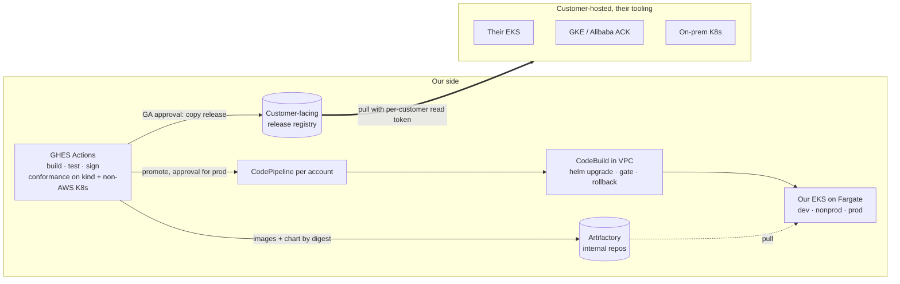
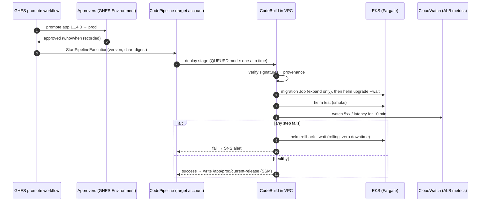

# Proposal: lean, zero-downtime delivery (v4)

**Status:** Proposed, for review  ·  **Date:** 2026-10-10

The recommended design, written to be read on its own. The rest of the repo
(requirements, IP model, options, open questions) is supporting detail.

> **Revision history.**
> v1 put everything on AWS, including what customers depend on at runtime.
> v2 wrongly assumed we run deployments in customer environments.
> v3 reflected the real split: CI/CD only in our AWS accounts; customers host
> and deploy the app themselves.
> **v4 incorporates your answers:**
> - Customers **pull releases from a registry we expose**.
> - The services **can run at mixed versions**, so rolling upgrades are the
>   default and blue/green is dropped.
> - **Rollback must also have zero downtime.**
> - **No secondary pod CIDR**, so our accounts move to **EKS on Fargate**.
>
> v4 also corrects v3's surge arithmetic: a Helm upgrade rolls all 8 services
> at once, so the peak is 16 pods, not 9.

---

## 1. The situation, and the answer in one page

| | **Our AWS accounts** (dev, nonprod, prod) | **Customer-hosted environments** |
|---|---|---|
| Who deploys | Our CI/CD | The customer, with their tools (Helm, their Argo CD/Flux, scripts) |
| Platform | EKS, AWS managed services allowed | Their EKS, GKE, ACK or on-prem. **No AWS services assumed.** |
| How they get releases | Artifactory (internal) | **Pull from a customer-facing registry we expose** (§2.5) |
| Zero downtime comes from | The chart's built-in behaviour **plus** our pipeline gates | **The chart's built-in behaviour alone** |

The design:

1. **The product is portable; our pipeline doesn't need to be.** One signed OCI
   Helm chart pins all 8 image digests and has **no hard dependency on any cloud
   service** [PORT-07]. A customer's plain `helm upgrade` *and* `helm rollback`
   are **zero-downtime rolling updates** on any conformant Kubernetes [PORT-08].
2. **Our AWS accounts use AWS-native CI/CD with no deployment controllers in the
   cluster.**
   - A GHES approval promotes a release and starts **CodePipeline**.
   - A **CodeBuild step inside the VPC** runs `helm upgrade` through the same
     values interface customers use, gates on health and ALB metrics, and runs
     `helm rollback` automatically on failure.
3. **Rolling updates everywhere, forward and back.** It's the same path
   customers run, so every prod release also proves the customer upgrade and
   rollback.
4. **EKS with every pod on Fargate.** Each pod uses exactly one IP, with no
   node warm pools and no DaemonSets, and there are no nodes for us to patch.
   That's an estimated **~18 routable IPs at steady state and ~33 at the peak of
   a release**, with no secondary CIDR. Today it's ~130.
5. **Argo CD, ARC, the in-cluster Prometheus stack, cert-manager and
   external-dns are removed.** AWS managed services replace them **in our
   accounts only**. The app never requires them.



---

## 2. The product: what customers get

### 2.1 The release

```
oci://releases.<our-domain>/helm/app:1.14.0   signed (cosign), SBOM + provenance attached
├── values.schema.json                        the configuration contract
├── profiles/   minimal.yaml  standard.yaml  ha.yaml
├── adapters/   aws.yaml  gcp.yaml  alibaba.yaml  generic.yaml   (examples, all optional)
├── templates/                                8 services, digests pinned, zero-downtime rules (§2.3)
└── docs/       INSTALL.md  UPGRADE.md  ROLLBACK.md  COMPATIBILITY.md  RELEASE_NOTES.md
```

Built **once** in GHES. Promotion never rebuilds [REL-01]. Digests only, never
tags [REL-02]. One version identifies the whole stack [REL-03].

### 2.2 The hosting contract: what the app needs from wherever it runs

| Capability | App/chart interface | Our AWS accounts | Customer examples |
|---|---|---|---|
| HTTP exposure | Gateway API `HTTPRoute`, Ingress, or plain Service (values switch) | ALB via AWS Load Balancer Controller | GKE Gateway, Alibaba ALB, Envoy Gateway, Cilium, NGINX… |
| TLS | Terminated at the gateway/LB, or a referenced Secret | ACM | Cloud cert services, cert-manager, their own CA |
| Secrets | `existingSecret` name(s); the app reads K8s Secrets only | Secrets Manager, synced at deploy time | Vault, cloud secret stores, manual |
| Database | Connection settings via Secret | RDS | Cloud SQL, ApsaraDB, their Postgres |
| Metrics | `/metrics` (Prometheus format) + optional OTLP | CloudWatch / Amazon Managed Prometheus | Their Prometheus, GMP, ARMS, Datadog… |
| Logs | JSON on stdout | CloudWatch Logs (Fargate built-in log router) | Whatever their cluster collects |
| Workload identity | Optional, by values | IRSA (Pod Identity isn't supported on Fargate *(verify)*) | Not required |

### 2.3 Zero downtime built into the chart (upgrade **and** rollback)

`helm rollback` is just another rolling update to the previous version, so the
same rules make it zero-downtime too. Enforced by chart templates and CI lint:

| Rule | Why | Req |
|---|---|---|
| `maxUnavailable: 0`, `maxSurge: 1` | Never fewer serving pods than needed, in either direction | ZDT-01 |
| Readiness probe that checks the service can really serve, and fails first on shutdown | Traffic only goes to ready pods, and drains before a pod stops | ZDT-06 |
| `preStop` delay (~10 s) + grace period sized for the slowest request/websocket | Gives any load balancer time to deregister and drain | ZDT-06 |
| ≥ 2 replicas + `PodDisruptionBudget` in `standard`/`ha` | Infrastructure maintenance doesn't cause downtime either | ZDT-01 |
| **N/N+1 API compatibility** between services, **tested in CI** | Old and new pods coexist during upgrade *and* rollback | ZDT-04 |
| **Expand/contract migrations**: expand in release N, contract no earlier than N+2 | **The key to zero-downtime rollback.** Version N-1 must still run on N's schema, so a release must never contain a destructive schema change. | ZDT-05 |
| `helm test` smoke-test Job | A gate any customer can run, with no metrics system needed | ZDT-03 |
| LB readiness integration where it exists (AWS LB readiness gates, GKE NEG) | Closes a known cloud-LB race. Harmless where unused. | ZDT-07 |

A customer's `helm upgrade --install app oci://releases.<our-domain>/helm/app
--version 1.14.0 -f profiles/standard.yaml -f their-values.yaml --wait --atomic`
is zero-downtime, and `--atomic` rolls back automatically, also with zero
downtime, if pods don't become ready.

**One honest caveat about rollback.** A rollback has zero *downtime*, but it
can't undo errors a bad version already served. With rolling updates, a version
whose bug passes readiness and the smoke test takes a growing share of traffic
until the error-rate gate trips. That's typically a few minutes, and a fraction
of requests. We limit this with:
- the full test suite in dev and nonprod before prod;
- a strict smoke test;
- a tight error-rate gate.

If even that exposure is unacceptable, the remedy is a canary or blue/green
step, not a different rollback. This can be added later without changing the
chart contract (§5).

### 2.4 How we prove it (in our CI, not in customers' environments)

Every release, GHES runs a **conformance suite** on **kind**, using only
`helm`/`kubectl` with AWS adapters off, and with continuous load running
throughout:
1. Clean install.
2. **Upgrade N-1 → N: 0 failed requests.**
3. **Mixed-version test:** N-1 and N pods serving together. This confirms your
   expectation that the services can run at mixed versions.
4. **Rollback N → N-1: 0 failed requests**, including against N's schema.
5. A deliberately broken release auto-rolls back with 0 failed requests.

A scheduled job repeats this on one non-AWS distribution (e.g. GKE or k3s)
[PORT-01/02]. Each release ships a compatibility matrix [PORT-05].

### 2.5 Customer-facing release registry

Customers pull releases from a registry we expose. To keep internal builds
private:

| Concern | Design |
|---|---|
| Repository | A **dedicated Artifactory repository** (Docker/OCI) for customer releases, e.g. `releases.<our-domain>`, separate from internal build repos |
| What goes in | Only releases approved as **GA**: a GHES approval copies the signed chart and images, by digest, into it. Dev/nonprod builds are never visible. |
| Access | **Per-customer read-only tokens**, scoped to that repository, revocable, with expiry and rotation |
| Integrity | Customers can verify **cosign signatures** and provenance before installing |
| Resilience | Recommend customers **mirror or proxy** into their own registry (Harbor, ECR, Artifact Registry, ACR pull-through), so their runtime doesn't depend on our availability |
| Exposure | Public HTTPS endpoint with WAF/rate limits, or Artifactory's own edge/distribution features. Q5 decides which. |
| Audit | Artifactory access logs show which customer pulled which version |

---

## 3. Our AWS accounts: CI/CD

### 3.1 Build (GHES → Artifactory)

GHES Actions runs on runners in a **tooling account** or on ephemeral compute,
**never in workload clusters** [NET-04]:

1. Build and test the 8 images.
2. Push them to Artifactory and record the digests.
3. Sign them, and attach the SBOM and provenance.
4. Package the chart with the digests and push it as OCI.
5. Run the conformance suite (§2.4).
6. Promote to dev automatically.

### 3.2 Promotion and deployment



| Concern | Design | Req |
|---|---|---|
| Trigger | A **promotion** in GHES, not an image push | DEP-03 |
| Approval | **GHES Environments** with required reviewers (nonprod, prod, GA/customer release). This is the single approval record. | DEP-02 |
| Identity | GHES → AWS via OIDC, to a role that can *only* start the pipeline. Only the CodeBuild role can write to the cluster. Dev and prod roles are separate. | DEP-04 |
| Network | GHES makes outbound AWS API calls only. Nothing connects into the cluster from outside. CodeBuild runs in the VPC and reaches the private EKS endpoint and Artifactory. | DEP-05 |
| One deploy at a time | CodePipeline V2 `QUEUED` execution mode | DEP-06 |
| Same interface as customers | CodeBuild runs `helm upgrade` with the chart + profile + `adapters/aws.yaml` + env values: the documented customer interface, wrapped with gates | DEP-01 |
| What's running where | CodePipeline history, CloudTrail, and SSM parameter `/app/<env>/current-release` | DEP-09 |
| Drift | Humans get **read-only** cluster access, with a break-glass role that's time-bound and alarmed. A nightly scheduled CodeBuild runs `helm diff` and alerts on any difference. | SEC-01, OPS-03 |

The gate, rollback and record logic lives in a small script in our **ops
repo**. It's internal automation around the customer interface, not part of the
product.

### 3.3 Release gate and rollback

- **Gate:** pods become ready (with ALB target health via readiness gates),
  `helm test` passes, and the ALB target group's 5xx rate and p95 latency stay
  within thresholds for 10 minutes.
- **Automatic rollback:** `helm rollback --wait` on any gate failure.
- **Manual rollback:** re-promote the previous version (the same pipeline, the
  same gates).
- Either way it's a rolling update: **zero downtime**, taking about 2–3 minutes
  to complete [ZDT-02].

### 3.4 Cluster, compute and managed services (our accounts only)

| Choice | Decision |
|---|---|
| Compute | **EKS with all pods on Fargate.** One ENI and one IP per pod, no warm pool, no DaemonSets, no nodes to patch or scale. |
| System pods | **CoreDNS** (EKS managed add-on, on Fargate) and the **AWS Load Balancer Controller** (2 pods, `ip` target mode). Those are the only platform pods. |
| Clusters | One per account/environment |
| Ingress / TLS / DNS | One shared ALB per environment (IngressGroup), ACM certificate, Route 53 records in IaC |
| Telemetry | ALB CloudWatch metrics (release gate). **Fargate's built-in Fluent Bit log router** → CloudWatch Logs, with no sidecars or DaemonSets. Optional Amazon Managed Prometheus scraper *(verify Fargate support)*. |
| Secrets / DB | Secrets Manager synced to K8s Secrets at deploy time; RDS |
| IaC | Terraform/OpenTofu (Q12): VPC wiring, cluster, Fargate profiles, access entries, pipeline, CodeBuild, OIDC trust, ALB/DNS, alarms |

#### Why Fargate, now that the secondary CIDR is out

| Option (no secondary CIDR) | Peak routable IPs, minimal | Ops burden | Notes |
|---|---|---|---|
| **EKS + Fargate** *(chosen)* | **~33** | **Lowest**: no nodes | IPs are exactly predictable. Slower pod start (~30–60 s), which is fine for rolling. No privileged pods or EBS volumes. Per-pod sizing. |
| Managed node groups + VPC CNI with `WARM_IP_TARGET=1` | ~35–40 | Medium: node AMIs, add-ons, scaling | Warm IPs per node plus DaemonSet pods add up |
| EKS Auto Mode in primary subnets | uncertain | Low | IP allocation behaviour in small subnets *(verify)*. Can't be budgeted precisely yet. |

Fargate's constraints are worth checking against the app (Q7): no EBS volumes
(EFS works), no DaemonSets, no privileged containers, and limited CPU/memory
combinations. For cost at this size (≈ 10–12 small pods), Fargate is generally
comparable to 2–3 EC2 nodes *(estimate in Phase 1 with real pod sizes)*.

### 3.5 IP budget (no secondary CIDR, 2 AZs)

A Helm upgrade rolls all 8 Deployments at once, each surging by one pod, so the
app pod count doubles briefly at peak.

| Line | Minimal steady | Minimal peak | HA steady | HA peak |
|---|---|---|---|---|
| EKS control-plane ENIs | 4 | 4 | 4 | 4 |
| App pods (1 replica each; ha 2) | 8 | 16 | 16 | 24 |
| CoreDNS (2) + LB controller (2) | 4 | 4 | 4 | 4 |
| ALB (min 1/AZ, can scale to ~8) | 2 | 8 | 2 | 8 |
| CodeBuild ENI (during deploys only) | 0 | 1 | 0 | 1 |
| VPC endpoints (0 if centralised or using NAT) | 0 | 0 | 0 | 0 |
| **Total routable** | **18** | **33** | **26** | **41** |

- Both profiles fit **NET-01 (≤ 50)**. In an **80-IP account** the minimal peak
  leaves ~59% free and the HA peak ~49% free [NET-02]. Today it's ~130.
- If interface VPC endpoints must be local (no NAT, no central hub), add ~10.
  The HA peak becomes ~51, slightly over budget. The fix is to cap surge by
  rolling services in two batches (pipeline option), which brings the HA peak to ~47.
- During the one-off **migration** from the old platform, both stacks can't sit
  in the same constrained account at once. The plan (§6, slice 5) uses a fresh
  account or VPC and a DNS cutover.

---

## 4. What gets removed

| Today | Replaced by (our accounts) | What customers need instead |
|---|---|---|
| Argo CD stack | CodePipeline + CodeBuild (0 pods) | Nothing. They use their own tooling. |
| ARC runners in workload clusters | GHES runners in a tooling account | Nothing |
| kube-prometheus-stack | CloudWatch / AMP (managed) | Their own monitoring, scraping `/metrics` |
| cert-manager | ACM | Whatever they use for TLS |
| external-dns | Route 53 in IaC | Their DNS |
| EC2 node groups, CNI tuning, autoscaler | Fargate | n/a |
| Per-environment manifest forks | One chart + profile + adapter + env values | The same chart + their values |

---

## 5. Options considered

### Delivery in our AWS accounts

Weights are from `docs/05-proposal-brief.md`; scale 1–5; total = Σ score × weight.

| Option | IP (25) | ZDT (20) | Simplicity (20) | Same interface as customers (15) | Security (10) | Cost (5) | Maturity (5) | **Total /500** |
|---|---|---|---|---|---|---|---|---|
| **Chosen: CodePipeline + in-VPC CodeBuild** | 5 | 4 | 5 | 5 | 5 | 5 | 4 | **475** |
| GHES Actions pushing directly to EKS | 5 | 4 | 4 | 5 | 3 | 5 | 4 | **435** |
| Flux pulling OCI from Artifactory | 4 | 4 | 3 | 4 | 5 | 5 | 5 | **400** |
| Slimmed Argo CD + Argo Rollouts | 3 | 5 | 2 | 3 | 4 | 4 | 5 | **345** |
| Keep current platform | 1 | 3 | 1 | 2 | 3 | 2 | 5 | **200** |

With the IP and ZDT weights swapped, the scores are 470 / 430 / 400 / 355 / 210.
The winner doesn't change.

### Release strategy

| Strategy | Downtime on upgrade | Downtime on rollback | Bad-version exposure | Extra cost | Verdict |
|---|---|---|---|---|---|
| **Rolling** *(chosen)* | 0 | 0 | A fraction of requests until the gate trips | +1 pod per service during a release | Default, everywhere. Matches customers. |
| Blue/green | 0 | 0 (instant flip) | Small (preview + weighted shift) | 2× app pods + edge release + switch logic | Not needed now that mixed versions are OK |
| Canary (e.g. Argo Rollouts/Flagger) | 0 | 0 | Smallest | A controller + metrics analysis | Revisit only if bad-version exposure becomes a problem in practice |

---

## 6. Risks and assumptions

| # | Assumption | If wrong | Q |
|---|---|---|---|
| R1 | Services tolerate N/N+1 running together (you expect so) | The CI mixed-version test (§2.4) will catch it. Fix the API compatibility, or fall back to blue/green. | Q1 |
| R2 | App fits Fargate: no EBS, privileged or DaemonSet needs | Managed node groups with tuned VPC CNI (~35–40 IPs peak) | Q7 |
| R3 | CodeBuild in the VPC can reach Artifactory, and Fargate pods can pull from it | Use a pull-through cache in ECR *(ADR needed)* | Q5 |
| R4 | AWS IAM can trust GHES OIDC tokens (the issuer must be reachable by AWS) | Runner instance roles in the tooling account assume the trigger role | Q4 |
| R5 | DB changes can follow expand/contract, with no destructive change in the same release | **Required for zero-downtime rollback**, under any design. It's app work and must be planned. | Q7 |
| R6 | We can expose a customer-facing Artifactory repository securely | Use a separate registry (e.g. a public-facing ECR or Harbor) fed by the same GA promotion | Q5 |
| R7 | NAT or central VPC endpoints exist in our accounts | Add ~10 IPs for local endpoints. HA then needs batched rollout (§3.5). | Q14 |

---

## 7. Delivery plan

| # | Slice | Proves | Size (1–2 engineers) |
|---|---|---|---|
| 1 | Chart with zero-downtime rules, digests, schema, adapters, signing. Conformance on kind: upgrade, **mixed-version** and **rollback** under load, broken-release auto-rollback. | ZDT-*, REL-*, PORT-01/07/08 | 2–3 wks |
| 2 | Dev account: EKS + Fargate profiles, LB controller, CodePipeline/CodeBuild, GHES promote workflow. **Measure IPs.** | DEP-*, NET-01 | 2 wks |
| 3 | Nonprod with approvals, ALB-metric gate, auto-rollback, SSM record, drift job | DEP-02/09, ZDT-02/03, OPS-03 | 1 wk |
| 4 | Deploy into an ~80-IP account (or a deliberately constrained VPC) | NET-02 | 2–3 days |
| 5 | Prod migration: new stack in a fresh VPC/account, Route 53 weighted cutover, decommission the old stack | MIG-* | 1–2 wks |
| 6 | Customer-facing release registry, per-customer tokens, GA promotion, customer docs, scheduled non-AWS conformance | PORT-02/05, §2.5 | 1–2 wks |

About **8–10 weeks** to prod cutover. The app work for graceful shutdown,
N/N+1 compatibility and expand/contract migrations is the main variable, and
it's needed for zero downtime under any design.

---

## 8. Remaining questions that matter

1. **Does the app need EBS volumes, privileged containers or DaemonSets?** (Q7)
   If yes, Fargate is out and we use tuned node groups instead.
2. **Where is Artifactory hosted, and can it safely expose a customer-facing
   repository?** (Q5)
3. **Do our VPCs have NAT or central VPC endpoints?** (Q14) This affects the HA
   IP budget.
4. **Which customer platforms are real today?** (Q9) This sets the non-AWS
   conformance target.
