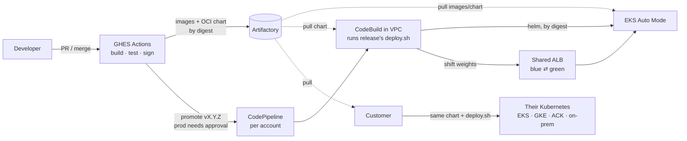
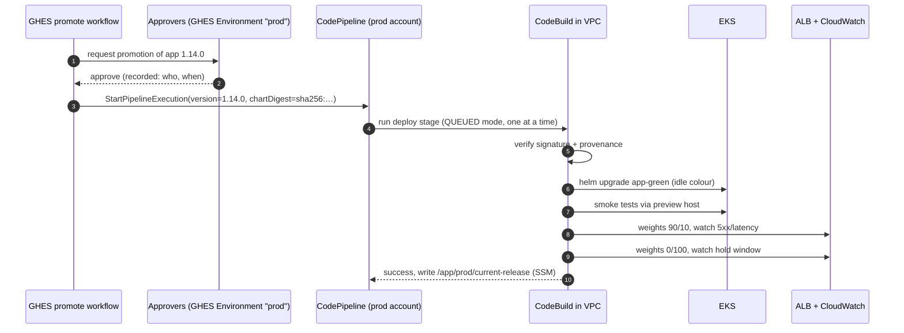

# Proposal: a lean, zero-downtime delivery platform for 2026

**Status:** Proposed, for review  ·  **Date:** 2026-10-10

This is the recommended design. It's meant to be read on its own; the rest of
the repo (requirements, IP model, options, open questions) is supporting detail.

---

## 1. The answer in one page

**Keep** GHES, Artifactory and EKS. **Remove** Argo CD, ARC, the in-cluster
Prometheus stack, cert-manager, external-dns and the other add-ons. **Replace**
them with this:

1. **One release artefact.** GHES Actions builds the 8 images once, signs them,
   and publishes **one OCI Helm chart** to Artifactory that pins all 8 image
   digests. That chart, plus a small `deploy.sh`, *is the product*. Customers get
   exactly the same thing.
2. **Push-based delivery, AWS-native, no controller in the cluster.** Promoting a
   release in GHES (with approval for prod) calls **CodePipeline** in the target
   account. CodePipeline runs **one CodeBuild step inside the VPC** that executes
   the release's own `deploy.sh`. That is the same script a customer would run.
3. **Blue/green at whole-stack level on one shared ALB.** The new version comes up
   in the idle colour's namespace, gets smoke-tested on a preview hostname, then
   ALB weights move traffic 10% → 100% while ALB 5xx metrics are watched.
   Anything wrong flips the weights back in seconds. The old colour is scaled to
   zero after a hold window.
4. **EKS Auto Mode, with pods on a secondary non-routable CIDR.** AWS runs the
   nodes, CNI, load balancing, storage and DNS. Pod IPs come from `100.64.0.0/16`,
   not from your scarce routable range.
5. **Managed everything else.** ACM for TLS, Route 53 records in IaC, CloudWatch
   ALB metrics for the release gate, CloudWatch/AMP for telemetry, Secrets Manager
   for secrets. Humans get read-only cluster access, and a nightly job detects drift.

**Effect on IP addresses** (minimal profile, during a blue/green release):

| | Today | Proposed | Fallback if no secondary CIDR (Fargate) |
|---|---|---|---|
| Routable VPC IPs | ~130 | **~16** (+ local VPC endpoints, if any) | ~35 |
| In-cluster platform controllers we operate | ~15+ | **0** | 2 (CoreDNS, LB controller) |
| Fits an 80-IP account? | No | **Yes, with > 75% headroom** | Yes, with ~40% headroom |

Estimates, not measurements; §8 shows the arithmetic. Phase 0 will measure today's
actual breakdown.



---

## 2. Why this design

| Principle | How the design applies it |
|---|---|
| **The product is the release artefact** (ADR-0002) | Our pipeline runs the customer's install script. If it works for us, it works for them, and it's tested on every release. |
| **No resident machinery we don't need** | Production changes only through authorised releases, so continuous reconciliation buys little. Prevention (read-only humans) plus nightly detection covers drift at zero pods. |
| **The IP problem is a compute and CNI problem** | The deploy tool barely affects IP count. Platform pods, warm pools and pod-IP placement do. Auto Mode plus a secondary CIDR fixes it structurally. |
| **Zero downtime is designed in, not bolted on** | Readiness gates, drain timings, expand/contract migrations and an ALB-metric gate. A rollout controller doesn't replace any of these. |
| **Boring, managed, auditable** | CodePipeline, CodeBuild, IAM, CloudTrail and the ALB are all AWS-managed with nothing to upgrade. The only code we own is one script (a few hundred lines) and one chart. |

---

## 3. Build and release (GHES → Artifactory)

**Runs in:** GHES Actions on runners in a **tooling account** or ephemeral
compute. **Never in workload clusters** [NET-04].

On every merge to `main`:

1. Build the 8 images, run unit and integration tests.
2. Push images to Artifactory. Record each **digest**.
3. Generate an SBOM and build provenance, and **sign** the images (cosign; Artifactory stores the signatures) [REL-04].
4. Package the **umbrella chart** `app` with the 8 digests written into `values.yaml`, validate it against `values.schema.json` [REL-05], and push it as an OCI artefact: `oci://artifactory.example/helm/app:1.14.0`.
5. Attach `deploy.sh`, profile files and release notes to the same version.
6. **Conformance test on kind**: install, upgrade from N-1, break-and-abort, rollback, using only `helm`, `kubectl` and `deploy.sh` [PORT-01].
7. Automatically promote to **dev**.

**Rules:** nothing is ever rebuilt for another environment [REL-01]. Nothing
references `:latest` [REL-02]. One version number identifies the whole stack [REL-03].

### What's in a release

```
app-1.14.0 (OCI, in Artifactory)
├── chart/                    umbrella Helm chart, 8 services, digests pinned
│   ├── values.schema.json    the configuration contract
│   ├── profiles/minimal.yaml standard.yaml ha.yaml
│   └── templates/            workloads + exposure adapters (gateway | alb-ingress | service)
├── deploy.sh                 install / bluegreen / rollback / status / diff
├── RELEASE_NOTES.md          migrations, N-1 compatibility, rollback limits
├── sbom.spdx.json, provenance.intoto.jsonl, signatures
```

---

## 4. Promotion and deployment (Artifactory → EKS)

### Who triggers what



| Concern | Design | Req |
|---|---|---|
| Trigger | The **promotion**, not the image push. A GHES `promote` workflow calls `StartPipelineExecution` with pipeline variables (version and chart digest). | DEP-03 |
| Approval | **GHES Environments** with required reviewers for `nonprod` and `prod`. There's one approval record, in the tool developers already use. CodePipeline has no second approval. | DEP-02 |
| Identity | GHES → AWS via **OIDC** to a role that can *only* start that pipeline. The pipeline's CodeBuild role is the only principal with write access to the cluster. Dev and prod roles are separate. | DEP-04, SEC-01 |
| Network | GHES needs **outbound AWS API access only**. There's no inbound path to any cluster. CodeBuild runs inside the VPC, reaches the private EKS endpoint, and pulls from Artifactory. | DEP-05 |
| Serialization | CodePipeline V2 **QUEUED** execution mode means one deploy at a time per environment. | DEP-06 |
| Record | CodePipeline execution history, CloudTrail, and an SSM parameter `/app/<env>/current-release` (versioned) that anyone can query without cluster access. | DEP-09 |
| Same as customers | The CodeBuild step does nothing except `helm pull` the release and run its `deploy.sh`. | DEP-01 |

Why CodeBuild and not CodePipeline's built-in EKS action: the EKS action only
applies Helm/kubectl. It can't run smoke tests, move ALB weights or watch
metrics. CodeBuild in the VPC runs the release's own script, so behaviour is
versioned with the release.

### Per-account footprint (all IaC, e.g. Terraform/OpenTofu)

- VPC wiring: a secondary CIDR `100.64.0.0/16` with 2 pod subnets [NET-03].
- EKS Auto Mode cluster, private endpoint, access entries (humans = view, break-glass = admin, alarmed).
- One CodePipeline V2 + one CodeBuild project (VPC-attached) + IAM roles + the GHES OIDC trust.
- ACM certificate, Route 53 alias to the shared ALB, CloudWatch alarms → SNS.
- A nightly drift job (EventBridge → same CodeBuild project, `deploy.sh diff`).

Standing up a new environment is `terraform apply` plus one promotion [ENV-03, ENV-04].

---

## 5. Zero-downtime blue/green

### Shape

Three Helm releases per environment, all from the same chart:

| Release | Namespace | Contains |
|---|---|---|
| `app-blue` | `app-blue` | the 8 services, version N |
| `app-green` | `app-green` | the 8 services, version N+1 (during a release) |
| `app-edge` | `app-edge` | only the Ingress/route objects: `activeColour`, `weights`, preview host |

Blue/green works at **whole-stack level**: service-to-service calls stay inside a
colour, so N never talks to N+1. This is the safe default until Q1 confirms the
services are independently deployable [ZDT-04].

### Release steps (`deploy.sh bluegreen`)

1. Verify the chart and image signatures [SEC-04].
2. Read the active colour from `app-edge`. The idle one is the target.
3. **Expand-only migrations** run as a Job in the idle namespace (a pre-install
   hook). The old version keeps working on the new schema [ZDT-05].
4. `helm upgrade --install app-<idle> --wait`. Pods are only Ready once the **ALB
   target is healthy** (LB readiness gates) [ZDT-07].
5. **Smoke tests** against `preview.<env-domain>`, which routes 100% to the idle colour [ZDT-08].
6. Shift weights to **90/10**, then watch the idle colour's target group for 2 minutes:
   `HTTPCode_Target_5XX_Count`, `TargetResponseTime`, unhealthy hosts.
7. Shift to **0/100** and watch for the hold window (5 minutes in `minimal`, 30 in `ha`).
8. Any gate failure **flips weights back** (seconds) and exits non-zero, failing the pipeline [ZDT-03].
9. On success: write the SSM record and **scale the old colour to 0** (its release
   is kept, so rollback is "scale up + flip", about 2 minutes) [ZDT-02].
   In `ha`, the old colour stays warm until the next release.

**Rollback** is a pipeline run with `action=rollback`. It scales up the previous
colour if needed and flips the weights. One command, rehearsed quarterly.

### Built into every service (chart defaults, enforced by lint)

- `readinessProbe` that checks real dependencies, plus a `preStop` sleep of about 10 s.
- `terminationGracePeriodSeconds` > ALB deregistration delay (set to 20 s) + preStop [ZDT-06].
- `maxUnavailable: 0`, `maxSurge: 1`, and a PDB in `standard`/`ha`.
- Expand/contract migrations: contract steps ship one release *after* the code stops using the old schema. CI runs N-1 against the new schema [ZDT-05].

The same chart also supports plain **rolling** deploys (`deploy.sh install`):
dev uses it for speed, and simple customers can too. Blue/green is the prod default.

### Traffic layer

On EKS, the `app-edge` release renders an **Ingress for the Auto Mode ALB**
(IngressGroup = one ALB per environment) with **weighted target groups**, which is
the most mature mechanism today. For customers, the same release can render a
**Gateway API `HTTPRoute`** with weighted `backendRefs` instead. That works on GKE,
Envoy Gateway, Cilium and NGINX Gateway Fabric [PORT-04]. When Gateway API support
in Auto Mode's load balancing is confirmed GA, EKS switches to it too and the
Ingress path is retired *(verify)*.

---

## 6. Cluster, compute and network

| Choice | Decision | Why |
|---|---|---|
| Compute | **EKS Auto Mode** | AWS manages nodes (Bottlerocket, auto-patched), VPC CNI, load balancing, EBS CSI and DNS. That leaves **no kube-system controllers for us to own or upgrade**. Costs a small premium on instance price, negligible at 2–3 nodes *(verify current premium)*. |
| Pod IPs | **Secondary CIDR `100.64.0.0/16`, pod subnets selected in the Auto Mode NodeClass** | Pods stop consuming routable IPs at all. Routable space is only used by the control plane, node primary IPs, the ALB and CodeBuild *(verify NodeClass pod-subnet support)*. |
| Clusters | **One per account/environment** | No shared fixed overhead to duplicate [NET-06]. |
| Ingress | One shared ALB per environment, ACM certificate | Replaces cert-manager. TLS ends at the ALB. |
| DNS | Route 53 records in IaC | Replaces external-dns. The ALB is stable because the IngressGroup is fixed. |
| VPC endpoints | Use the central network account's if one exists (Q14), plus the free S3 gateway endpoint | Avoids 10–20 routable IPs per account. |
| CI runners | Tooling account only | Removes ARC from workload clusters [NET-04]. |

**Fallbacks** if the preferred option isn't available in an account:

| Constraint | Fallback |
|---|---|
| Secondary CIDR not allowed (Q3) | **Fargate** for the app pods: exactly 1 routable IP per pod, no warm pool. CoreDNS and the AWS LB controller run on Fargate too. About 35 routable IPs at peak, still within budget. |
| Auto Mode not approved | Managed node groups + VPC CNI custom networking + `WARM_IP_TARGET=2`, `MINIMUM_IP_TARGET=10`, with AWS-managed add-ons. |
| IPv6-ready network | An IPv6 cluster removes the problem permanently. Revisit when the enterprise network supports it. |

---

## 7. Observability, secrets and security (all managed, near-zero pods)

| Function | Decision | Req |
|---|---|---|
| Release gate metrics | **ALB CloudWatch metrics** per target group, with no agent needed | OBS-03 |
| App metrics | The app exposes `/metrics` (Prometheus format). Scraped by an **Amazon Managed Prometheus agentless scraper**, or skipped entirely if ALB metrics and logs are enough for now (Q15). | OBS-01/02 |
| Logs | JSON to stdout → **CloudWatch Logs** through the Container Insights add-on (AWS-managed) | OBS-02/04 |
| Alerting | CloudWatch alarms → SNS → your on-call channel | — |
| Secrets | Stored in **Secrets Manager**. `deploy.sh` (AWS adapter) syncs them into K8s Secrets at deploy time. The app only ever reads K8s Secrets. Rotation means redeploying. Add the Secrets Store CSI driver only if rotation needs to happen without a deploy. | SEC-02, PORT-03 |
| AWS access from pods | **EKS Pod Identity**, if the app needs AWS APIs at all | SEC-05 |
| Pod security | `restricted` Pod Security Standard on app namespaces. Non-root, read-only root FS. | SEC-03 |
| Policy | Built-in **ValidatingAdmissionPolicy** rejecting tag-only images, so no Kyverno/Gatekeeper | REL-02 |
| Human access | EKS access entries: engineers get **view**. A **break-glass** admin role is time-bound with a CloudTrail alarm. | SEC-01 |
| Drift | Prevented by the above. **Detected** nightly by `deploy.sh diff` against the recorded release, alerting on any difference. **Corrected** by re-running the pipeline. | OPS-03 |

---

## 8. IP budget (minimal profile, 2 AZs)

Uses the model in `docs/03-ip-address-budget.md`. "Routable" means the scarce
primary CIDR.

| Line | Steady (routable) | Blue/green peak (routable) | Pod CIDR (non-routable), peak |
|---|---|---|---|
| A. EKS control-plane ENIs | 4 | 4 | — |
| B. Node primary IPs (2 → 3 nodes at peak) | 2 | 3 | — |
| C. App pods (8 → 16 at peak) | 0 | 0 | 16 |
| D. Platform pods we run | 0 | 0 | ≤ 4 (AWS-managed, if any) |
| E. Warm pool | 0 | 0 | small, from a /16 |
| F. Deploy surge | 0 | 0 | included in C |
| G. ALB (min 1 per AZ, can scale up) | 2 | up to 8 | — |
| H. VPC endpoints | 0 if central / ~10 if local | same | — |
| I. CodeBuild deploy ENI (only during a deploy) | 0 | 1 | — |
| **Total** | **8** (18 with local endpoints) | **16** (26 with local endpoints) | ~20 of 65,536 |

**Fargate fallback, peak:** 4 (A) + 16 app pods + 4 platform pods (CoreDNS, LB
controller) + 8 (ALB) + 1 (CodeBuild) ≈ **33** routable, or ~43 with local
endpoints. That's still under NET-01's 50.

---

## 9. Customer installation

Customers never see GHES, CodePipeline or our AWS accounts [PORT-01]. They get
the release and can choose how much of it to use:

| Customer type | How they install |
|---|---|
| Simplest | `helm install app oci://…/app --version 1.14.0 -f profiles/minimal.yaml -f my-values.yaml` (rolling updates) |
| Wants blue/green | `deploy.sh bluegreen --version 1.14.0 --exposure gateway` on any Gateway API implementation |
| Runs Argo CD / Flux already | Point their GitOps tool at the OCI chart. It's an ordinary Helm chart. |
| On EKS | The same, plus the optional `alb-ingress` and `aws-secrets` adapters, enabled in values |
| Air-gapped | Mirror the chart and images to their registry and set `global.registry` [PORT-06] |

CI verifies kind/k3d plus EKS on every release, and one more distribution
(e.g. GKE or k3s) on a schedule [PORT-02]. Every release ships a compatibility
matrix and an upgrade guide [PORT-05].

---

## 10. What gets removed

| Today | Replaced by |
|---|---|
| Argo CD (+ repo-server, redis, dex, notifications, ApplicationSets) | CodePipeline + CodeBuild running `deploy.sh` (0 pods) |
| ARC runner controller, listeners, runners in-cluster | GHES runners in a tooling account |
| kube-prometheus-stack (Prometheus, Alertmanager, Grafana, exporters) | ALB CloudWatch metrics, CloudWatch Logs, optional AMP agentless scraper |
| cert-manager | ACM on the ALB |
| external-dns | Route 53 in IaC |
| Self-managed CNI tuning, node groups, autoscaler | EKS Auto Mode |
| Per-environment manifest forks | One chart + profiles + env values files [ENV-01] |

---

## 11. Options I considered and didn't choose

Scored with the weights in `docs/05-proposal-brief.md` (1–5, higher is better).

| Option | IP (25) | ZDT (20) | Simplicity (20) | Customer parity (15) | Security/audit (10) | Cost (5) | Maturity (5) | **Total /500** |
|---|---|---|---|---|---|---|---|---|
| **Chosen: CodePipeline + in-VPC CodeBuild running `deploy.sh`** | 5 | 4 | 5 | 5 | 5 | 5 | 4 | **475** |
| GHES Actions pushing directly to EKS | 5 | 4 | 4 | 5 | 3 | 5 | 4 | **435** |
| Flux (OCI from Artifactory) + `deploy.sh`-equivalent gates | 4 | 4 | 3 | 4 | 5 | 5 | 5 | **400** |
| Slimmed Argo CD + Argo Rollouts | 3 | 5 | 2 | 3 | 4 | 4 | 5 | **345** |
| Keep current platform | 1 | 3 | 1 | 2 | 3 | 2 | 5 | **200** |

(Total = Σ score × weight.)

- **GHES pushing directly** is close, but it needs a network path from runners into
  every private cluster. It also puts prod-write credentials in the CI trust domain.
  It's fine for dev if you want it.
- **Flux** is the right answer if you later decide you *want* continuous drift
  correction, or you operate many customer accounts yourselves (Q8). It reads the
  same OCI chart, so switching later is cheap. That's a deliberate property of
  this design.
- **Argo Rollouts / Flagger** become worth it only if scripted gates prove
  inadequate, e.g. if you need canary analysis across many metrics. Not at
  < 10k users.
- **Sensitivity:** swapping the IP and ZDT weights doesn't change the winner (470, vs GHES
  push 430, Flux 400, Argo 355).

---

## 12. Risks and assumptions

| # | Risk / assumption | If wrong | Linked question |
|---|---|---|---|
| R1 | The 8 services are fine to release together as one stack | If they release independently, run per-service blue/green in the same mechanism (one colour pair per service) | Q1 |
| R2 | Blue/green is truly wanted in prod | If not, use rolling everywhere: simpler and fewer peak pods | Q2 |
| R3 | A secondary CIDR can be associated to workload VPCs | Use the Fargate fallback (§6) | Q3 |
| R4 | CodeBuild in the VPC can reach Artifactory (private link, proxy or allowed egress) | Add an ECR pull-through/replication of release artefacts as a cache *(ADR needed)* | Q5 |
| R5 | GHES OIDC tokens can be trusted by AWS IAM. This needs the GHES OIDC discovery endpoint reachable by AWS, or published publicly. | Use runner instance roles in the tooling account to assume the trigger role | Q4 |
| R6 | Auto Mode NodeClass supports custom pod subnets, and Auto Mode's ALB supports weighted target-group actions | Managed node groups + custom networking + AWS LB controller (2 pods) | *(verify)* |
| R7 | The app tolerates N and N+1 against one schema | This is engineering work in the app, not the platform, and is required for any zero-downtime approach | Q7 |
| R8 | Customers are all on Kubernetes | A docker-compose profile would be a separate product decision | Q9 |

Items marked *(verify)* must be checked against current AWS documentation
before Phase 2 (AGENTS.md rule 6).

---

## 13. Delivery plan

Thin vertical slices, each demoable. Sizes are rough estimates for 1–2 engineers.

| # | Slice | Proves | Size |
|---|---|---|---|
| 1 | Umbrella chart + digests + schema + signing, published from GHES; installs on kind | REL-*, PORT-01 | 1–2 wks |
| 2 | `deploy.sh install/bluegreen/rollback/diff` + conformance suite on kind (load test, broken release, rollback) | ZDT-* | 2 wks |
| 3 | Dev account IaC: secondary CIDR, Auto Mode, ALB, CodePipeline/CodeBuild, GHES promote workflow. **Measure IPs.** | DEP-*, NET-01 | 2 wks |
| 4 | Nonprod with approvals, SSM release record, drift job, alarms | DEP-02/09, OPS-03 | 1 wk |
| 5 | Deploy into an ~80-IP account (or a deliberately constrained VPC) | NET-02 | 2–3 days |
| 6 | Prod: run new and old side by side, **Route 53 weighted cutover** old → new, then decommission | MIG-* | 1–2 wks |
| 7 | Customer docs, compatibility matrix, second-distribution CI | PORT-02/05 | 1 wk |

Roughly **8–10 weeks** to prod cutover, depending on the open questions and on
how much expand/contract work the app's database migrations need.

---

## 14. Decisions needed from you

1. **Approve the direction**, or tell me which section to rework.
2. Answer **Q1–Q5** in `docs/06-open-questions.md`. Q2 (is blue/green really
   needed?) and Q3 (secondary CIDR allowed?) change the design most.
3. Run `scripts/inventory-ip-usage.sh` in one current account, so we replace
   estimates with measured numbers before building.

Once approved, each row of §1 becomes an ADR (`docs/adr/0003…`) marked
`Accepted`, and Phase 2 starts with slice 1.
