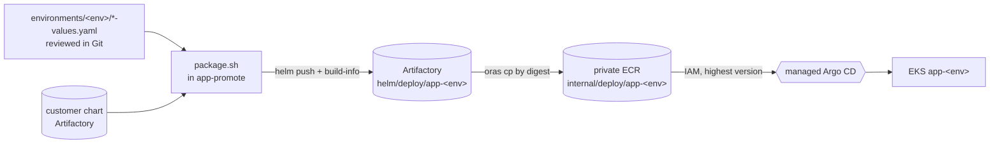

# deploy: desired state as Helm bundles (no Git source)

The managed Argo CD (EKS Capability, tooling account) runs outside our VPC,
so it can reach neither GHES nor Artifactory. Its only source is the **private
ECR copy**, which it reads with its IAM role. Artifactory stays private and
remains the system of record. See [design.md](../docs/proposal/design.md) §5
and [ADR-0004](../docs/adr/0004-delivery-via-eks-managed-argocd.md).

| Path | What | Changed by |
|---|---|---|
| `charts/app-env/` | Wrapper chart: the customer chart (vendored, unchanged) + one env's values | Rarely |
| `charts/platform-env/` | LB controller subchart + Fargate log router ConfigMap | Rarely |
| `environments/<env>/app-values.yaml` | That env's values for the customer chart [ENV-01] | Reviewed PR |
| `environments/<env>/platform-values.yaml` | That env's platform values | Reviewed PR |
| `package.sh` | Builds `<component>-<env>-<bundle>.tgz` | — |
| `test.sh` | Tests for `package.sh` (CI: `.github/workflows/deploy.yml`) | — |
| `bootstrap/` | Cluster registrations + one Application per env/component on the hub. Applied once by hand. | New environment |

**How a release reaches an environment.** `app-promote.yml` runs after the
GHES Environment approval. It:
1. Copies the release images and chart to ECR by digest.
2. Packages `app-<env>` at bundle version `1.0.<unix time>`.
3. Pushes the bundle to Artifactory, with build-info.
4. Copies it by digest to ECR `internal/deploy/`.

The `app-<env>` Application tracks `targetRevision: "*"` (the highest
version), so Argo CD rolls it out [DEP-02] [DEP-03].

**Rollback** is promoting the previous version. That makes a new, higher
bundle wrapping the older release, rolled out as a normal rolling update [ZDT-02].

**What changes are reviewed where.** Env values are reviewed in Git here. The
promotion record is the GHES Environment approval plus the Artifactory
build (`<repo>-deploy-<component>-<env>`, numbered by bundle version). What's
running is visible in the Argo CD UI and as the highest tag in ECR [DEP-09].

**Needs from the ECR owner:** repositories `internal/deploy/app-<env>` and
`internal/deploy/platform-<env>`, plus pull access for the Argo CD
capability role (Q34).

**To verify (V11):** that `targetRevision: "*"` resolves on the managed
capability for OCI Helm sources. If it doesn't, the promote job pins the exact
version on the hub Application from a tooling-VPC runner instead.

Customers never see any of this. They install the customer chart from ECR
`release/*` with Helm [PORT-01].
