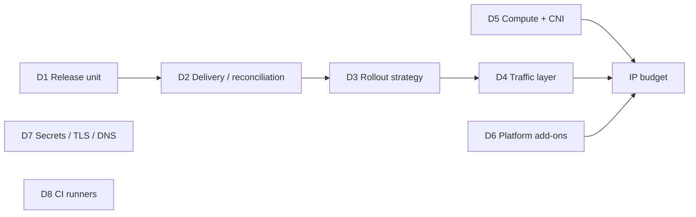

# Solution space

These are candidate options for each open decision, with the trade-offs we
already know. **These are not decisions.** The proposal must score them against
the requirements, add options we've missed, and record the outcome as ADRs.

The decisions are mostly independent, so pick per row:

---

## D1: Release unit

| Option | Notes |
|---|---|
| **OCI Helm chart in Artifactory, pinning image digests** *(leading)* | Universally consumable by customers. Artifactory supports OCI Helm. Signable. |
| Kustomize base + OCI artefact | No templating language, but weaker customer UX for configuration. |
| Raw manifests bundle | Simplest, worst configurability. |
| Timoni / CUE, KCL | Modern, typed, niche. Customer adoption risk. |

## D2: Delivery and reconciliation (the big one)

| Option | How it works | Resident pods | Pros | Cons |
|---|---|---|---|---|
| **A. CodePipeline V2 + EKS action** | GHES (OIDC) records the promotion and calls `StartPipelineExecution` with release version/digest variables, or writes a release manifest to S3 (S3 source). Pipeline: verify signature → EKS deploy action (Helm) → health gate → done. Separate pipeline per account. | 0 | AWS-native IAM, audit and approvals. Reaches private clusters without runners in VPC. No in-cluster controller. | AWS-only (fine: customers don't use it). Not a rollout controller, so blue/green and gates are scripted (Commands/CodeBuild). Needs egress to Artifactory. Artifactory isn't a native source. |
| **B. GHES Actions push (OIDC → AWS → helm)** | Deploy job in GHES assumes a deploy role and runs the same install command customers use. | 0 | One tool for CI and CD. GHES Environments give approvals and history. Simplest to understand. | Needs a network path from runners to the EKS API (public endpoint with CIDR allow-list, or runners in the account VPC, which is ARC again unless ephemeral EC2/CodeBuild). Prod credentials live in the CI system's trust domain. |
| **C. Minimal pull: Flux OCI** | Flux source-controller + helm-controller watch an OCI artefact/tag in Artifactory, e.g. `prod` → digest. Promotion = moving a reference in Artifactory. | 2–3 | Pull model: no inbound access, no deploy credentials outside the cluster. Continuous drift correction. Same in every account. Customers *may* use it but don't have to. | A controller to upgrade and secure. Release gates and traffic switching still need Flagger or scripting. Visibility is CLI/notifications only. |
| D. Argo CD Core (slimmed) | Keep Argo CD without UI/Dex/notifications. | 3–4 | Familiar to the team. | Still the heaviest. The main problem was the stack around it, not just Argo. |
| E. Keep current platform | — | many | No migration. | Fails NET-01/02. |

**Reviewer's lean:** A or C. A if the organisation values AWS-native audit and
wants zero resident pods. C if pull-based security and drift correction are
valued, and 2–3 pods are affordable (they are, with secondary CIDR). B is
attractive for its simplicity, but the network path and the CI-holds-prod-keys
trust problem usually push it out for prod. It can still be the right answer
for dev.

Whichever wins: **the deploy step must call the same install interface as
customers (DEP-01)**, e.g. `helm upgrade --install <release> oci://.../app
--version X -f profile-standard.yaml -f env-prod.yaml` plus a scripted
traffic-switch/health gate.

## D3: Rollout strategy

| Option | IP/capacity cost | Rollback speed | Fit |
|---|---|---|---|
| **Rolling, done right** (readiness gates, preStop, PDB, `maxUnavailable: 0`, `maxSurge: 1`) | +1 pod per service | Minutes (redeploy previous) | Default for `minimal`. Meets ZDT-01 for stateless, loosely coupled services. |
| **Stack-level blue/green** (namespace per colour, switch at edge by weight) | +100% app pods during release | Seconds (flip weight back) | When services must be version-coherent, or instant rollback is required. |
| Per-service blue/green | +1× that service | Seconds | Loosely coupled services with risky changes. |
| Canary (weighted 5→25→100) | Small | Seconds | Needs good metrics. Probably overkill at < 10k users. |
| Argo Rollouts / Flagger | + controller pods | Seconds | Only if scripted gates prove inadequate. |

## D4: Traffic layer (EKS)

| Option | Notes |
|---|---|
| **AWS LBC + Gateway API** (`HTTPRoute` weighted `backendRefs`) | Portable API. Same route objects work on GKE/Envoy Gateway/Cilium. *(verify LBC Gateway API GA status and ALB feature coverage)* |
| AWS LBC + Ingress with weighted `actions` annotation | Mature, ALB-specific. Blue/green via weighted target groups. |
| IaC-owned ALB + `TargetGroupBinding` | ALB, listener and target groups in Terraform. Pods register into the blue/green TGs. Switch = `elbv2 modify-rule` weights. Very stable DNS, minimal controller logic, but AWS-only switching code. |
| ingress-nginx | **Don't.** Project retired *(verify)*. |

All options: one shared ALB per environment, ACM certificates on the listener.

## D5: Compute and CNI

| Option | IP profile | Ops | Notes |
|---|---|---|---|
| **Managed node groups + secondary CIDR custom networking + `WARM_IP_TARGET`** | Pods off routable space | Medium | Proven. Requires secondary CIDR on the VPC. |
| **EKS Auto Mode** | Fewer system pods. Pod subnets configurable *(verify)* | Low | Managed nodes, CNI, LB, storage. Price premium on instances *(verify)*. |
| **Fargate** | Exactly 1 routable IP per pod, no warm pool, no DaemonSets | Low | Excellent for 8 stateless services. Check app needs (EBS, privileged, start time). CoreDNS/LBC can also run on Fargate. |
| IPv6 cluster | Effectively unlimited pod IPs | Medium | Depends on enterprise network, Artifactory and dependency IPv6 reachability. |
| Node groups, default CNI | Worst | Medium | Baseline only. |

## D6: Platform add-ons

Default to **none**. Each candidate needs a requirement to justify it:

| Function | Lean default | Instead of |
|---|---|---|
| Metrics | AMP agentless managed scraper, or Container Insights | in-cluster Prometheus/Grafana/Alertmanager |
| Logs | Container Insights / Fluent Bit (hostNetwork DaemonSet), or Fargate built-in log router | Loki / EFK in cluster |
| TLS | ACM on the ALB | cert-manager |
| DNS | Route 53 records in IaC (stable ALB) | external-dns |
| Autoscaling nodes | Auto Mode / Fargate / Karpenter only if needed | Cluster Autoscaler + Karpenter both |
| Policy | Pod Security Admission (built in), plus ValidatingAdmissionPolicy (built-in CEL) | Kyverno/Gatekeeper |
| Secrets | Deploy-time sync from Secrets Manager into K8s Secrets, or Secrets Store CSI | External Secrets Operator (reconsider if rotation needs it) |

## D7: Secrets, TLS, DNS

Covered in D6. The key constraint is PORT-03: the app reads K8s
Secrets/files only, and AWS integration is an adapter.

## D8: CI runners

| Option | Notes |
|---|---|
| GHES runners in a dedicated CI/tooling account (EC2 autoscaling or ARC there) | Removes runners from workload accounts (NET-04). |
| CodeBuild as a GitHub Actions runner *(verify GHES support)* | Ephemeral, no cluster. |
| Existing GHES runner fleet | If one exists outside workload accounts. |
