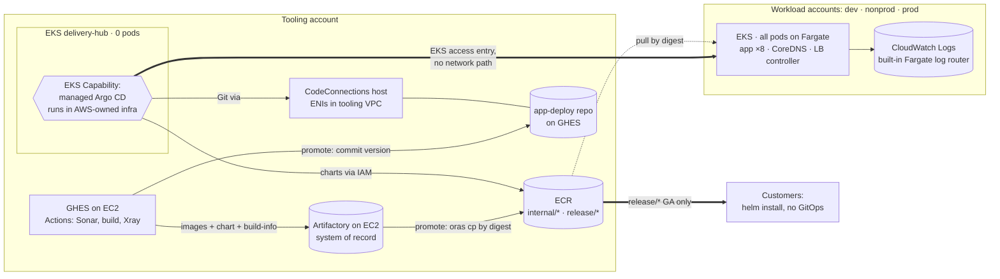
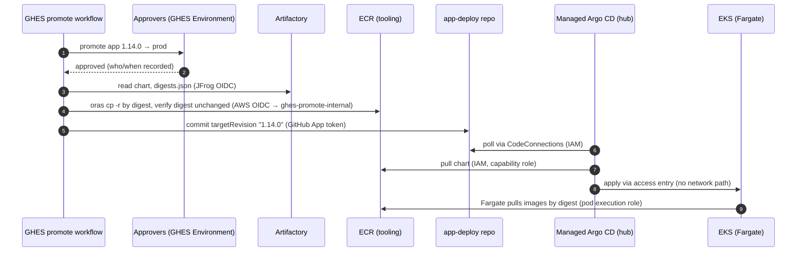

# Design: deployment with EKS managed Argo CD, IaC with CDK Terrain

**Status:** Proposed, for review  ·  **Date:** 2026-10-11  ·  **ADRs:** [0004](../adr/0004-delivery-via-eks-managed-argocd.md), [0005](../adr/0005-iac-cdk-terrain-opentofu.md), [0006](../adr/0006-fargate-logging-and-debugging.md), [0007](../adr/0007-customer-distribution-via-ecr.md)

This design takes the [proposal](../../PROPOSAL.md) further, adding the requirements the owner set on 2026-10-11:

| # | Owner requirement (2026-10-11) | Where it lands |
|---|---|---|
| O1 | Deploy to **EKS**, using **AWS managed Argo CD** | §3, ADR-0004 |
| O2 | Anything DevOps/GitOps is **AWS managed** if possible. GHES and Artifactory are the exceptions. | §3, §8 component register |
| O3 | Infra that isn't shared with customers uses **managed services** | §2 |
| O4 | **Minimise IP usage** | §6 |
| O5 | A **cheap logging/debug** solution for the ephemeral (Fargate) containers | §7, ADR-0006 |
| O6 | Helm charts compiled and stored **with the images in Artifactory**, with **build-info and Xray** | §4 |
| O7 | GitHub workflows using the **vendors' own** SonarQube and JFrog actions | §4 |
| O8 | Customers don't run GitOps. They deploy **from our Artifactory → ECR** | §2, ADR-0007 |
| O9 | IaC in **CDK Terrain (cdktn)** generating **OpenTofu ≥ 1.13**, built **test-first**, run from a **Containerfile** via a **Makefile** (Apple `container` on macOS, Docker in CI). Output split into conventional `.tf` files. | §9, ADR-0005 |

> **This changes the proposal's delivery choice.** PROPOSAL.md §3.3 picked
> CodePipeline + in-VPC CodeBuild. O1 asks for managed Argo CD. The EKS
> Capability for Argo CD runs **in AWS-owned infrastructure, not in our
> clusters**, so it adds 0 pods and 0 workload-VPC IPs. That removes the
> objection that sank Argo CD before (~7 pods, upgrades, IPs). The scoring is
> in §3.2. On the default weights it's close (420 vs 425), and O1 decides it.

---

## 1. The answer in one page



| Concern | Decision | Managed? |
|---|---|---|
| Build, test, scan | GHES Actions with the **SonarQube Server** action, **JFrog CLI** (`setup-jfrog-cli`, OIDC) and **Xray** build scan | GHES/Artifactory: fixed, self-hosted |
| Release unit | One Helm chart pinning all 8 digests (`digests.json` inside the chart), in Artifactory as OCI, recorded in **build-info** with the images | — |
| Runtime registry | **ECR**, copied from Artifactory by digest at promotion: `internal/*` for our envs, `release/*` for customers | ECR ✅ |
| Deploy (our envs) | **EKS Capability for Argo CD** on a zero-pod hub cluster in the tooling account. Pulls Git via **CodeConnections**, charts from ECR via IAM, deploys to workload clusters via **EKS access entries** | ✅ |
| Promotion | GHES Environment approval → copy to ECR → one commit to the deploy repo | — |
| Compute | **EKS, every pod on Fargate**: 1 IP per pod, no nodes, no DaemonSets | ✅ |
| Logs / debug | Fargate's **built-in** Fluent Bit → **CloudWatch Logs**: Standard class in dev/nonprod (Live Tail), Infrequent Access in prod. `kubectl logs`/`exec` for live debugging. | ✅ |
| IaC | **cdktn** (TypeScript) → **OpenTofu ≥ 1.13** root modules, one per account, state in S3 with native locking | — |
| Customers | Pull the GA chart from ECR `release/*`, install with Helm. No Argo CD, no GitOps, no AWS services required. | — |

**IP cost in a workload account: 19 at steady state and 33 at peak (`minimal`).**
That fits NET-01 (≤ 50) and leaves 59% of an 80-IP account free (NET-02). §6.

---

## 2. What is shared with customers, and what is ours

O3 and O8 draw the line. Anything a customer also runs must be portable. Everything else is ours and uses managed services.

| Layer | Shared with customers? | So it must be | Ours |
|---|---|---|---|
| Container images (×8) | ✅ | Built once, by digest | — |
| Helm chart + `values.schema.json` + profiles | ✅ | Portable; no cloud dependency [PORT-07] | — |
| Zero-downtime behaviour (probes, preStop, PDB, surge) | ✅ | In the chart [PORT-08] | — |
| ECR `release/*` | ✅ (they pull from it) | Read-only, per-customer IAM principal | — |
| Argo CD, deploy repo, promote workflow | ❌ | — | Managed Argo CD, GHES |
| EKS, Fargate, ALB, ACM, CloudWatch | ❌ | — | Managed AWS |
| IaC (cdktn) | ❌ | — | Our accounts only |

The internal environments use **the same chart and the same values interface**
customers use [DEP-01]. Argo CD renders it as an automation of that interface
(ADR-0002 §3). §5.3 covers the one real difference: Argo CD renders the chart
with `helm template`, while customers run `helm upgrade`.

---

## 3. Options: how the app is deployed, and where

### 3.1 Options

| | **A. Managed Argo CD, hub in tooling account** | **B. Managed Argo CD on each workload cluster** | **C. CodePipeline + in-VPC CodeBuild** (PROPOSAL v5) |
|---|---|---|---|
| How | One Argo CD capability on a **zero-pod** `delivery-hub` EKS cluster. It manages dev/nonprod/prod clusters by ARN through access entries. | Each workload cluster has its own capability and deploys to itself. | GHES starts a pipeline. CodeBuild in the VPC runs `helm upgrade`, gates, and rolls back. |
| Where Argo runs | AWS-owned infra (0 pods anywhere) | AWS-owned infra (0 pods) | n/a |
| Git access | One CodeConnections host, in the tooling VPC next to GHES | A CodeConnections path per account, so ENIs in each workload VPC or cross-account sharing *(unverified)* | n/a (no Git source) |
| Drift | Reconciled continuously (`selfHeal`) | Same | Nightly `helm diff` job + alert |
| Auto-rollback on bad metrics | Not built in. Rolling update stalls on failed readiness (old pods keep serving); a metric gate is a follow-up (§5.2) | Same | Scripted (ALB 5xx/latency gate, then `helm rollback`) |
| Same command as customers | Chart + values, rendered with `helm template` | Same | `helm upgrade`, verbatim |
| Blast radius | Hub can write to all clusters | Per account | Per account |
| Meets O1 / O2 (managed GitOps) | ✅ | ✅ | ❌ (no GitOps) |

### 3.2 Scoring

Weights are the defaults from [05-proposal-brief](../05-proposal-brief.md). Scores run 1–5, and each total is Σ score × weight.

| Criterion (weight) | A | B | C | Notes |
|---|---|---|---|---|
| IP budget (25) | 5 | 4 | 5 | A: 0 pods, 0 workload-VPC ENIs. B: CodeConnections ENIs per workload VPC. C: 1 CodeBuild ENI during deploys. |
| Zero downtime and rollback (20) | 3 | 3 | 4 | All roll with `maxUnavailable: 0`. Only C has an automatic metric-based rollback today. |
| Operational simplicity (20) | 5 | 3 | 3 | A: one declarative controller, no scripts, drift handled. B: 3× capabilities/IdC/connections. C: pipelines plus gate, rollback and drift scripts to own. |
| Same artefact and interface as customers (15) | 4 | 4 | 5 | Argo renders with `helm template` (hooks differ, §5.3) |
| Security and audit (10) | 4 | 5 | 4 | A: pull model, SSO via Identity Center, no CI-held cluster credentials, but the hub is a high-value target. B isolates per account. |
| Cost (5) | 4 | 3 | 5 | A: hub control plane plus one capability. B: 3 capabilities. C: pay per build minute. |
| Maturity (5) | 3 | 3 | 4 | The capability went GA in Nov 2025 |
| **Total /500** | **420** | **360** | **425** | |

**Sensitivity (IP and ZDT weights swapped, 20 and 25):** A 410, B 355, C 420.
**Sensitivity (simplicity 25, IP 20):** A 420, B 355, C 415.

**Reading it:** A and C are within 5 points of each other, and either would
work. C wins only because it already has an automatic metric gate. A wins on
simplicity and on drift correction, and it is the only option that meets the
owner's requirements O1 and O2. **Recommendation: A.** The ZDT gap closes
with the post-sync gate in §5.2. B is rejected: it triples the managed
footprint and puts CodeConnections ENIs in IP-constrained VPCs, for an
isolation benefit that access-entry scoping and the hub's own controls mostly
provide.

### 3.3 Where it runs: compute (unchanged from the proposal, re-checked)

| Option | Peak routable IPs (`minimal`) | Notes |
|---|---|---|
| **EKS + Fargate** *(chosen)* | **33** | Exactly 1 IP per pod. No warm pool, no DaemonSets, no nodes. |
| EKS Auto Mode | uncertain, likely > 40 | Defaults to **/28 prefix delegation plus a warm pool**, falling back to /32s only when the subnet is fragmented. That's the wrong shape for an 80-IP VPC. [Auto Mode networking](https://docs.aws.amazon.com/eks/latest/userguide/auto-networking.html) |
| Managed node groups + `WARM_IP_TARGET=1` | ~36–41 | Node AMIs, add-ons and DaemonSets come back |

---

## 4. Build and release (GHES → Artifactory)

Workflow: [`.github/workflows/app-release.yml`](../../.github/workflows/app-release.yml) (reusable, called from the app repo).

| Step | Tool (vendor action) | Output | Req |
|---|---|---|---|
| 1. Static analysis + quality gate | `SonarSource/sonarqube-scan-action` with `sonar.qualitygate.wait=true` | Fails before anything is published | — |
| 2. Auth to JFrog | `jfrog/setup-jfrog-cli` with **OIDC** (no stored token) | Short-lived token | DEP-04 |
| 3. Build ×8, push | `docker build` + `jf docker push --build-name/--build-number` | Images in Artifactory, layers in build-info, digests recorded | REL-01 |
| 4. Compile chart | `helm lint --strict`, `helm package` with `digests.json` inside | Chart version = release version | REL-02/03 |
| 5. Push chart | `helm push oci://<artifactory>/<helm-repo>` | Chart stored **alongside the images** in Artifactory | O6 |
| 6. Build-info | `jf rt upload` (chart + digests.json), `build-collect-env`, `build-add-git`, `build-publish` | One build ties images, chart and commit together | REL-04 (partial) |
| 7. Xray | `jf build-scan --fail=true` against the build's watches | Fails on a policy violation | — |

Every action is pinned by commit SHA. On GHES the actions have to be
available on the instance (GitHub Connect or `actions-sync`).
**Signing (cosign) is not built yet** [REL-04, SEC-04 SHOULD]. `oras cp -r`
already copies referrers, so signatures will travel to ECR once they exist.

---

## 5. Promote and deploy (Artifactory → ECR → Argo CD)

Workflow: [`.github/workflows/app-promote.yml`](../../.github/workflows/app-promote.yml). Desired state: [`gitops/`](../../gitops/README.md), a template for the GHES `app-deploy` repo.

### 5.1 Flow and credentials



| Step | Who | Credential | Can do |
|---|---|---|---|
| Approve | Named reviewers | GHES login | Approve that one Environment |
| Copy to ECR | Promote workflow | GHES OIDC → `ghes-promote-internal` (or `ghes-publish-ga`), 1 h session | Push to `internal/*` (or `release/*`) only |
| Record desired state | Promote workflow | GitHub App installation token | Write to `app-deploy` only |
| Deploy | Managed Argo CD | Capability role, in AWS | Read the deploy repo + `internal/*`; admin on workload clusters via access entries |
| Read | Humans | SSO read-only role | `AmazonEKSAdminViewPolicy` only [SEC-01] |
| Break-glass | On-call | `break-glass` role, alarmed | Cluster admin |

### 5.2 Zero downtime, rollback and the gate

| Requirement | How |
|---|---|
| ZDT-01 rolling with no failed requests | Chart rules from PROPOSAL §2.3 (`maxUnavailable: 0`, readiness, preStop, PDB, LB readiness gates) |
| ZDT-03 abort on failed health | New pods that never get ready **stall** the rollout and old pods keep serving. Argo marks the app *Degraded*. |
| ZDT-02 rollback ≤ 5 min | **Promote the previous version**, or `git revert` the promotion commit. Same path, same rolling update. |
| Metric gate (gap vs option C) | **Follow-up, slice 3:** after the commit, the promote job waits for Argo CD `Healthy`/`Synced` (Argo CD API on the capability endpoint), then watches the ALB target group's 5xx and p95 in CloudWatch for 10 min, and reverts the commit on breach. It's 30–50 lines of shell in the workflow, with no new component. Open question Q29: CI access to the capability's API. |
| DEP-06 serialised | GHES `concurrency` per environment, and Argo CD syncs one revision at a time |
| DEP-09 what's running | `environments/<env>/app.yaml` in Git, the Argo CD UI (SSO), and GHES deployment history |
| OPS-03 drift | `selfHeal: true` corrects drift continuously. Humans can't write anyway. |

### 5.3 Argo CD vs plain Helm (the DEP-01 caveat)

Argo CD renders charts with `helm template` and applies them itself. It
doesn't run `helm upgrade`. For our chart that means:

- Helm hooks become Argo hooks (`pre-upgrade` → `PreSync`). So migration Jobs
  use annotations both understand, and `helm test` doesn't run under Argo. The
  promote gate runs the smoke test instead.
- The **customer path stays proven** by the conformance suite. It runs
  plain `helm upgrade`/`rollback` on kind and on-prem distros every release
  (PROPOSAL §2.4). Dev/nonprod/prod prove the same chart and values under Argo.

---

## 6. IP budget (no secondary CIDR, 2 AZs)

This is computed by [`infra/src/ip-budget.ts`](../../infra/src/ip-budget.ts) and asserted in its tests.

| Line | Minimal steady | Minimal peak | Standard peak | HA steady | HA peak |
|---|---|---|---|---|---|
| A. EKS control-plane ENIs | 4 | 4 | 4 | 4 | 4 |
| B. Nodes | 0 | 0 | 0 | 0 | 0 |
| C. App pods (8 × replicas) | 8 | 16 | 24 | 16 | 24 |
| D. Platform pods: CoreDNS 2, LB controller 2 | 4 | 4 | 4 | 4 | 4 |
| E. Warm pool | 0 | 0 | 0 | 0 | 0 |
| G. ALB | 2 | 8 | 8 | 2 | 8 |
| H. VPC endpoints (Q14: not budgeted) | 0 | 0 | 0 | 0 | 0 |
| I. RDS | 1 | 1 | 1 | 2 | 2 |
| **Delivery (managed Argo CD)** | **0** | **0** | **0** | **0** | **0** |
| **Total routable** | **19** | **33** | **41** | **28** | **42** |

Line F (surge) is folded into C at peak. Every profile leaves ≥ 47% of an 80-IP account free.

**Tooling account** (not IP-constrained as far as we know; Q30): hub control-plane ENIs (2–4), plus CodeConnections host ENIs (1 per subnet, 2), so about **6 IPs** in the tooling VPC next to GHES and Artifactory.

---

## 7. Logging and debugging for ephemeral containers

Fargate pods are short-lived and have no node to SSH to. Logs must leave the
pod as they are written, and debugging has to work through the Kubernetes API.

### 7.1 Options

Weights: cost 35, debug usefulness 25, in-cluster footprint 25, operations 15.

| Option | Cost (35) | Debug (25) | Footprint (25) | Ops (15) | **Total /500** |
|---|---|---|---|---|---|
| L1. Built-in Fargate log router → CloudWatch Logs **Standard**, short retention | 3 | 5 | 5 | 5 | 430 |
| L2. Same, **Infrequent Access** class (half the ingestion price; no Live Tail, metric filters or subscriptions) | 5 | 3 | 5 | 5 | 450 |
| L3. Built-in router → Firehose → S3 + Athena | 5 | 2 | 5 | 3 | 395 |
| L4. Loki/Grafana or EFK in cluster | 3 | 4 | 1 | 1 | 245 |
| **L1 in dev/nonprod + L2 in prod** *(chosen)* | 4 | 5 | 5 | 5 | **465** |

**Chosen:** one pre-created log group per environment (`/aws/eks/app-<env>/containers`),
written by Fargate's **built-in** Fluent Bit (0 pods, 0 IPs) [OBS-04]:

| Env | Class | Retention | Why |
|---|---|---|---|
| dev | Standard | 7 days | Live Tail while debugging |
| nonprod | Standard | 14 days | Live Tail during release rehearsals |
| prod | Infrequent Access | 30 days | Half the ingestion price. Logs Insights still works. Alarms come from ALB metrics, not log filters. |

The class is fixed when the group is created, so changing it means a new
group. Log-group IaC: `infra/.../logging.tf`. Router config:
`gitops/environments/<env>/observability/aws-logging.yaml`. The router role can
only write streams in that one group, and can't create groups.

### 7.2 Debug toolkit (no extra components)

| Need | Tool | Cost |
|---|---|---|
| Follow a live pod | `kubectl logs -f` (read-only role) | Free |
| Follow all pods of a service | CloudWatch **Live Tail** (dev/nonprod) | Per session-minute |
| Search history | Logs Insights saved queries | Per GB scanned |
| Inspect a running pod | `kubectl exec` (break-glass in prod) | Free |
| Distroless image, need tools | `kubectl debug --copy-to` with a debug image from Artifactory. Ephemeral containers on Fargate: *(verify)* | Free |
| Who changed what | EKS audit + authenticator logs (only those two types) | Small |

**Rough cost** (us-east-1 list prices *(verify for ap-southeast-2)*: ingestion
$0.50/GB Standard, $0.25/GB IA, storage $0.03/GB-month). At 1 GB/day per
environment that's about **$15/month in dev or nonprod and $8/month in prod**.

---

## 8. Component register

| Component | Where | Pods | Workload IPs | Justifies | Owner / upgrades |
|---|---|---|---|---|---|
| App (8 Deployments) | Workload EKS, Fargate | 8–16 (+8 surge) | = pods | the product | App team, every release |
| CoreDNS (EKS add-on, Fargate) | Workload EKS | 2 | 2 | Service discovery | EKS add-on, with cluster upgrades |
| AWS Load Balancer Controller v2.17.1 | Workload EKS, Fargate | 2 | 2 | ZDT-07, PORT-03 (AWS adapter) | Platform, quarterly, via Argo CD |
| Fargate log router | Built into Fargate | 0 | 0 | OBS-01/02/04 | AWS |
| **EKS Capability: Argo CD** | AWS-owned infra, on `delivery-hub` | 0 | 0 | DEP-02/03/06/09, OPS-03, O1 | **AWS-managed** |
| `delivery-hub` EKS control plane | Tooling account | 0 | 0 (tooling: 2–4) | Hosts the capability's CRDs | Platform, with EKS upgrades |
| CodeConnections host + connection | Tooling VPC | 0 | 0 (tooling: 2) | Argo CD → private GHES | AWS-managed |
| ECR `internal/*`, `release/*` | Tooling account | — | 0 | REL-01/02, ZDT-02 (rollback without Artifactory), O8 | AWS-managed |
| ALB (one per env, IngressGroup), ACM | Workload | — | 2–8 | ZDT-07, ENV-04 | AWS-managed |
| CloudWatch log group | Workload | — | 0 | OBS-* | AWS-managed |
| GHES, Artifactory, Xray, SonarQube | Tooling (fixed) | — | 0 | ADR-0001 | Existing owners |

There are **no other in-cluster components.** No Argo CD pods, no ARC, no
Prometheus stack, no cert-manager, no external-dns.

---

## 9. Infrastructure as code

| Item | Choice |
|---|---|
| Language/tool | **CDK Terrain** `cdktn` 0.24.0 + `@cdktn/provider-aws` 25.7.2 (wraps `hashicorp/aws` 6.68.0), TypeScript run natively by Node (type stripping) |
| Engine | **OpenTofu ≥ 1.13** (`required_version` in every stack, `targetVersions` in `cdktf.json`). The image ships 1.13.1. |
| Stacks = root modules = state | `tooling`, `workload-dev`, `workload-nonprod`, `workload-prod`, each with its own S3 state, `use_lockfile`, `allowed_account_ids` |
| Output | `cdktn synth` writes **conventional root modules** to `infra/cdktn.out/tofu/<stack>/`, then `tofu fmt`s them |
| Tests | `node:test`. Specs were written first and failed (commit `596d90d`), then the stacks made them pass. 69 tests: requirements as assertions (IP budget, immutability, read-only humans, IRSA scope, log retention, OpenTofu floor) **plus layout rules** (no `main.tf`, ≤ 200 lines per file, bare references, `for_each` first, no inline JSON policies). |
| Toolchain | `Containerfile`: Node 24.21, OpenTofu 1.13.1 (checksum-verified, amd64/arm64), cdktn-cli 0.24.0, TypeScript 7.0.2 (`tsgo`) |
| Entry point | `Makefile`: Apple `container` on macOS, Docker on Linux/CI, `CONTAINER=none` for host tools. `make ci` = image, doctor, deps, typecheck, coverage, validate. |
| CI | [`infra.yml`](../../.github/workflows/infra.yml): `make` targets in the image, artefact upload, SonarQube (once configured) |

Synthesised layout for one workload account:

```
cdktn.out/tofu/workload-dev/
├── terraform.tf                  required_version >= 1.13.0, aws = 6.68.0
├── backend.tf                    S3, encrypt, use_lockfile
├── providers.tf                  region, allowed_account_ids, default_tags
├── locals.tf                     oidc_issuer_host, access_principals
├── eks.tf                        cluster role, cluster, OIDC provider
├── logging.tf                    log group, log-router policy document
├── fargate.tf                    pod execution role, profiles, CoreDNS add-on
├── access.tf                     access entries + associations (for_each)
├── load_balancer_controller.tf   IRSA role + policy
├── tls.tf                        ACM certificate (+ DNS validation)
└── policies/aws-load-balancer-controller.json
```

`apply` isn't automated yet. A plan/apply job (GHES OIDC role per account,
plan on PR, apply after Environment approval) is slice 2 and needs
ADR-0005 accepted.

---

## 10. Traceability (changed or new only; the rest is as in PROPOSAL.md)

| Req | Component | Verified by |
|---|---|---|
| NET-01/02/03 | Fargate, 0-pod delivery | `ip-budget.test.ts`; `inventory-ip-usage.sh` in slice 2 |
| DEP-01 | Same chart + values via Argo CD; customer path in conformance | Conformance suite; `values.yaml` review |
| DEP-02/03 | GHES Environments + deploy-repo commit | Git log + GHES deployments |
| DEP-04 | OIDC roles pinned to repo + environment | `tooling-stack.test.ts` |
| DEP-05 | Private endpoints; Argo uses access entries | `workload-stack.test.ts` |
| DEP-07 | 0 resident delivery pods | Component register; pod inventory |
| REL-02 | Immutable ECR tags; digests verified on copy | Tests + promote workflow |
| SEC-01 | Humans view-only; only Argo CD and break-glass are admin | `workload-stack.test.ts` |
| SEC-05 | IRSA scoped to `kube-system/aws-load-balancer-controller` | `workload-stack.test.ts` |
| OBS-04 | 0 observability pods | Test: no observability add-ons |
| OPS-02 | `support_type = STANDARD` | Test |
| OPS-03 | Argo `selfHeal` | Inject drift in nonprod; observe correction |
| ENV-04 | cdktn stacks | `make ci` |

---

## 11. Risks and unverified claims

Vendor docs couldn't be fetched directly from the authoring environment
(network policy). The claims below come from search results on 2026-10-11 and
must be checked against the docs in slice 2.

| # | Claim the design relies on | Source | If wrong |
|---|---|---|---|
| V1 | The Argo CD capability runs off-cluster, reaches private EKS clusters without networking, and targets clusters by ARN via access entries, cross-account | [EKS Argo CD](https://docs.aws.amazon.com/eks/latest/userguide/argocd.html), [considerations](https://docs.aws.amazon.com/eks/latest/userguide/argocd-considerations.html), [deep dive](https://aws.amazon.com/blogs/containers/deep-dive-streamlining-gitops-with-amazon-eks-capability-for-argo-cd) | Option A fails; fall back to C |
| V2 | Private GHES is reachable through a CodeConnections host in our VPC | [AWS blog, private Git repos](https://aws.amazon.com/blogs/containers/accessing-private-git-repositories-from-amazon-eks-capability-for-argo-cd/) | Mirror the deploy repo to CodeCommit, or put env config in ECR as OCI |
| V3 | ECR Helm charts are usable directly by IAM, with no Repository config | [Configure repository access](https://docs.aws.amazon.com/eks/latest/userguide/argocd-configure-repositories.html) | Add a Repository secret |
| V4 | Identity Center is required. The trust principal is `capabilities.eks.amazonaws.com`. RBAC roles are `ADMIN`/`EDITOR`/`VIEWER` with `SSO_GROUP` identities. | [Permissions](https://docs.aws.amazon.com/eks/latest/userguide/argocd-permissions.html), provider `aws_eks_capability` schema | Adjust `argocd.tf` |
| V5 | Pricing: a base hourly charge per capability plus a charge per Argo CD Application-hour (rates not retrieved) | [EKS pricing](https://aws.amazon.com/eks/pricing/) | Cost line in §3.2 |
| V6 | Auto Mode uses /28 prefixes plus a warm pool | [Auto Mode networking](https://docs.aws.amazon.com/eks/latest/userguide/auto-networking.html) | Re-score Auto Mode |
| V7 | Infrequent Access omits Live Tail, metric filters and alarms, at half the ingestion price | [AWS News Blog](https://aws.amazon.com/blogs/aws/new-amazon-cloudwatch-log-class-for-infrequent-access-logs-at-a-reduced-price) | Prod class choice |
| V8 | A pure-Fargate cluster needs no `kube-proxy`/`vpc-cni` add-ons (`bootstrap_self_managed_addons = false`) | Inferred | Add the add-ons back; they'd schedule nowhere |
| V9 | `kubectl debug` ephemeral containers work on Fargate | Not found | Use `--copy-to` |
| V10 | cdktn behaviour (HCL renderer, `targetVersions`, `TERRAFORM_BINARY_NAME`) | Installed package source and types; cdktn.io blocked here | Covered by tests; recheck via the cdktn MCP server |

Design risks:

| Risk | Mitigation |
|---|---|
| The hub's capability role is admin on every workload cluster | Narrow it with namespace-scoped access policies once V1 is confirmed. The hub runs nothing else. CloudTrail on the role. |
| No automatic metric rollback until slice 3 | Rolling stalls on bad readiness. Strict smoke test. Manual re-promote takes under 5 min. |
| The cdktn HCL renderer is young | Our layout step regenerates the `terraform` block and normalises output. Tests plus `tofu validate` and `fmt -check` in CI. |

---

## 12. New open questions

Also added to [06-open-questions.md](../06-open-questions.md).

| # | Question | Impact |
|---|---|---|
| Q29 | Can CI read Argo CD app health from the capability's API (token or IAM)? | Metric gate in §5.2 |
| Q30 | How many free IPs does the tooling VPC have, and which subnets can the hub and CodeConnections use? | §6 tooling line |
| Q31 | Is there an Identity Center instance (account or org) usable for Argo CD SSO? | V4 |
| Q32 | Do customers have AWS accounts for ECR pull, or do some need IAM users or a pull-through mirror? | ADR-0007 |
| Q33 | Which Artifactory repos (Docker, Helm OCI, generic) and Xray watches already exist? | Workflow vars |
