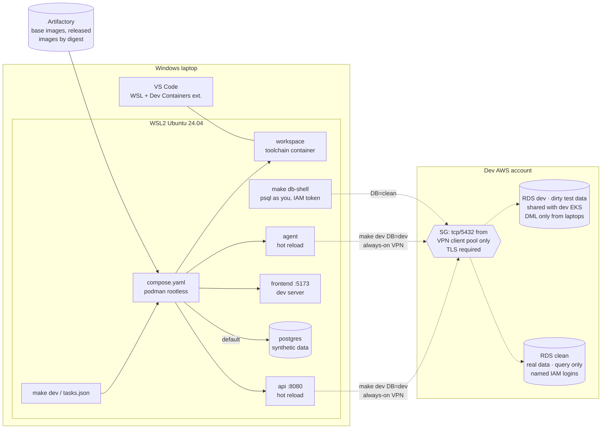

# Proposal: local development workflow

**Status:** Proposed, for review  ·  **Date:** 2026-10-10  ·  **ADR:** [ADR-0003](../adr/0003-local-development-workflow.md)

How a developer on a Windows laptop builds and runs the `api`, `agent` and
`frontend` containers locally in VS Code. It runs against generated synthetic
data by default, and against the shared **dev** Postgres on RDS, with its
"dirty" test data, when the developer needs it. This covers the inner loop only. The release path (PROPOSAL.md §3)
doesn't change.

Requirements cited as `[DEV-xx]` are **proposed** in
[02-requirements.md](../02-requirements.md#dev-local-development-proposed). None
of the existing requirements cover laptops, so per AGENTS.md rule 1 they're
argued here rather than assumed.

---

## 1. The answer in one page

**One definition, three front doors.** None of the three options you asked
about is enough by itself, but each does one job well:

| Layer | File | Job | Who uses it |
|---|---|---|---|
| **Runtime definition** | `compose.yaml` | The only place that says which containers run, how they're built (`target: dev`), and how they're wired | Everything below |
| **Front door 1: `make`** | `Makefile` | The single, editor-neutral entry point: `make dev`, `make db-shell`, `make test`. CI calls the same targets. | Terminal users, CI, docs |
| **Front door 2: Dev Container** | `.devcontainer/devcontainer.json` | A pinned toolchain (language runtimes, `aws`, `psql`, `helm`, linters) with no local installs. It's built on the same `compose.yaml`. | VS Code users (the default) |
| **Front door 3: VS Code tasks** | `.vscode/tasks.json`, `launch.json` | Buttons and debugger attach. Each task is a **one-line call to a `make` target**, with no logic of its own. | VS Code users |

The recommended setup on each laptop:

- **WSL2** running Ubuntu 24.04, with systemd enabled.
- **Podman, rootless, installed inside that WSL distro.** No Docker Desktop.
- **VS Code on Windows**, using the WSL and Dev Containers extensions.
- **The repo cloned inside the WSL filesystem** (`~/src/...`), never under `/mnt/c`.

`make dev` with no configuration runs against a **local Postgres populated by a
seed script with generated synthetic data**, configured by `./.env.local`.
`make dev DB=dev` connects the
stack to the **shared dev RDS with the dirty test data**. The script fetches
the URL and password with your AWS login and passes them into the containers'
environment, with no config file. Either way, every start prints which database is in use.
The clean database holds real data. Laptops can only query it, read-only,
through each person's own login, and it's never copied off RDS. Local code may
run migrations only against the local Postgres.



---

## 2. Options considered

### 2.1 Options

| # | Option | Summary |
|---|---|---|
| A | **Makefile + compose only** | `make dev` runs `podman compose up`. Toolchain (Node, Python, etc.) installed by each dev in WSL. |
| B | **Dev Container only** | `.devcontainer/` owns everything. To start, run *Reopen in Container*. No CLI path outside VS Code (the `devcontainer` CLI exists but nobody uses it). |
| C | **VS Code tasks only** | `tasks.json` holds the `podman run ...` commands |
| D | **Local Kubernetes** | kind/k3d + Tilt or Skaffold, running the real Helm chart on the laptop |
| E | **Hybrid** *(recommended)* | `compose.yaml` is the single definition. `make` is the canonical entry point. The Dev Container is built from the same compose file. Tasks are one-line wrappers around `make`. |
| F | **Hosted dev environments** | Coder or Gitpod self-hosted in AWS. GitHub Codespaces isn't available on GHES *(verify)*. |

### 2.2 Scoring

Local development has nothing to do with IP budget or zero downtime, so the
default weights in `05-proposal-brief.md` don't fit this decision. These
weights are proposed for it; humans may adjust. Scale is 1–5, and the total is
Σ score × weight.

| Criterion | Weight | Why it matters here |
|---|---|---|
| Parity with CI and the release image | 20 | "Works on my machine" bugs; same Dockerfile stages |
| Windows/WSL friction | 20 | Every dev is on Windows; filesystem, UID and proxy issues kill adoption |
| Editor-neutral, reusable by CI | 15 | One definition, not one per tool. Matches AGENTS.md rule 4 in spirit. |
| Onboarding time | 15 | Target: clone to running stack in < 1 hour [DEV-05] |
| Toolchain reproducibility | 15 | Pinned versions, not "whatever is on your laptop" |
| Maintenance cost | 10 | Files and moving parts someone has to own |
| Licence cost | 5 | Docker Desktop is paid at our size |

| Option | Parity (20) | WSL friction (20) | Editor-neutral (15) | Onboarding (15) | Reproducible (15) | Maintenance (10) | Licence (5) | **Total /500** |
|---|---|---|---|---|---|---|---|---|
| **E. Hybrid** *(recommended)* | 4 | 3 | 5 | 5 | 5 | 3 | 5 | **420** |
| F. Hosted dev envs | 4 | 5 | 3 | 5 | 5 | 1 | 1 | **390** |
| A. Makefile + compose | 4 | 4 | 5 | 3 | 2 | 4 | 5 | **375** |
| B. Dev Container only | 4 | 3 | 2 | 4 | 5 | 3 | 5 | **360** |
| D. Local Kubernetes | 5 | 2 | 4 | 2 | 4 | 2 | 5 | **335** |
| C. VS Code tasks only | 3 | 4 | 1 | 2 | 1 | 3 | 5 | **255** |

**Sensitivity check.** If WSL friction is weighted 30 and reproducibility 5,
the totals become E 400, A 395, F 390. E still wins, but only narrowly over A.
A is what E falls back to for anyone who won't use the Dev Container, and E is
built to allow that, since `make dev` works without it.

### 2.3 Why the losers lose

- **C (tasks only)**: tasks can't run in CI or from a terminal, and they lock
  the workflow into one editor. Tasks are kept as a UI over `make`, nothing more.
- **B (Dev Container only)**: reproducible, but the workflow then lives in
  JSON that only VS Code reads. CI can't reuse it, and anyone using a terminal
  or another editor is left out.
- **D (local Kubernetes)**: the highest parity, but it adds a cluster on every
  laptop, slower edit-to-run cycles and more RAM. Chart parity is already
  proven in CI by the kind conformance suite (PROPOSAL.md §2.4). Laptops don't
  need to prove it again. A `make kind-smoke` target **may** be added later for
  chart authors, but it's not the inner loop.
- **F (hosted)**: it removes the Windows friction, but it's a new platform to
  run, secure and pay for. An internal developer platform is an explicit
  non-goal (`01-context-and-problem.md`). It's the right fallback only if
  WSL turns out to be unworkable in practice (see §8, R2).

---

## 3. The laptop: Windows + WSL2 + Podman

| Choice | Decision | Reason |
|---|---|---|
| Linux environment | **WSL2, Ubuntu 24.04 LTS**, `systemd=true` in `/etc/wsl.conf` | Matches CI runners. systemd is needed for the rootless Podman socket (`systemctl --user enable --now podman.socket`). |
| Container engine | **Podman, rootless, in the dev's own WSL distro** (from apt) | Free. No root daemon. Docker Desktop needs a paid subscription for organisations over 250 staff or US$10M revenue *(verify against our size)*. |
| Compose | **`docker-compose` v2 standalone binary** pointed at the Podman socket (`DOCKER_HOST=unix:///run/user/$UID/podman/podman.sock`). `podman compose` calls the same provider. | The v2 compose spec is the most widely supported. `podman-compose` (Python) lags on spec features. *(verify on the Podman version we pin)* |
| Podman Desktop | Optional, for those who want a GUI | Not required. It creates its own WSL machine, which is a second engine to reason about. |
| Source location | **Inside the WSL filesystem** (`~/src/<repo>`) | Bind mounts from `/mnt/c` are slow, and file watchers (hot reload) don't get inotify events across the 9P boundary. |
| Line endings | `.gitattributes`: `* text=auto eol=lf` | Avoids CRLF-broken shell scripts and Dockerfiles from Windows-side git |
| Resources | `.wslconfig` documented: e.g. `memory=8GB`, `processors=4` | WSL2 otherwise grows to take half of RAM by default |
| WSL networking with the corporate VPN | `.wslconfig` `networkingMode=mirrored` if VPN routes or DNS don't reach WSL in default NAT mode *(verify on our Windows build)* | Laptops reach the dev VPC over the corporate route (Q21). Some VPN clients don't pass that route into WSL2's NAT network, so slice 1 must test it. |
| Corporate CA / proxy | None (Q24) | Laptops reach Artifactory (EC2, tooling account) over the VPN. The `dev` image stage only adds the public **RDS CA bundle**, for `sslmode=verify-full`. |

**Rootless UID mapping.** Bind-mounted source must stay owned by the developer,
not by a subuid. Use `userns_mode: keep-id` in compose for source-mounting
services, and `"runArgs": ["--userns=keep-id"]` with `updateRemoteUserUID` in
the Dev Container. Community guides agree on keep-id but differ on the exact
`containerUser`/`remoteUser` combination, so **slice 1 (§9) must settle it on a
real laptop** and record the working combination.

---

## 4. Repo layout (application repo)

Shown here for review only. Nothing is built until ADR-0003 is accepted.

```
app/
├── compose.yaml                  # the single runtime definition
├── compose.db-local.yaml         # adds ephemeral postgres; used only when DB=local
├── Makefile                      # canonical entry point; `make help` lists targets
├── .env.example                  # non-secret defaults; copy to .env (gitignored)
├── .env.local.example            # local-DB settings; copied to .env.local (gitignored) on first `make dev`
├── .gitattributes                # eol=lf
├── .devcontainer/
│   ├── devcontainer.json         # dockerComposeFile: ../compose.yaml; service: workspace
│   └── Dockerfile                # workspace toolchain, base pinned by digest
├── .vscode/
│   ├── extensions.json           # recommended: WSL, Dev Containers, language exts
│   ├── tasks.json                # each task = `make <target>`
│   └── launch.json               # attach debugger to api/agent (debug ports in compose)
├── services/
│   ├── api/Dockerfile            # stages: base → dev (hot reload) → runtime (released)
│   ├── agent/Dockerfile
│   └── frontend/Dockerfile
└── scripts/dev/
    ├── bootstrap-wsl.sh          # one-time: podman, compose, systemd, aws cli, RDS CA bundle
    ├── up.sh                     # what `make dev` runs: SSO check → fetch DB password → compose up (§5.2.1)
    └── seed/                     # generator script: synthetic data for DB=local (no data files)
```

**The same Dockerfiles as the release [DEV-02].** Each service Dockerfile has a
`dev` stage, which is the `runtime` stage plus a hot-reload runner and debugger.
CI builds `runtime`, and compose builds `dev`. There's one file per service,
so the runtime base image and system packages can't drift between laptop and
release.

**Running services you aren't working on.** The other services run from
**released images, by digest**, pulled from Artifactory:

```
make dev                         # api + agent + frontend from source
make dev SRC="api"               # api from source; agent + frontend from the last release
```

The `.env` digests are written by `make pin-release VERSION=1.14.0`, which reads
them out of the released chart. Local stacks use the same immutable references
as every environment (AGENTS.md rule 7) [DEV-02].

### Make targets

| Target | Does | Notes |
|---|---|---|
| `make bootstrap` | One-time WSL setup (`scripts/dev/bootstrap-wsl.sh`). Idempotent. | Checks repo isn't under `/mnt/c`, and that systemd and the Podman socket are running |
| `make dev` | Creates `.env.local` from `.env.local.example` if missing, starts local Postgres with it, runs migrations and the seed generator, then `compose up --build` | Prints a banner with the DB target |
| `make dev DB=dev` | `scripts/dev/up.sh`: checks your AWS login, fetches URL + password from Secrets Manager, starts `api`/`agent` with them in their environment (§5.2.1) | Needs the DevDatabaseAccess permission set. Nothing written to disk. |
| `make db-shell` | `psql` against whichever DB the stack uses: local, or dev as **you** (IAM auth token) | Attributable, short-lived |
| `make db-shell DB=clean` | `psql` as **you** (IAM auth token), read-only, against clean | The only laptop path to clean. Query only (§5.4). |
| `make down` / `make clean` | Stop / remove containers and volumes | `clean` also deletes the local DB volume |
| `make test`, `make lint` | The same commands CI runs, in the workspace container | Same versions as CI |
| `make pin-release VERSION=x` | Write released image digests into `.env` | Used with `SRC=` |
| `make help` | Lists targets | The default target |

VS Code `tasks.json` exposes `dev`, `dev: dirty data (RDS)`, `down`, `test`, `db-shell`, `db-shell: clean`.
Each one is `"command": "make <target>"`.

### Dev Container shape

```jsonc
// .devcontainer/devcontainer.json (illustrative, not final)
{
  "name": "app",
  "dockerComposeFile": ["../compose.yaml"],
  "service": "workspace",
  "runServices": ["workspace"],           // app services start via `make dev`, not on open
  "workspaceFolder": "/workspace",
  "remoteUser": "dev",
  "updateRemoteUserUID": true,
  "customizations": { "vscode": { "extensions": [ /* pinned list */ ] } }
}
```

Opening the folder in VS Code gives you the toolchain. **Starting the stack is
still `make dev`**, from the integrated terminal or a task. There's one way to
run the stack, whether or not you use the Dev Container.

### VS Code with Podman

VS Code's Dev Containers extension calls `docker` by default. Two settings point
it at Podman instead. They go in the developer's VS Code **user settings for
the WSL remote**, not in the repo, so nobody else's engine choice is forced:

```jsonc
// VS Code settings (Remote [WSL: Ubuntu-24.04])
{
  "dev.containers.dockerPath": "podman",
  "dev.containers.dockerComposePath": "docker-compose"   // v2 binary, talking to the Podman socket
}
```

In the repo, `devcontainer.json` carries the rootless-Podman UID fix, so files
created in the container stay owned by the developer:

```jsonc
  "runArgs": ["--userns=keep-id"],   // for compose-based configs: `userns_mode: keep-id` on the workspace service
  "containerUser": "dev",
  "updateRemoteUserUID": true
```

Day to day:

1. Open the repo folder in WSL (`code .` from the WSL terminal, or *WSL: Open
   Folder*).
2. Run *Dev Containers: Reopen in Container*. VS Code builds the `workspace`
   service from `compose.yaml` with Podman and attaches to it.
3. Run `make dev` from the integrated terminal, or *Tasks: Run Task → dev*.
4. Run `make down` when finished.

Podman is a community-supported engine for Dev Containers, not the default
*(verify current status)*. That's why slice 1 (§9) proves this exact setup on
one managed laptop first. If it doesn't hold up, the fallback is: no Dev
Container, the toolchain installed in WSL, and the same `compose.yaml` and
`make dev`. Nothing else changes.

---

## 5. Databases: local synthetic by default, dev RDS on request, clean query-only

### 5.1 The three targets

| `DB=` | Where | Laptop access | Can run DDL? | Default? | Use for |
|---|---|---|---|---|---|
| **`local`** | Podman container on the laptop, populated by the seed generator, discarded on `make down` | Owner | **Yes** | **Yes** (`make dev`) | Everyday feature work, migrations, destructive experiments, working offline |
| `dev` | RDS, dev account. **The "dirty" test data**: messy, realistic data for testing against. **Shared with the dev EKS environment** (Q25). | Only with `make dev DB=dev`. App containers: `app_dev_local`, DML only. People: own IAM login, DML only. | **No** | No | Testing against messy, realistic data; integration with what's deployed in the dev environment |
| `clean` | RDS, dev account. **Real data** (Q22). | **People only**, each with their own IAM login mapped to `clean_reader` (SELECT only). No app containers, no shared credential. | No | No | Querying real data to understand a bug or check an assumption |

### 5.2 Choosing the target: `make dev` or `make dev DB=dev` [DEV-03]

For now, generated synthetic data on the laptop is the default. Connecting to
the dirty data on dev RDS is one explicit flag. **For RDS no config file is
involved: the script fetches the URL and password at start and passes them
straight into the containers' environment.** Nothing about the RDS connection
is written to disk. `./.env.local` configures only the local database.

1. **`make dev`: local data, configured by `./.env.local`.** Starts the local
   Postgres and populates it with the seed generator (§5.3). It needs no AWS
   access, so a new starter is productive before their database access is
   granted. `.env.local` holds only throwaway local settings, and is created
   from the committed `.env.local.example` on first run:

   ```sh
   # .env.local: local database only; gitignored; safe to edit or delete
   PGHOST=postgres
   PGPORT=5432
   PGDATABASE=app
   PGUSER=app
   PGPASSWORD=local          # the throwaway container's password, not a real credential
   PGSSLMODE=disable
   SEED=42                   # seed generator: deterministic data
   ROWS=small                # seed generator: small | large
   ```

   It never holds an RDS URL or password.
2. **`make dev DB=dev`: the dirty data on dev RDS.** Runs `scripts/dev/up.sh`
   (§5.2.1). The script logs in to AWS if needed, fetches the connection
   secret, and starts `api` and `agent` with it in their environment.
3. **Every start shows the target.** `make dev` prints
   `DB: local (generated, SEED=42)` or
   `DB: dev (dirty test data, shared with dev EKS, <endpoint>)`, and the
   frontend shows a matching corner badge. Nobody is unsure which database
   they're on.
4. **The frontend never gets DB settings.** Only `api` and `agent` receive
   them, and no variable uses a client-exposed prefix (e.g. `VITE_`), so DB
   settings can't end up in a browser bundle.
5. **Clean isn't a place to run the app.** The stack can't target it at all.
   Clean can only be queried by a named person, read-only.
6. **Dev isn't reset to synthetic data.** Its dirty data is the reason to
   connect to it, so this proposal doesn't add a reset job. Laptop roles have
   no DDL rights, so a branch can't break dev's schema (§5.3). They can change
   rows, though. If shared edits start making the dirty data unreliable, the
   fix is a snapshot of dev to restore from, not overwriting it with synthetic
   data.

**Later:** to make dev the default, change `DB ?= local` to `DB ?= dev` in the
Makefile. Nothing else changes.

#### 5.2.1 What `make dev DB=dev` does

One script in the repo, `scripts/dev/up.sh`. It uses the developer's AWS login
to fetch the URL and password from Secrets Manager, exports them **in its own
process only**, and starts the containers. Compose passes them into the
containers' environment. About 20 lines of shell:

```sh
# scripts/dev/up.sh (sketch, not final)
set -euo pipefail
SECRET_ID="dev/app_dev_local"                          # a name, not a secret; same for everyone

aws sts get-caller-identity >/dev/null 2>&1 \
  || aws sso login --profile "${AWS_PROFILE:-dev}"     # browser once; cached for the SSO session

secret=$(aws secretsmanager get-secret-value --secret-id "$SECRET_ID" \
           --query SecretString --output text)         # JSON: host, port, dbname, username, password
export PGHOST=$(jq -r .host <<<"$secret")     PGPORT=$(jq -r .port <<<"$secret")
export PGDATABASE=$(jq -r .dbname <<<"$secret") PGUSER=$(jq -r .username <<<"$secret")
export PGPASSWORD=$(jq -r .password <<<"$secret")
export PGSSLMODE=verify-full PGSSLROOTCERT=/etc/ssl/rds/global-bundle.pem
unset secret

echo "DB: dev (dirty test data) ${PGUSER}@${PGHOST}:${PGPORT}/${PGDATABASE}"
exec podman compose up --build                         # compose passes PG* to api + agent
```

```yaml
# compose.yaml (excerpt). `make dev` runs `compose --env-file .env.local`.
# `up.sh` doesn't pass .env.local, and exported shell variables win anyway.
services:
  api:
    environment:
      PGHOST: ${PGHOST}
      PGPASSWORD: ${PGPASSWORD}
      # ... PGPORT, PGDATABASE, PGUSER, PGSSLMODE, PGSSLROOTCERT the same way
```

| Step | Why this way |
|---|---|
| URL and password both come from one Secrets Manager secret | Nothing to hand out or keep in sync. Moving the instance or rotating the password needs no change on any laptop. |
| `aws sso login` only if the session has expired | One browser login per working day, not per start |
| Exported in the script's process, not written to a file | Nothing on disk to commit, copy or leave behind. It's gone when the stack stops. |
| Local settings in `./.env.local`, RDS settings from the script's environment | Plain `make dev` needs no AWS at all. Compose gives exported shell variables precedence over `--env-file` values, so RDS mode can't accidentally pick up local settings *(verify on the compose version we pin)*. |
| Same env-var shape as the K8s Secret in clusters | The app code path is identical (PROPOSAL.md §2.2) |
| Same script from a terminal, a VS Code task or the Dev Container | One way to start the stack [DEV-01] |

**One thing to know:** environment variables are visible to the same Linux user,
via `podman inspect` and `/proc`. On a single-user laptop that's the same
exposure as any running process's memory. It's acceptable for a DML-only dev
role, but not a reason to put a more powerful credential there.

**Podman or Docker?** The compose file and script work with either engine
(`podman compose` / `docker compose`). The proposal uses Podman to avoid the
Docker Desktop licence (§3), so "docker containers" here just means OCI
containers.

### 5.3 Why laptops must not run migrations against shared dev [DEV-04]

Dev is shared by every developer **and** the dev EKS environment. One branch's
unmerged migration would break everyone else, and the dev deploy pipeline would
later fail on a schema it didn't create. So:

- **DDL rights aren't granted to any laptop role.** That's enforced by
  Postgres grants, not by a rule people have to remember.
- **Migrations reach dev only through the pipeline**: the expand-only migration
  Job in PROPOSAL.md §3.3, run when `main` deploys to dev.
- **Branch code still works on dev's schema.** Expand/contract [ZDT-05] already
  requires release N to run on schema N-1 and N+1. The same rule means branch
  code runs against `main`'s schema. A local stack that breaks on dev's schema
  is an early warning of a migration that would break zero-downtime rollback.
- **Local DB seed: a generator script, not stored data.**
  `scripts/dev/seed/` runs after migrations and inserts synthetic rows through
  the current schema. That means:
  - no data files in the repo to review, store, or drift from the schema;
  - the generator is versioned with the migrations, so the seed always matches
    the branch's schema;
  - nothing from clean or dev is ever copied (Q22).

  Keep it **deterministic**: a fixed random seed (`SEED=42` by default), so a
  bug seen on one laptop reproduces on another. Keep it **sized by a
  parameter** (`ROWS=small|large`), so most runs take seconds but load-ish
  testing is still possible. Make it **deliberately messy where it matters**:
  nulls, unicode, boundary values, duplicates the app must tolerate. Then local
  work catches some of what the dirty data would. The generator runs only
  against `local`: `make seed` refuses unless `DB=local`.

### 5.4 Credentials and clean-data controls [DEV-06, DEV-08]

| Who | Target | How | Stored |
|---|---|---|---|
| People (`psql`, GUI client) | dev, clean | **RDS IAM database authentication**: `aws sso login`, then `make db-shell` generates a token (valid 15 min for *connecting*; the session outlives it). One Postgres login per person, granted `rds_iam`. | Nowhere: generated per connection |
| Local app containers (`api`, `agent`) | dev only, with `make dev DB=dev` | `app_dev_local` URL + password from **Secrets Manager**, fetched by `scripts/dev/up.sh` using your SSO session; rotated | **Not stored.** Held in the script's process and passed to the containers' environment, the same shape as the K8s Secret in clusters |

**Clean is query-only, not copy.** Postgres can't technically stop someone who
can `SELECT` from saving the result. So the controls are about making that
deliberate, attributable and visible, not impossible:

| Control | How |
|---|---|
| Attributable | **IAM authentication only** on clean: no password logins, no shared role. Every session is a named person. |
| Least privilege | `clean_reader`: `SELECT` on application schemas only. No `CREATE`, no `TEMP`, no `pg_read_server_files`. |
| Audited | **`pgaudit`** with `pgaudit.log = 'read'` for `clean_reader`, plus `log_connections`, shipped to CloudWatch Logs with retention set by the data owner *(verify pgaudit settings on our RDS Postgres version)*. |
| Bounded | `statement_timeout` (e.g. 60 s) and `idle_in_transaction_session_timeout` on the role. That stops accidental full-table pulls and long-held snapshots. |
| No bulk paths | No `make` target or script dumps clean. The onboarding doc states the rule: **query, don't copy**. Results go nowhere outside the client session. |
| Who | Access to clean is a **separate SSO permission set** ("CleanDataReader") from dev access, so it can be granted to fewer people and reviewed. |

- **Why not IAM auth for the app containers too?** A pooled app needs a token
  refresh hook when it reconnects after 15 minutes. If the app doesn't already
  support that, a static role password delivered the way the cluster delivers
  it (a Secret → env/file, PROPOSAL.md §2.2) keeps the app's code path
  identical everywhere. That's acceptable for dev because **dev holds no PII**
  (Q28). If that changes, dev needs the same per-person, audited access as
  clean: an IAM-authenticated login per developer, with token refresh in the
  app or a per-person secret that `up.sh` fetches instead.
- **Dev holds samples of actual data, so don't copy it either.** No PII doesn't
  mean nothing sensitive: real samples can still be commercially or customer
  confidential. The rule for dev is the same as for clean, *use it in place,
  don't copy it*, with lighter enforcement:
  - no `make` target or script dumps dev;
  - the seed generator never reads from dev or clean;
  - nothing from dev goes into Git, test fixtures, bug reports or screenshots
    shared outside the team.

  If you want this audited too, enable `pgaudit` on dev as on clean. That's
  cheap, but optional at this sensitivity. If the app gains IAM auth for prod (SEC-05), switch local over too.
- **No RDS credentials in Git, images or files on the laptop** [SEC-02].
  They're fetched at start and held only in process environments. `.env` (image
  digests) and `.env.local` (local DB only) are gitignored, and secret scanning runs in CI.
- **Permission sets:** "DevDatabaseAccess" allows `rds-db:connect` to your dev
  user and `secretsmanager:GetSecretValue` on the one laptop secret.
  "CleanDataReader" allows `rds-db:connect` to your clean user only. Neither
  allows anything else in the dev account.

### 5.5 Network path: yes, open 5432, but only this narrowly (Q21)

The VPN is always on and routes to the dev VPC, so a tunnel adds nothing. Open
the port, scoped like this:

| Control | Setting | Why |
|---|---|---|
| Source | **The VPN client address pool** (one or a few CIDRs, from the network team at build time) in a managed prefix list in IaC. Not the whole corporate network. | With an always-on VPN every laptop is in that pool, so it's a one-line lookup, not a design question. It keeps the DB port off on-prem servers and datacentre subnets. Per-user addresses don't matter: identity comes from the DB login (§5.4). |
| Destination | **One security group per RDS instance** (dev, clean), each with only the `tcp/5432` rule from that list. Separate from the rule that lets dev EKS pods in. | Laptop access can be removed or narrowed without touching the app's path. Clean can use a tighter list later if needed. |
| Port | `5432` only. No other ingress. | |
| Exposure | `publicly_accessible = false`, private subnets only | Reachable from the corporate route, never from the internet |
| Transport | `rds.force_ssl = 1`; clients use `sslmode=verify-full` with the RDS CA bundle | Credentials and query results are encrypted on the corporate network too |
| Authentication | Grants and IAM auth as in §5.4 | Reaching the port isn't access. Clean accepts IAM logins only. |
| DNS | Use the RDS endpoint name. For a non-public instance it resolves to the private IP *(verify from a laptop on the VPN)*. | No hosts-file hacks. Failover keeps working. |

**Rejected:**
- **SSM port forwarding:** not needed with an always-on VPN. It would cost a
  host and an IP.
- **Opening 5432 to the whole private range:** every corporate server and any
  compromised host could reach the DB port. Scoping to the VPN pool costs
  nothing.
- **Public RDS:** the DB would be on the internet.

---

## 6. IP impact (dev account)

AGENTS.md rule 3 requires an IP count. Laptops consume no VPC IPs. In the dev
account:

| Line | IPs | Notes |
|---|---|---|
| RDS dev (single-AZ) | 1 | Multi-AZ would add a standby ENI |
| RDS clean (single-AZ) | 1 | |
| Laptop access (direct route, §5.5) | 0 | SG rules and a prefix list use no IPs |

The dev RDS is already counted in the main budget (PROPOSAL.md §3.6). Clean
adds 1, so the dev account's minimal peak is ~35. That's still ≤ 50 [NET-01].

---

## 7. Traceability (proposed DEV requirements)

| Req | Satisfied by | Verified by |
|---|---|---|
| DEV-01 One documented entry point | `make dev`; tasks and Dev Container call it | New-starter exercise: README only |
| DEV-02 Same Dockerfiles; non-edited services by digest | `dev` stage of each service Dockerfile; `make pin-release` | CI builds `dev` and `runtime` from the same file; lint rejects `:latest` in compose |
| DEV-03 Local synthetic by default (configured by `.env.local`); shared dev RDS only with `make dev DB=dev`; target always shown | `DB ?= local` in Makefile; `.env.local`; `up.sh`; banner | `make dev` uses local; `make dev DB=dev` uses dev; banner matches both times; no RDS URL or password in any file on the laptop |
| DEV-04 No laptop DDL on shared DBs | Postgres grants on `app_dev_local`, personal dev logins, `clean_reader` | Test: `CREATE TABLE` as each laptop role fails on dev and clean |
| DEV-05 Clone to running stack < 1 h on Windows | `make bootstrap`, Dev Container | Timed onboarding of a new team member |
| DEV-06 No long-lived DB creds on laptops for humans; none in Git | IAM DB auth; Secrets Manager fetch; `.gitignore` | IAM review; secret scanning |
| DEV-07 No paid container-desktop licence required | Podman rootless | Onboarding doc lists no paid tool |
| DEV-08 Clean data is query-only from laptops: named, read-only, audited, never copied | IAM-only logins, `clean_reader`, pgaudit, no dump tooling, generated local data (§5.3–5.4) | Password login to clean fails; a `SELECT` appears in the audit log under a person's name; repo contains no dump of clean |

---

## 8. Risks and assumptions

| # | Assumption | If wrong | Q |
|---|---|---|---|
| R1 | The always-on VPN route also reaches *inside WSL2* and rootless containers | `networkingMode=mirrored`; failing that, the VPN vendor's WSL guidance | Q21 |
| R2 | WSL2 + rootless Podman + Dev Containers works on our managed Windows build (endpoint security, Hyper-V policy) | Slice 1 will show it. Fallback: option A for toolchain, then option F if WSL itself is blocked. | Q23 |
| R3 | The app reads DB settings from env/file (hosting contract §2.2), so local and cluster delivery are identical | Small app change, needed for portability anyway | Q7 |
| R4 | Branch code tolerates `main`'s schema (expand/contract) | That's a ZDT-05 violation, which the local stack exposes early. That's a feature. | — |
| R5 | Laptop writes to the dirty test data, which the dev EKS environment also uses, don't disrupt dev-environment testing | If laptop edits make that data unreliable, take a snapshot of dev to restore from, or give laptops their own copy on the same instance. | Q25 |
| R6 | The application owner approves named, audited, read-only laptop access to real data in clean | If not, clean is queried only from a host inside the VPC, never directly from laptops | Q22 |
| R7 | Dev stays free of PII (it holds samples of actual data) | If PII ever lands there, laptop access to dev moves from the shared `app_dev_local` role to per-person, audited logins (as clean), and the app containers must use them | Q28 |

Unverified items, which slice 1 must check against current docs and cite:
- Dev Containers' current Podman support statement.
- Docker Desktop licence terms against our headcount and revenue.
- GHES has no Codespaces.
- `docker-compose` v2 against the Podman socket on the Podman version we pin.
- WSL2 `networkingMode=mirrored` with our VPN client.
- RDS endpoint DNS resolving to the private IP from a laptop.
- `pgaudit` read logging on our RDS Postgres version.

---

## 9. Delivery plan

| # | Slice | Proves | Size |
|---|---|---|---|
| 1 | On **one real managed Windows laptop**: WSL2 + Podman + compose + Dev Container for `api` only, with `DB=local`. Settle the keep-id/user combination. **Prove the VPN route reaches RDS from inside a rootless container in WSL.** | R1, R2, DEV-07 | 2–3 days |
| 2 | Dev account: two RDS instances, VPN-pool prefix list + SGs, `force_ssl`, roles and grants, IAM-only clean with pgaudit, two SSO permission sets, one Secrets Manager secret. In IaC. | DEV-04, DEV-06, DEV-08, §5.5 | 3–4 days |
| 3 | `make dev` for api + agent + frontend: local synthetic by default, dev RDS via `make dev DB=dev` (`up.sh`); `pin-release`/`SRC=`; tasks.json, launch.json; banner | DEV-01/02/03 | 3–4 days |
| 4 | Seed generator (deterministic, sized, deliberately messy), `make seed`, refusal unless `DB=local` | §5.3, DEV-03 | 2–3 days |
| 5 | Timed onboarding with a new team member; fix what they hit | DEV-05 | 1 day |

About **2–3 weeks** for one engineer. It can run in parallel with PROPOSAL.md
§6 slices 1–2, since it only needs the dev account.
