# Proposal: local development workflow

**Status:** Proposed, for review  ·  **Date:** 2026-10-10  ·  **ADR:** [ADR-0003](../adr/0003-local-development-workflow.md)

How a developer on a Windows laptop builds and runs the `api`, `agent` and
`frontend` containers locally in VS Code, against the shared **dev** Postgres
on RDS. This covers the inner loop only. The release path (PROPOSAL.md §3)
doesn't change.

Requirements cited as `[DEV-xx]` are **proposed** in
[02-requirements.md](../02-requirements.md#dev-local-development-proposed). None
of the existing requirements cover laptops, so per AGENTS.md rule 1 they're
argued here rather than assumed.

---

## 1. The answer in one page

**One definition, three front doors.** None of the three options you asked
about is enough by itself, but each does one job well:

| Layer | File | Job | Who uses it |
|---|---|---|---|
| **Runtime definition** | `compose.yaml` | The only place that says which containers run, how they're built (`target: dev`), and how they're wired | Everything below |
| **Front door 1: `make`** | `Makefile` | The single, editor-neutral entry point: `make dev`, `make db-tunnel`, `make test`. CI calls the same targets. | Terminal users, CI, docs |
| **Front door 2: Dev Container** | `.devcontainer/devcontainer.json` | A pinned toolchain (language runtimes, `aws`, `psql`, `helm`, linters) with no local installs. It's built on the same `compose.yaml`. | VS Code users (the default) |
| **Front door 3: VS Code tasks** | `.vscode/tasks.json`, `launch.json` | Buttons and debugger attach. Each task is a **one-line call to a `make` target**, with no logic of its own. | VS Code users |

The recommended setup on each laptop:

- **WSL2** running Ubuntu 24.04, with systemd enabled.
- **Podman, rootless, installed inside that WSL distro.** No Docker Desktop.
- **VS Code on Windows**, using the WSL and Dev Containers extensions.
- **The repo cloned inside the WSL filesystem** (`~/src/...`), never under `/mnt/c`.

Developers are pushed toward the dev database because it's the zero-config
default (`make dev` ⇒ `DB=dev`). The clean database is read-only to laptops.
The only target where local code may run migrations is a throwaway local
Postgres.

```mermaid
flowchart LR
  subgraph win[Windows laptop]
    vsc[VS Code<br/>WSL + Dev Containers ext.]
    subgraph wsl[WSL2 Ubuntu 24.04]
      make[make dev / tasks.json] --> compose[compose.yaml<br/>podman rootless]
      compose --> ws[workspace<br/>toolchain container]
      compose --> api[api :8080<br/>hot reload]
      compose --> agent[agent<br/>hot reload]
      compose --> fe[frontend :5173<br/>dev server]
      compose -. DB=local .-> pg[(postgres<br/>ephemeral)]
      tun[make db-tunnel<br/>SSM port-forward]
    end
    vsc --- ws
  end
  subgraph aws[Dev AWS account]
    dev[(RDS dev<br/>shared · read/write DML)]
    clean[(RDS clean<br/>golden · read-only)]
  end
  api & agent -->|DB=dev default| tun --> dev
  api & agent -. DB=clean .-> tun -.-> clean
  art[(Artifactory<br/>base images, released<br/>images by digest)] --> compose
```



---

## 2. Options considered

### 2.1 Options

| # | Option | Summary |
|---|---|---|
| A | **Makefile + compose only** | `make dev` runs `podman compose up`. Toolchain (Node, Python, etc.) installed by each dev in WSL. |
| B | **Dev Container only** | `.devcontainer/` owns everything. To start, run *Reopen in Container*. No CLI path outside VS Code (the `devcontainer` CLI exists but nobody uses it). |
| C | **VS Code tasks only** | `tasks.json` holds the `podman run ...` commands |
| D | **Local Kubernetes** | kind/k3d + Tilt or Skaffold, running the real Helm chart on the laptop |
| E | **Hybrid** *(recommended)* | `compose.yaml` is the single definition. `make` is the canonical entry point. The Dev Container is built from the same compose file. Tasks are one-line wrappers around `make`. |
| F | **Hosted dev environments** | Coder or Gitpod self-hosted in AWS. GitHub Codespaces isn't available on GHES *(verify)*. |

### 2.2 Scoring

Local development has nothing to do with IP budget or zero downtime, so the
default weights in `05-proposal-brief.md` don't fit this decision. These
weights are proposed for it; humans may adjust. Scale is 1–5, and the total is
Σ score × weight.

| Criterion | Weight | Why it matters here |
|---|---|---|
| Parity with CI and the release image | 20 | "Works on my machine" bugs; same Dockerfile stages |
| Windows/WSL friction | 20 | Every dev is on Windows; filesystem, UID and proxy issues kill adoption |
| Editor-neutral, reusable by CI | 15 | One definition, not one per tool. Matches AGENTS.md rule 4 in spirit. |
| Onboarding time | 15 | Target: clone to running stack in < 1 hour [DEV-05] |
| Toolchain reproducibility | 15 | Pinned versions, not "whatever is on your laptop" |
| Maintenance cost | 10 | Files and moving parts someone has to own |
| Licence cost | 5 | Docker Desktop is paid at our size |

| Option | Parity (20) | WSL friction (20) | Editor-neutral (15) | Onboarding (15) | Reproducible (15) | Maintenance (10) | Licence (5) | **Total /500** |
|---|---|---|---|---|---|---|---|---|
| **E. Hybrid** *(recommended)* | 4 | 3 | 5 | 5 | 5 | 3 | 5 | **420** |
| F. Hosted dev envs | 4 | 5 | 3 | 5 | 5 | 1 | 1 | **390** |
| A. Makefile + compose | 4 | 4 | 5 | 3 | 2 | 4 | 5 | **375** |
| B. Dev Container only | 4 | 3 | 2 | 4 | 5 | 3 | 5 | **360** |
| D. Local Kubernetes | 5 | 2 | 4 | 2 | 4 | 2 | 5 | **335** |
| C. VS Code tasks only | 3 | 4 | 1 | 2 | 1 | 3 | 5 | **255** |

**Sensitivity check.** If WSL friction is weighted 30 and reproducibility 5,
the totals become E 400, A 395, F 390. E still wins, but only narrowly over A.
A is what E falls back to for anyone who won't use the Dev Container, and E is
built to allow that, since `make dev` works without it.

### 2.3 Why the losers lose

- **C (tasks only)**: tasks can't run in CI or from a terminal, and they lock
  the workflow into one editor. Tasks are kept as a UI over `make`, nothing more.
- **B (Dev Container only)**: reproducible, but the workflow then lives in
  JSON that only VS Code reads. CI can't reuse it, and anyone using a terminal
  or another editor is left out.
- **D (local Kubernetes)**: the highest parity, but it adds a cluster on every
  laptop, slower edit-to-run cycles and more RAM. Chart parity is already
  proven in CI by the kind conformance suite (PROPOSAL.md §2.4). Laptops don't
  need to prove it again. A `make kind-smoke` target **may** be added later for
  chart authors, but it's not the inner loop.
- **F (hosted)**: it removes the Windows friction, but it's a new platform to
  run, secure and pay for. An internal developer platform is an explicit
  non-goal (`01-context-and-problem.md`). It's the right fallback only if
  WSL turns out to be unworkable in practice (see §8, R3).

---

## 3. The laptop: Windows + WSL2 + Podman

| Choice | Decision | Reason |
|---|---|---|
| Linux environment | **WSL2, Ubuntu 24.04 LTS**, `systemd=true` in `/etc/wsl.conf` | Matches CI runners. systemd is needed for the rootless Podman socket (`systemctl --user enable --now podman.socket`). |
| Container engine | **Podman, rootless, in the dev's own WSL distro** (from apt) | Free. No root daemon. Docker Desktop needs a paid subscription for organisations over 250 staff or US$10M revenue *(verify against our size)*. |
| Compose | **`docker-compose` v2 standalone binary** pointed at the Podman socket (`DOCKER_HOST=unix:///run/user/$UID/podman/podman.sock`). `podman compose` calls the same provider. | The v2 compose spec is the most widely supported. `podman-compose` (Python) lags on spec features. *(verify on the Podman version we pin)* |
| Podman Desktop | Optional, for those who want a GUI | Not required. It creates its own WSL machine, which is a second engine to reason about. |
| Source location | **Inside the WSL filesystem** (`~/src/<repo>`) | Bind mounts from `/mnt/c` are slow, and file watchers (hot reload) don't get inotify events across the 9P boundary. |
| Line endings | `.gitattributes`: `* text=auto eol=lf` | Avoids CRLF-broken shell scripts and Dockerfiles from Windows-side git |
| Resources | `.wslconfig` documented: e.g. `memory=8GB`, `processors=4` | WSL2 otherwise grows to take half of RAM by default |
| Corporate CA / proxy | The onboarding script installs the internal CA into WSL **and** bakes it into the `dev` image stage | Artifactory is on-prem with (probably) an internal CA. This is the most common day-one failure. Q24. |

**Rootless UID mapping.** Bind-mounted source must stay owned by the developer,
not by a subuid. Use `userns_mode: keep-id` in compose for source-mounting
services, and `"runArgs": ["--userns=keep-id"]` with `updateRemoteUserUID` in
the Dev Container. Community guides agree on keep-id but differ on the exact
`containerUser`/`remoteUser` combination, so **slice 1 (§9) must settle it on a
real laptop** and record the working combination.

---

## 4. Repo layout (application repo)

Shown here for review only. Nothing is built until ADR-0003 is accepted.

```
app/
├── compose.yaml                  # the single runtime definition
├── compose.db-local.yaml         # adds ephemeral postgres; used only when DB=local
├── Makefile                      # canonical entry point; `make help` lists targets
├── .env.example                  # non-secret defaults; copy to .env (gitignored)
├── .gitattributes                # eol=lf
├── .devcontainer/
│   ├── devcontainer.json         # dockerComposeFile: ../compose.yaml; service: workspace
│   └── Dockerfile                # workspace toolchain, base pinned by digest
├── .vscode/
│   ├── extensions.json           # recommended: WSL, Dev Containers, language exts
│   ├── tasks.json                # each task = `make <target>`
│   └── launch.json               # attach debugger to api/agent (debug ports in compose)
├── services/
│   ├── api/Dockerfile            # stages: base → dev (hot reload) → runtime (released)
│   ├── agent/Dockerfile
│   └── frontend/Dockerfile
└── scripts/dev/
    ├── bootstrap-wsl.sh          # one-time: podman, compose, CA, systemd, aws cli, ssm plugin
    └── db-creds.sh               # fetch dev DB secret → .dev/secrets (tmpfs-like, 0600)
```

**The same Dockerfiles as the release [DEV-02].** Each service Dockerfile has a
`dev` stage, which is the `runtime` stage plus a hot-reload runner and debugger.
CI builds `runtime`, and compose builds `dev`. There's one file per service,
so the runtime base image and system packages can't drift between laptop and
release.

**Running services you aren't working on.** The other services run from
**released images, by digest**, pulled from Artifactory:

```
make dev                         # api + agent + frontend from source
make dev SRC="api"               # api from source; agent + frontend from the last release
```

The `.env` digests are written by `make pin-release VERSION=1.14.0`, which reads
them out of the released chart. Local stacks use the same immutable references
as every environment (AGENTS.md rule 7) [DEV-02].

### Make targets

| Target | Does | Notes |
|---|---|---|
| `make bootstrap` | One-time WSL setup (`scripts/dev/bootstrap-wsl.sh`). Idempotent. | Checks repo isn't under `/mnt/c`, and that systemd and the Podman socket are running |
| `make dev` | `db-creds` → `db-tunnel` (background) → `compose up --build` | `DB=dev` by default; prints a banner with the DB target |
| `make dev DB=clean` | Same, read-only credentials for the clean DB | For reproducing a bug against known data |
| `make dev DB=local` | Starts ephemeral Postgres, seeds it, **runs migrations** | The only target where local code runs DDL |
| `make db-tunnel` | SSM port-forward to the chosen RDS on `localhost:15432` | Not needed if the corporate network routes to the VPC (Q21) |
| `make db-shell` | `psql` as **you** (IAM auth token), against the current `DB` | Attributable, short-lived |
| `make down` / `make clean` | Stop / remove containers and volumes | `clean` also deletes `.dev/` |
| `make test`, `make lint` | The same commands CI runs, in the workspace container | Same versions as CI |
| `make pin-release VERSION=x` | Write released image digests into `.env` | Used with `SRC=` |
| `make help` | Lists targets | The default target |

VS Code `tasks.json` exposes `dev`, `dev: local db`, `down`, `test`, `db-shell`.
Each one is `"command": "make <target>"`.

### Dev Container shape

```jsonc
// .devcontainer/devcontainer.json (illustrative, not final)
{
  "name": "app",
  "dockerComposeFile": ["../compose.yaml"],
  "service": "workspace",
  "runServices": ["workspace"],           // app services start via `make dev`, not on open
  "workspaceFolder": "/workspace",
  "remoteUser": "dev",
  "updateRemoteUserUID": true,
  "customizations": { "vscode": { "extensions": [ /* pinned list */ ] } }
}
```

Opening the folder in VS Code gives you the toolchain. **Starting the stack is
still `make dev`**, from the integrated terminal or a task. There's one way to
run the stack, whether or not you use the Dev Container.

VS Code Dev Containers with Podman works when `dev.containers.dockerPath` is set
to `podman` (or `docker` is a shim to the Podman socket), but the official docs
treat Podman as a secondary engine *(verify)*. If slice 1 hits blocking issues,
the fallback is option A for the toolchain plus the same `compose.yaml`. Nothing
else changes.

---

## 5. Databases: dev by default, clean read-only, local for schema work

### 5.1 The three targets

| `DB=` | Where | Laptop role | Can run DDL? | Default? | Use for |
|---|---|---|---|---|---|
| **`dev`** | RDS, dev account; also used by the dev EKS environment | `app_dev_local`: DML only (SELECT/INSERT/UPDATE/DELETE) | **No** | **Yes** | Everyday feature work against realistic, shared data |
| `clean` | RDS, dev account | `readonly`: SELECT only | No | No | Reproducing a bug against known, stable data; diffing what dev has drifted to |
| `local` | Podman container on the laptop, discarded on `make down` | Owner | **Yes** | No | Writing and testing migrations; destructive experiments; working offline |

*Assumption:* "clean data DB" means a **golden reference dataset** whose schema
tracks the latest release. It's refreshed only by a controlled job, and is used
to reset dev. If it's actually something else (for example, a prod extract with
real customer data), §5.3 changes: see Q22.

### 5.2 How developers are pushed toward dev [DEV-03]

1. **It's the default.** `make dev` with no arguments uses dev. Nothing to
   configure apart from `aws sso login`.
2. **Clean is useless for writing.** Laptop credentials for clean are
   SELECT-only, so no one "temporarily" points at it to get unstuck and then
   corrupts it.
3. **Every start shows the target.** `make dev` prints
   `DB: dev (shared, rds-dev.xxxx:5432 via tunnel)` and the frontend shows a
   corner badge in dev mode. Nobody is unsure which database they're on.
4. **The migration path goes through local, by design.** Schema changes need
   `DB=local`, so dev is never the place to try a migration.
5. **Dev is kept useful.** A scheduled job **resets dev from clean** (e.g.
   weekly, or on demand via a GHES workflow), then re-applies pending
   migrations from `main`. A shared DB that slowly fills with junk drives
   people away from it. A predictable reset keeps them on it.

### 5.3 Why laptops must not run migrations against shared dev [DEV-04]

Dev is shared by every developer **and** the dev EKS environment. One branch's
unmerged migration would break everyone else, and the dev deploy pipeline would
later fail on a schema it didn't create. So:

- **DDL rights aren't granted to the laptop role.** That's enforced by
  Postgres grants, not by a rule people have to remember.
- **Migrations reach dev only through the pipeline**: the expand-only migration
  Job in PROPOSAL.md §3.3, run when `main` deploys to dev.
- **Branch code still works on dev's schema.** Expand/contract [ZDT-05] already
  requires release N to run on schema N-1 and N+1. The same rule means branch
  code runs against `main`'s schema. A local stack that breaks on dev's schema
  is an early warning of a migration that would break zero-downtime rollback.
- **Local DB seed:** from a **synthetic fixture set** checked into the repo, or
  from a `pg_dump` of clean **only if** clean holds no customer/personal data
  (Q22). Seeding is `make dev DB=local`, and takes a few seconds for a fixture
  set.

### 5.4 Credentials [DEV-06]

| Who | How | Lifetime | Stored |
|---|---|---|---|
| Developer (human, `psql`, GUI) | **RDS IAM database authentication**: `aws sso login`, then a token from `aws rds generate-db-auth-token`. Each dev has a Postgres login mapped to the `rds_iam` role. | Token valid 15 min for *connecting*; the session lasts beyond it | Nowhere: generated per connection |
| Local app containers (`api`, `agent`) | `app_dev_local` (or `readonly` for clean) password from **Secrets Manager**, fetched by `make db-creds` using your SSO session | Rotated (e.g. 30 days) | `.dev/secrets/db.env`, mode 0600, gitignored, injected as env/file exactly as the K8s Secret is in clusters |

- **Why not IAM auth for the app containers too?** A pooled app needs a token
  refresh hook when it reconnects after 15 minutes. If the app doesn't already
  support that, a static role password delivered the way the cluster delivers
  it (a Secret → env/file, PROPOSAL.md §2.2) keeps the app's code path
  identical everywhere. If the app gains IAM auth for prod (SEC-05), switch
  local over too.
- **No credentials in Git or images** [SEC-02]. `.dev/` and `.env` are
  gitignored, and secret scanning runs in CI.
- Access is granted via an **SSO permission set** "DevDatabaseAccess". It
  allows `rds-db:connect` to the dev users, `secretsmanager:GetSecretValue` on
  the two laptop secrets, and SSM port forwarding to the tunnel host. Nothing
  else in the dev account.

### 5.5 Network path from laptop to RDS

RDS stays private. Not publicly accessible. Ever.

| Option | Extra IPs (dev account) | Cost | Verdict |
|---|---|---|---|
| **Existing corporate route** (VPN / Direct Connect / TGW from on-prem to the dev VPC) | 0 | 0 | **Use if it exists** (Q21) |
| **SSM Session Manager port forwarding** (`AWS-StartPortForwardingSessionToRemoteHost`) via one small EC2 instance with no inbound rules | 1 (+ SSM VPC endpoints if the subnet has no NAT; endpoints aren't budgeted, per Q14) | ~a few US$/month (t4g.nano) | **Recommended otherwise.** IAM-controlled, CloudTrail-logged, no open ports. Needs the Session Manager plugin in WSL. |
| AWS Client VPN | 1 ENI per associated subnet | Hourly per association + per connection | Heavier than needed for one DB port |
| Public RDS + IP allow-list | 0 | 0 | **Rejected.** Exposes the DB to the internet. |

---

## 6. IP impact (dev account)

AGENTS.md rule 3 requires an IP count. Laptops consume no VPC IPs. The dev
account gains:

| Line | IPs | Notes |
|---|---|---|
| RDS dev (single-AZ) | 1 | Multi-AZ would add a standby ENI |
| RDS clean (single-AZ) | 1 | |
| SSM tunnel host (only if no corporate route) | 1 | |
| **Total added** | **2–3** | Dev minimal peak goes from ~33 (PROPOSAL.md §3.6) to ~36. Still ≤ 50 [NET-01]. |

**Gap found:** PROPOSAL.md §3.6 doesn't count **RDS ENIs** in any environment.
That should be fixed in the main budget (+1 per single-AZ instance, +2 for
Multi-AZ). It doesn't change the verdict for any profile.

---

## 7. Traceability (proposed DEV requirements)

| Req | Satisfied by | Verified by |
|---|---|---|
| DEV-01 One documented entry point | `make dev`; tasks and Dev Container call it | New-starter exercise: README only |
| DEV-02 Same Dockerfiles; non-edited services by digest | `dev` stage of each service Dockerfile; `make pin-release` | CI builds `dev` and `runtime` from the same file; lint rejects `:latest` in compose |
| DEV-03 Dev DB is the default | `DB ?= dev` in Makefile; banner | `make dev` with an empty `.env` connects to dev |
| DEV-04 No laptop DDL on shared DBs | Postgres grants on `app_dev_local` and `readonly` | Test: `CREATE TABLE` as the laptop role fails on dev and clean |
| DEV-05 Clone to running stack < 1 h on Windows | `make bootstrap`, Dev Container | Timed onboarding of a new team member |
| DEV-06 No long-lived DB creds on laptops for humans; none in Git | IAM DB auth; Secrets Manager fetch; `.gitignore` | IAM review; secret scanning |
| DEV-07 No paid container-desktop licence required | Podman rootless | Onboarding doc lists no paid tool |

---

## 8. Risks and assumptions

| # | Assumption | If wrong | Q |
|---|---|---|---|
| R1 | Laptops can reach the dev VPC (corp route), or SSM port forwarding is allowed | Use Client VPN, or a hosted dev env (option F) | Q21 |
| R2 | Clean holds no customer/personal data | Seed local from synthetic fixtures only. Clean stays reachable read-only through the tunnel, never dumped to laptops. | Q22 |
| R3 | WSL2 + rootless Podman + Dev Containers works on our managed Windows build (endpoint security, proxy, Hyper-V policy) | Slice 1 will show it. Fallback: option A for toolchain, then option F if WSL itself is blocked. | Q23 |
| R4 | Internal CA / proxy can be trusted inside WSL and containers | Artifactory pulls fail on day one. The bootstrap script must handle it. | Q24 |
| R5 | The app reads DB settings from env/file (hosting contract §2.2), so local and cluster delivery are identical | Small app change, needed for portability anyway | Q7 |
| R6 | Branch code tolerates `main`'s schema (expand/contract) | That's a ZDT-05 violation, which the local stack exposes early. That's a feature. | — |
| R7 | Dev being shared with the dev EKS environment is acceptable | Give laptops their own `dev_shared` database on the same instance, reset from clean on the same schedule | Q25 |

Unverified items, which slice 1 must check against current docs and cite:
- Dev Containers' current Podman support statement.
- Docker Desktop licence terms against our headcount and revenue.
- GHES has no Codespaces.
- `docker-compose` v2 against the Podman socket on the Podman version we pin.

---

## 9. Delivery plan

| # | Slice | Proves | Size |
|---|---|---|---|
| 1 | On **one real managed Windows laptop**: WSL2 + Podman + compose + Dev Container for `api` only, with `DB=local`. Settle the keep-id/user combination and the CA install. | R3, R4, DEV-07 | 2–3 days |
| 2 | Dev account: two RDS instances, roles and grants, the SSO permission set, Secrets Manager secrets, and (if Q21 says so) the SSM tunnel host. In IaC. | DEV-04, DEV-06, §5.5 | 2–3 days |
| 3 | `make dev` for api + agent + frontend against dev; `pin-release`/`SRC=`; tasks.json, launch.json; banner | DEV-01/02/03 | 3–4 days |
| 4 | Scheduled dev reset from clean + migrations from `main` (GHES workflow → CodeBuild in VPC, same pattern as deploys) | §5.2 point 5 | 2 days |
| 5 | Timed onboarding with a new team member; fix what they hit | DEV-05 | 1 day |

About **2–3 weeks** for one engineer. It can run in parallel with PROPOSAL.md
§7 slices 1–2, since it only needs the dev account.
