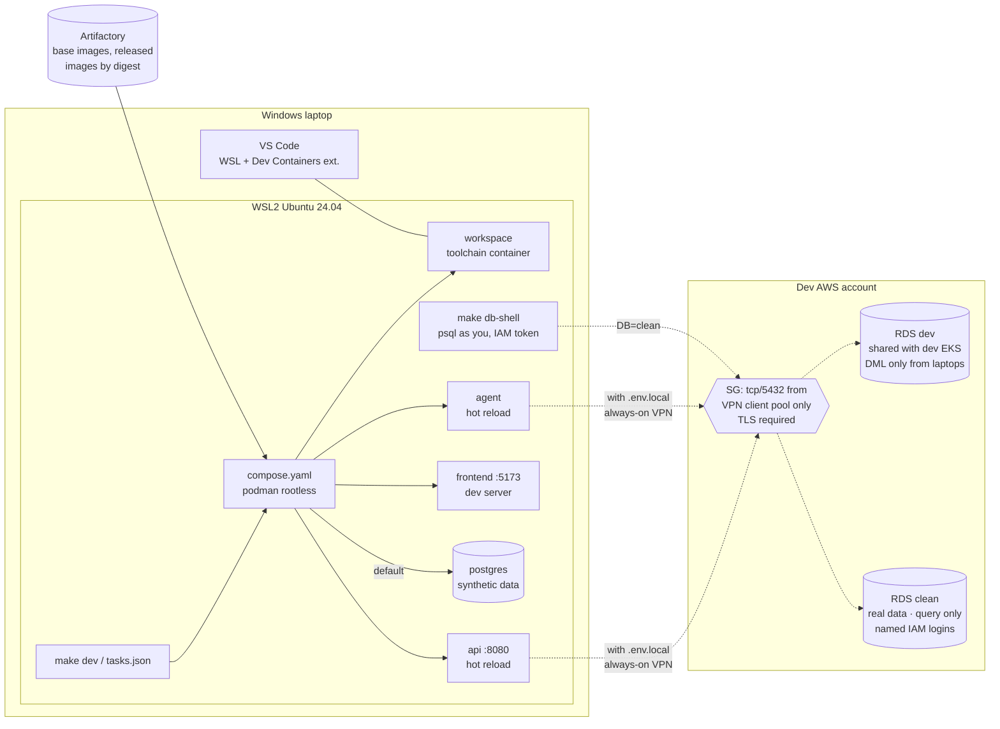

# Proposal: local development workflow

**Status:** Proposed, for review (rev 3)  ·  **Date:** 2026-10-10  ·  **ADR:** [ADR-0003](../adr/0003-local-development-workflow.md)

> **Rev 2 incorporates answers to Q21–Q25.** Laptops already route to the dev
> VPC, so they connect **directly on 5432, through a narrowly scoped security
> group rule** (§5.5), and the SSM tunnel is dropped. **Clean holds real
> data:** laptops may *query* it, as named people only, and never copy it
> (§5.1, §5.4). So dev is **no longer reset from clean** (Q26). No corporate
> CA or proxy is needed. Dev is shared with the dev EKS environment.
>
> **Rev 3:** **synthetic data locally is the default for now.** A developer
> connects to the shared dev RDS only when they need it, by adding a
> **`./.env.local`** file (§5.2). The VPN is **always on**, so the SG source is
> simply the VPN client pool, and the SSM fallback is gone (§5.5).

How a developer on a Windows laptop builds and runs the `api`, `agent` and
`frontend` containers locally in VS Code. It runs against synthetic data by
default, and against the shared **dev** Postgres on RDS when the developer
needs it. This covers the inner loop only. The release path (PROPOSAL.md §3)
doesn't change.

Requirements cited as `[DEV-xx]` are **proposed** in
[02-requirements.md](../02-requirements.md#dev-local-development-proposed). None
of the existing requirements cover laptops, so per AGENTS.md rule 1 they're
argued here rather than assumed.

---

## 1. The answer in one page

**One definition, three front doors.** None of the three options you asked
about is enough by itself, but each does one job well:

| Layer | File | Job | Who uses it |
|---|---|---|---|
| **Runtime definition** | `compose.yaml` | The only place that says which containers run, how they're built (`target: dev`), and how they're wired | Everything below |
| **Front door 1: `make`** | `Makefile` | The single, editor-neutral entry point: `make dev`, `make db-shell`, `make test`. CI calls the same targets. | Terminal users, CI, docs |
| **Front door 2: Dev Container** | `.devcontainer/devcontainer.json` | A pinned toolchain (language runtimes, `aws`, `psql`, `helm`, linters) with no local installs. It's built on the same `compose.yaml`. | VS Code users (the default) |
| **Front door 3: VS Code tasks** | `.vscode/tasks.json`, `launch.json` | Buttons and debugger attach. Each task is a **one-line call to a `make` target**, with no logic of its own. | VS Code users |

The recommended setup on each laptop:

- **WSL2** running Ubuntu 24.04, with systemd enabled.
- **Podman, rootless, installed inside that WSL distro.** No Docker Desktop.
- **VS Code on Windows**, using the WSL and Dev Containers extensions.
- **The repo cloned inside the WSL filesystem** (`~/src/...`), never under `/mnt/c`.

`make dev` with no configuration runs against a **local Postgres seeded with
synthetic data**. Adding a `./.env.local` file switches the stack to the
**shared dev RDS**. Either way, every start prints which database is in use.
The clean database holds real data. Laptops can only query it, read-only,
through each person's own login, and it's never copied off RDS. Local code may
run migrations only against the local Postgres.



---

## 2. Options considered

### 2.1 Options

| # | Option | Summary |
|---|---|---|
| A | **Makefile + compose only** | `make dev` runs `podman compose up`. Toolchain (Node, Python, etc.) installed by each dev in WSL. |
| B | **Dev Container only** | `.devcontainer/` owns everything. To start, run *Reopen in Container*. No CLI path outside VS Code (the `devcontainer` CLI exists but nobody uses it). |
| C | **VS Code tasks only** | `tasks.json` holds the `podman run ...` commands |
| D | **Local Kubernetes** | kind/k3d + Tilt or Skaffold, running the real Helm chart on the laptop |
| E | **Hybrid** *(recommended)* | `compose.yaml` is the single definition. `make` is the canonical entry point. The Dev Container is built from the same compose file. Tasks are one-line wrappers around `make`. |
| F | **Hosted dev environments** | Coder or Gitpod self-hosted in AWS. GitHub Codespaces isn't available on GHES *(verify)*. |

### 2.2 Scoring

Local development has nothing to do with IP budget or zero downtime, so the
default weights in `05-proposal-brief.md` don't fit this decision. These
weights are proposed for it; humans may adjust. Scale is 1–5, and the total is
Σ score × weight.

| Criterion | Weight | Why it matters here |
|---|---|---|
| Parity with CI and the release image | 20 | "Works on my machine" bugs; same Dockerfile stages |
| Windows/WSL friction | 20 | Every dev is on Windows; filesystem, UID and proxy issues kill adoption |
| Editor-neutral, reusable by CI | 15 | One definition, not one per tool. Matches AGENTS.md rule 4 in spirit. |
| Onboarding time | 15 | Target: clone to running stack in < 1 hour [DEV-05] |
| Toolchain reproducibility | 15 | Pinned versions, not "whatever is on your laptop" |
| Maintenance cost | 10 | Files and moving parts someone has to own |
| Licence cost | 5 | Docker Desktop is paid at our size |

| Option | Parity (20) | WSL friction (20) | Editor-neutral (15) | Onboarding (15) | Reproducible (15) | Maintenance (10) | Licence (5) | **Total /500** |
|---|---|---|---|---|---|---|---|---|
| **E. Hybrid** *(recommended)* | 4 | 3 | 5 | 5 | 5 | 3 | 5 | **420** |
| F. Hosted dev envs | 4 | 5 | 3 | 5 | 5 | 1 | 1 | **390** |
| A. Makefile + compose | 4 | 4 | 5 | 3 | 2 | 4 | 5 | **375** |
| B. Dev Container only | 4 | 3 | 2 | 4 | 5 | 3 | 5 | **360** |
| D. Local Kubernetes | 5 | 2 | 4 | 2 | 4 | 2 | 5 | **335** |
| C. VS Code tasks only | 3 | 4 | 1 | 2 | 1 | 3 | 5 | **255** |

**Sensitivity check.** If WSL friction is weighted 30 and reproducibility 5,
the totals become E 400, A 395, F 390. E still wins, but only narrowly over A.
A is what E falls back to for anyone who won't use the Dev Container, and E is
built to allow that, since `make dev` works without it.

### 2.3 Why the losers lose

- **C (tasks only)**: tasks can't run in CI or from a terminal, and they lock
  the workflow into one editor. Tasks are kept as a UI over `make`, nothing more.
- **B (Dev Container only)**: reproducible, but the workflow then lives in
  JSON that only VS Code reads. CI can't reuse it, and anyone using a terminal
  or another editor is left out.
- **D (local Kubernetes)**: the highest parity, but it adds a cluster on every
  laptop, slower edit-to-run cycles and more RAM. Chart parity is already
  proven in CI by the kind conformance suite (PROPOSAL.md §2.4). Laptops don't
  need to prove it again. A `make kind-smoke` target **may** be added later for
  chart authors, but it's not the inner loop.
- **F (hosted)**: it removes the Windows friction, but it's a new platform to
  run, secure and pay for. An internal developer platform is an explicit
  non-goal (`01-context-and-problem.md`). It's the right fallback only if
  WSL turns out to be unworkable in practice (see §8, R3).

---

## 3. The laptop: Windows + WSL2 + Podman

| Choice | Decision | Reason |
|---|---|---|
| Linux environment | **WSL2, Ubuntu 24.04 LTS**, `systemd=true` in `/etc/wsl.conf` | Matches CI runners. systemd is needed for the rootless Podman socket (`systemctl --user enable --now podman.socket`). |
| Container engine | **Podman, rootless, in the dev's own WSL distro** (from apt) | Free. No root daemon. Docker Desktop needs a paid subscription for organisations over 250 staff or US$10M revenue *(verify against our size)*. |
| Compose | **`docker-compose` v2 standalone binary** pointed at the Podman socket (`DOCKER_HOST=unix:///run/user/$UID/podman/podman.sock`). `podman compose` calls the same provider. | The v2 compose spec is the most widely supported. `podman-compose` (Python) lags on spec features. *(verify on the Podman version we pin)* |
| Podman Desktop | Optional, for those who want a GUI | Not required. It creates its own WSL machine, which is a second engine to reason about. |
| Source location | **Inside the WSL filesystem** (`~/src/<repo>`) | Bind mounts from `/mnt/c` are slow, and file watchers (hot reload) don't get inotify events across the 9P boundary. |
| Line endings | `.gitattributes`: `* text=auto eol=lf` | Avoids CRLF-broken shell scripts and Dockerfiles from Windows-side git |
| Resources | `.wslconfig` documented: e.g. `memory=8GB`, `processors=4` | WSL2 otherwise grows to take half of RAM by default |
| WSL networking with the corporate VPN | `.wslconfig` `networkingMode=mirrored` if VPN routes or DNS don't reach WSL in default NAT mode *(verify on our Windows build)* | Laptops reach the dev VPC over the corporate route (Q21). Some VPN clients don't pass that route into WSL2's NAT network, so slice 1 must test it. |
| Corporate CA / proxy | **Not needed** (Q24) | Laptops reach Artifactory directly. The `dev` image stage only adds the public **RDS CA bundle**, for `sslmode=verify-full`. |

**Rootless UID mapping.** Bind-mounted source must stay owned by the developer,
not by a subuid. Use `userns_mode: keep-id` in compose for source-mounting
services, and `"runArgs": ["--userns=keep-id"]` with `updateRemoteUserUID` in
the Dev Container. Community guides agree on keep-id but differ on the exact
`containerUser`/`remoteUser` combination, so **slice 1 (§9) must settle it on a
real laptop** and record the working combination.

---

## 4. Repo layout (application repo)

Shown here for review only. Nothing is built until ADR-0003 is accepted.

```
app/
├── compose.yaml                  # the single runtime definition
├── compose.db-local.yaml         # adds ephemeral postgres; used only when DB=local
├── Makefile                      # canonical entry point; `make help` lists targets
├── .env.example                  # non-secret defaults; copy to .env (gitignored)
├── .env.local.example            # shape of .env.local (shared dev RDS); the real file is gitignored
├── .gitattributes                # eol=lf
├── .devcontainer/
│   ├── devcontainer.json         # dockerComposeFile: ../compose.yaml; service: workspace
│   └── Dockerfile                # workspace toolchain, base pinned by digest
├── .vscode/
│   ├── extensions.json           # recommended: WSL, Dev Containers, language exts
│   ├── tasks.json                # each task = `make <target>`
│   └── launch.json               # attach debugger to api/agent (debug ports in compose)
├── services/
│   ├── api/Dockerfile            # stages: base → dev (hot reload) → runtime (released)
│   ├── agent/Dockerfile
│   └── frontend/Dockerfile
└── scripts/dev/
    ├── bootstrap-wsl.sh          # one-time: podman, compose, systemd, aws cli, RDS CA bundle
    ├── db-creds.sh               # fetch dev DB secret → .dev/secrets (0600)
    └── fixtures/                 # synthetic seed data for DB=local and the dev reset
```

**The same Dockerfiles as the release [DEV-02].** Each service Dockerfile has a
`dev` stage, which is the `runtime` stage plus a hot-reload runner and debugger.
CI builds `runtime`, and compose builds `dev`. There's one file per service,
so the runtime base image and system packages can't drift between laptop and
release.

**Running services you aren't working on.** The other services run from
**released images, by digest**, pulled from Artifactory:

```
make dev                         # api + agent + frontend from source
make dev SRC="api"               # api from source; agent + frontend from the last release
```

The `.env` digests are written by `make pin-release VERSION=1.14.0`, which reads
them out of the released chart. Local stacks use the same immutable references
as every environment (AGENTS.md rule 7) [DEV-02].

### Make targets

| Target | Does | Notes |
|---|---|---|
| `make bootstrap` | One-time WSL setup (`scripts/dev/bootstrap-wsl.sh`). Idempotent. | Checks repo isn't under `/mnt/c`, and that systemd and the Podman socket are running |
| `make dev` | No `.env.local`: starts local Postgres, seeds it from `fixtures/`, runs migrations, then `compose up --build`. With `.env.local`: `db-creds` → `compose up --build` against dev RDS. | Prints a banner with the DB target |
| `make dev DB=local` | Forces the local database even if `.env.local` exists | Quick switch back without deleting the file |
| `make env-local` | Writes `.env.local` for the shared dev RDS (§5.2) | Needs `aws sso login` and the DevDatabaseAccess permission set |
| `make db-shell` | `psql` against whichever DB the stack uses: local, or dev as **you** (IAM auth token) | Attributable, short-lived |
| `make db-shell DB=clean` | `psql` as **you** (IAM auth token), read-only, against clean | The only laptop path to clean. Query only (§5.4). |
| `make down` / `make clean` | Stop / remove containers and volumes | `clean` also deletes `.dev/` |
| `make test`, `make lint` | The same commands CI runs, in the workspace container | Same versions as CI |
| `make pin-release VERSION=x` | Write released image digests into `.env` | Used with `SRC=` |
| `make help` | Lists targets | The default target |

VS Code `tasks.json` exposes `dev`, `dev: local db`, `env-local`, `down`, `test`, `db-shell`, `db-shell: clean`.
Each one is `"command": "make <target>"`.

### Dev Container shape

```jsonc
// .devcontainer/devcontainer.json (illustrative, not final)
{
  "name": "app",
  "dockerComposeFile": ["../compose.yaml"],
  "service": "workspace",
  "runServices": ["workspace"],           // app services start via `make dev`, not on open
  "workspaceFolder": "/workspace",
  "remoteUser": "dev",
  "updateRemoteUserUID": true,
  "customizations": { "vscode": { "extensions": [ /* pinned list */ ] } }
}
```

Opening the folder in VS Code gives you the toolchain. **Starting the stack is
still `make dev`**, from the integrated terminal or a task. There's one way to
run the stack, whether or not you use the Dev Container.

VS Code Dev Containers with Podman works when `dev.containers.dockerPath` is set
to `podman` (or `docker` is a shim to the Podman socket), but the official docs
treat Podman as a secondary engine *(verify)*. If slice 1 hits blocking issues,
the fallback is option A for the toolchain plus the same `compose.yaml`. Nothing
else changes.

---

## 5. Databases: local synthetic by default, dev via `.env.local`, clean query-only

### 5.1 The three targets

| `DB=` | Where | Laptop access | Can run DDL? | Default? | Use for |
|---|---|---|---|---|---|
| **`local`** | Podman container on the laptop, seeded from the synthetic fixture set, discarded on `make down` | Owner | **Yes** | **Yes** (no `.env.local`) | Everyday feature work, migrations, destructive experiments, working offline |
| `dev` | RDS, dev account. **Shared with the dev EKS environment** (Q25). | Only with `.env.local`. App containers: `app_dev_local`, DML only. People: own IAM login, DML only. | **No** | No | Work that needs the shared data set, or integration with what's deployed in the dev environment |
| `clean` | RDS, dev account. **Real data** (Q22). | **People only**, each with their own IAM login mapped to `clean_reader` (SELECT only). No app containers, no shared credential. | No | No | Querying real data to understand a bug or check an assumption |

### 5.2 Choosing the target: `.env.local` [DEV-03]

For now, synthetic data on the laptop is the default. The shared dev RDS is
opt-in, per developer, by adding one file.

1. **No file, local data.** `make dev` with no `.env.local` starts the local
   Postgres from `fixtures/`. It needs no AWS access, so a new starter is
   productive before their database access is granted.
2. **`.env.local` switches the stack to dev RDS.** compose loads it as an
   optional `env_file` for `api` and `agent` only *(verify `env_file.required:
   false` on the compose version we pin)*. It holds **connection settings, not
   credentials**:

   ```sh
   # .env.local: written by `make env-local`; gitignored; never committed
   DB_TARGET=dev
   PGHOST=<dev-rds-endpoint>        # RDS endpoint name, resolves over the VPN
   PGPORT=5432
   PGDATABASE=app
   PGUSER=app_dev_local
   PGSSLMODE=verify-full
   PGSSLROOTCERT=/etc/ssl/rds/global-bundle.pem
   DB_SECRET_ID=dev/app_dev_local   # make fetches the password at start (§5.4)
   ```

   "We provide the file" means **`make env-local` generates it** from the
   developer's SSO session, rather than someone sending it out. There's no
   password in it, so a copied or leaked file grants nothing on its own. If you
   would rather hand out a file containing a password, make it a **per-person**
   login so it stays attributable and revocable, never a shared one [DEV-06].
3. **Every start shows the target.** `make dev` prints
   `DB: local (synthetic)` or `DB: dev (shared with dev EKS, <endpoint>)`, and
   the frontend shows a matching corner badge. Nobody is unsure which database
   they're on.
4. **The frontend never sees `.env.local`.** Only `api` and `agent` load it,
   and no variable in it uses a client-exposed prefix (e.g. `VITE_`), so DB
   settings can't end up in a browser bundle.
5. **Clean isn't a place to run the app.** The stack can't target it at all.
   Clean can only be queried by a named person, read-only.
6. **Dev is kept useful.** A scheduled job **resets dev from the same synthetic
   fixture set** (e.g. weekly, or on demand via a GHES workflow), then
   re-applies migrations from `main`. **The reset never copies from clean**:
   that would put real data into a writable database every laptop can reach.
   One fixture set feeds both local and dev, so moving between them doesn't
   change the shape of the data.

**Later:** once fixtures and dev access are settled, the default can flip to
dev by having `make bootstrap` run `make env-local`. Nothing else changes.

### 5.3 Why laptops must not run migrations against shared dev [DEV-04]

Dev is shared by every developer **and** the dev EKS environment. One branch's
unmerged migration would break everyone else, and the dev deploy pipeline would
later fail on a schema it didn't create. So:

- **DDL rights aren't granted to any laptop role.** That's enforced by
  Postgres grants, not by a rule people have to remember.
- **Migrations reach dev only through the pipeline**: the expand-only migration
  Job in PROPOSAL.md §3.3, run when `main` deploys to dev.
- **Branch code still works on dev's schema.** Expand/contract [ZDT-05] already
  requires release N to run on schema N-1 and N+1. The same rule means branch
  code runs against `main`'s schema. A local stack that breaks on dev's schema
  is an early warning of a migration that would break zero-downtime rollback.
- **Local DB seed:** from the **synthetic fixture set** checked into the repo,
  never from clean (Q22). Seeding happens on every `make dev` without
  `.env.local` and takes seconds.

### 5.4 Credentials and clean-data controls [DEV-06, DEV-08]

| Who | Target | How | Stored |
|---|---|---|---|
| People (`psql`, GUI client) | dev, clean | **RDS IAM database authentication**: `aws sso login`, then `make db-shell` generates a token (valid 15 min for *connecting*; the session outlives it). One Postgres login per person, granted `rds_iam`. | Nowhere: generated per connection |
| Local app containers (`api`, `agent`) | dev only, when `.env.local` exists | `app_dev_local` password from **Secrets Manager** (`DB_SECRET_ID` in `.env.local`), fetched by `make db-creds` using your SSO session; rotated | `.dev/secrets/db.env`, mode 0600, gitignored, injected as env/file exactly as the K8s Secret is in clusters |

**Clean is query-only, not copy.** Postgres can't technically stop someone who
can `SELECT` from saving the result. So the controls are about making that
deliberate, attributable and visible, not impossible:

| Control | How |
|---|---|
| Attributable | **IAM authentication only** on clean: no password logins, no shared role. Every session is a named person. |
| Least privilege | `clean_reader`: `SELECT` on application schemas only. No `CREATE`, no `TEMP`, no `pg_read_server_files`. |
| Audited | **`pgaudit`** with `pgaudit.log = 'read'` for `clean_reader`, plus `log_connections`, shipped to CloudWatch Logs with retention set by the data owner *(verify pgaudit settings on our RDS Postgres version)*. |
| Bounded | `statement_timeout` (e.g. 60 s) and `idle_in_transaction_session_timeout` on the role. That stops accidental full-table pulls and long-held snapshots. |
| No bulk paths | No `make` target or script dumps clean. The onboarding doc states the rule: **query, don't copy**. Results go nowhere outside the client session. |
| Who | Access to clean is a **separate SSO permission set** ("CleanDataReader") from dev access, so it can be granted to fewer people and reviewed. |

- **Why not IAM auth for the app containers too?** A pooled app needs a token
  refresh hook when it reconnects after 15 minutes. If the app doesn't already
  support that, a static role password delivered the way the cluster delivers
  it (a Secret → env/file, PROPOSAL.md §2.2) keeps the app's code path
  identical everywhere. That's acceptable for dev because dev holds synthetic
  data only. If the app gains IAM auth for prod (SEC-05), switch local over too.
- **No credentials in Git or images** [SEC-02]. `.dev/`, `.env` and
  `.env.local` are gitignored, and secret scanning runs in CI.
- **Permission sets:** "DevDatabaseAccess" allows `rds-db:connect` to your dev
  user and `secretsmanager:GetSecretValue` on the one laptop secret.
  "CleanDataReader" allows `rds-db:connect` to your clean user only. Neither
  allows anything else in the dev account.

### 5.5 Network path: yes, open 5432, but only this narrowly (Q21)

The VPN is always on and routes to the dev VPC, so a tunnel adds nothing. Open
the port, scoped like this:

| Control | Setting | Why |
|---|---|---|
| Source | **The VPN client address pool** (one or a few CIDRs, from the network team at build time) in a managed prefix list in IaC. Not the whole on-prem range. | With an always-on VPN every laptop is in that pool, so it's a one-line lookup, not a design question. It keeps the DB port off on-prem servers and datacentre subnets. Per-user addresses don't matter: identity comes from the DB login (§5.4). |
| Destination | **One security group per RDS instance** (dev, clean), each with only the `tcp/5432` rule from that list. Separate from the rule that lets dev EKS pods in. | Laptop access can be removed or narrowed without touching the app's path. Clean can use a tighter list later if needed. |
| Port | `5432` only. No other ingress. | |
| Exposure | `publicly_accessible = false`, private subnets only | Reachable from the corporate route, never from the internet |
| Transport | `rds.force_ssl = 1`; clients use `sslmode=verify-full` with the RDS CA bundle | Credentials and query results are encrypted on the corporate network too |
| Authentication | Grants and IAM auth as in §5.4 | Reaching the port isn't access. Clean accepts IAM logins only. |
| DNS | Use the RDS endpoint name. For a non-public instance it resolves to the private IP *(verify from a laptop on the VPN)*. | No hosts-file hacks. Failover keeps working. |

**Rejected:**
- **SSM port forwarding:** not needed with an always-on VPN. It would cost a
  host and an IP.
- **Opening 5432 to the whole private range:** every on-prem server and any
  compromised host could reach the DB port. Scoping to the VPN pool costs
  nothing.
- **Public RDS:** the DB would be on the internet.

---

## 6. IP impact (dev account)

AGENTS.md rule 3 requires an IP count. Laptops consume no VPC IPs. The dev
account gains:

| Line | IPs | Notes |
|---|---|---|
| RDS dev (single-AZ) | 1 | Multi-AZ would add a standby ENI |
| RDS clean (single-AZ) | 1 | |
| Laptop access (direct route, §5.5) | 0 | SG rules and a prefix list use no IPs |
| **Total added** | **2** | Dev minimal peak goes from ~33 (PROPOSAL.md §3.6) to ~35. Still ≤ 50 [NET-01]. |

**Gap found:** PROPOSAL.md §3.6 doesn't count **RDS ENIs** in any environment.
That should be fixed in the main budget (+1 per single-AZ instance, +2 for
Multi-AZ). It doesn't change the verdict for any profile.

---

## 7. Traceability (proposed DEV requirements)

| Req | Satisfied by | Verified by |
|---|---|---|
| DEV-01 One documented entry point | `make dev`; tasks and Dev Container call it | New-starter exercise: README only |
| DEV-02 Same Dockerfiles; non-edited services by digest | `dev` stage of each service Dockerfile; `make pin-release` | CI builds `dev` and `runtime` from the same file; lint rejects `:latest` in compose |
| DEV-03 Local synthetic by default; shared dev RDS only with `.env.local`; target always shown | Makefile target selection; banner; `make env-local` | `make dev` with no `.env.local` uses local; with it, dev; banner matches both times |
| DEV-04 No laptop DDL on shared DBs | Postgres grants on `app_dev_local`, personal dev logins, `clean_reader` | Test: `CREATE TABLE` as each laptop role fails on dev and clean |
| DEV-05 Clone to running stack < 1 h on Windows | `make bootstrap`, Dev Container | Timed onboarding of a new team member |
| DEV-06 No long-lived DB creds on laptops for humans; none in Git | IAM DB auth; Secrets Manager fetch; `.gitignore` | IAM review; secret scanning |
| DEV-07 No paid container-desktop licence required | Podman rootless | Onboarding doc lists no paid tool |
| DEV-08 Clean data is query-only from laptops: named, read-only, audited, never copied | IAM-only logins, `clean_reader`, pgaudit, no dump tooling, synthetic seeds (§5.4) | Password login to clean fails; a `SELECT` appears in the audit log under a person's name; repo contains no dump of clean |

---

## 8. Risks and assumptions

| # | Assumption | If wrong | Q |
|---|---|---|---|
| R1 | ~~Laptops can reach the dev VPC~~ **Confirmed** (Q21). VPN is always on. Remaining: the VPN route also reaches *inside WSL2* | `networkingMode=mirrored`; failing that, the VPN vendor's WSL guidance | Q21 |
| R2 | **Resolved: clean holds real data** (Q22). Design changed: query-only, named and audited access; synthetic seeds; dev not reset from clean. | Revisit masked data only if synthetic proves too thin | Q22, Q26 |
| R3 | WSL2 + rootless Podman + Dev Containers works on our managed Windows build (endpoint security, Hyper-V policy). **Believed yes** (Q23). | Slice 1 will show it. Fallback: option A for toolchain, then option F if WSL itself is blocked. | Q23 |
| R4 | **Resolved:** no corporate CA or proxy needed (Q24) | — | Q24 |
| R5 | The app reads DB settings from env/file (hosting contract §2.2), so local and cluster delivery are identical | Small app change, needed for portability anyway | Q7 |
| R6 | Branch code tolerates `main`'s schema (expand/contract) | That's a ZDT-05 violation, which the local stack exposes early. That's a feature. | — |
| R7 | **Believed shared** with dev EKS (Q25). Laptop writes land in the dev environment's data, which is fine for synthetic data. | If laptop activity disrupts dev-env testing, give laptops their own database on the same instance, reset from fixtures on the same schedule. | Q25 |
| R8 | The application owner approves named, audited, read-only laptop access to real data in clean | If not, clean is reachable only from an in-VPC host (e.g. via SSM), never directly from laptops | Q22 |

Unverified items, which slice 1 must check against current docs and cite:
- Dev Containers' current Podman support statement.
- Docker Desktop licence terms against our headcount and revenue.
- GHES has no Codespaces.
- `docker-compose` v2 against the Podman socket on the Podman version we pin.
- WSL2 `networkingMode=mirrored` with our VPN client.
- RDS endpoint DNS resolving to the private IP from a laptop.
- `pgaudit` read logging on our RDS Postgres version.

---

## 9. Delivery plan

| # | Slice | Proves | Size |
|---|---|---|---|
| 1 | On **one real managed Windows laptop**: WSL2 + Podman + compose + Dev Container for `api` only, with `DB=local`. Settle the keep-id/user combination. **Prove the VPN route reaches RDS from inside a rootless container in WSL.** | R1, R3, DEV-07 | 2–3 days |
| 2 | Dev account: two RDS instances, VPN-pool prefix list + SGs, `force_ssl`, roles and grants, IAM-only clean with pgaudit, two SSO permission sets, one Secrets Manager secret. In IaC. | DEV-04, DEV-06, DEV-08, §5.5 | 3–4 days |
| 3 | `make dev` for api + agent + frontend: local synthetic by default, dev RDS via `make env-local`/`.env.local`; `pin-release`/`SRC=`; tasks.json, launch.json; banner | DEV-01/02/03 | 3–4 days |
| 4 | Synthetic fixture set + scheduled dev reset from it, then migrations from `main` (GHES workflow → CodeBuild in VPC, same pattern as deploys) | §5.2 point 5 | 3 days |
| 5 | Timed onboarding with a new team member; fix what they hit | DEV-05 | 1 day |

About **2–3 weeks** for one engineer. It can run in parallel with PROPOSAL.md
§7 slices 1–2, since it only needs the dev account.
