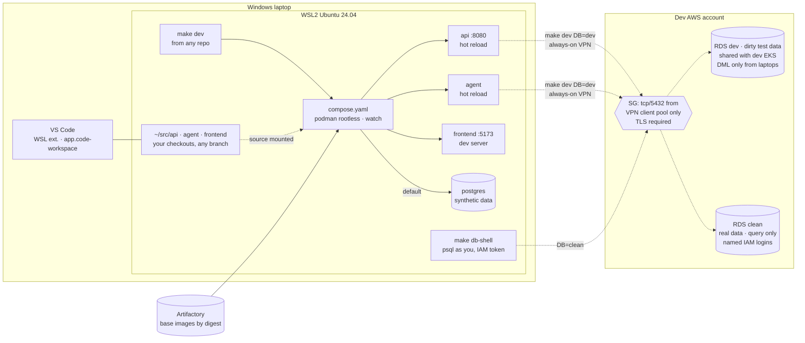

# Proposal: local development workflow

**Status:** Proposed, for review  ·  **Date:** 2026-10-10  ·  **ADR:** [ADR-0003](../adr/0003-local-development-workflow.md)

How a developer on a Windows laptop builds and runs the `api`, `agent` and
`frontend` containers locally in VS Code. It runs against generated synthetic
data by default, and against the shared **dev** Postgres on RDS, with its
"dirty" test data, when the developer needs it. This covers the inner loop only. The release path (PROPOSAL.md §3)
doesn't change.

Requirements cited as `[DEV-xx]` are **proposed** in
[02-requirements.md](../02-requirements.md#dev-local-development-proposed). None
of the existing requirements cover laptops, so per AGENTS.md rule 1 they're
argued here rather than assumed.

---

## 1. The answer in one page

**Your three repos side by side, one command, everything reloads.** The
`api`, `agent` and `frontend` repos stay as they are, separate and worked on
independently. No new repo. The files that run the stack live in the **`api`
repo** (it owns the database schema). They build all three services from your
checkouts:

```
~/src/
├── api/           ← its own repo and branches; also holds the stack files
├── agent/         ← its own repo and branches
└── frontend/      ← its own repo and branches
```

```sh
cd ~/src/api       # or ~/src/agent, or ~/src/frontend: `make dev` works from any of them
make clone         # once: clones agent and frontend next to api
make dev           # all three services, from source, reloading as you edit
```

- **Edit any repo and that service reloads:** code changes through each
  service's own hot reload, dependency or Dockerfile changes through an
  automatic rebuild of that one container (§4.3).
- **Switch branches in any repo** (`git switch`) and the running service picks
  up the files on disk. There's nothing to swap, pin or restart.
- **VS Code:** open `api/app.code-workspace`. You get all three repos
  in one window, each with its own branch, and *Run Task → dev* runs
  `make dev`.

| Layer | Where | Job |
|---|---|---|
| **Runtime definition** | `api/compose.yaml` | Builds each service's `dev` stage from `../<repo>`, mounts its source, adds Postgres |
| **Entry point** | `api/Makefile` (and a 3-line forwarding `Makefile` in `agent` and `frontend`) | `make clone`, `make dev`, `make dev DB=dev`, `make down`, `make db-shell` |
| **Editor** | `api/app.code-workspace` | Multi-root VS Code workspace: the three repos, tasks that call `make`, debugger attach |
| **Each service repo** | `<repo>/Dockerfile` | Its own `dev` stage (hot reload) and `runtime` stage (what CI releases) |

Each laptop has:

- **WSL2** running Ubuntu 24.04, with systemd enabled;
- **rootless Podman** inside that WSL distro (no Docker Desktop);
- **VS Code on Windows** with the WSL extension;
- **the repos cloned inside the WSL filesystem** (`~/src/...`), never under
  `/mnt/c`.

Language runtimes run **inside the containers**, so the laptop doesn't need
them installed to run the stack.

`make dev` runs against a **local Postgres populated by a seed script with
generated synthetic data**, configured by `api/.env.local`.
`make dev DB=dev` connects the stack to the **shared dev RDS with the dirty
test data**. The script fetches the URL and password with your AWS login and
passes them into the containers' environment, with no config file. Either way,
every start prints which database is in use. The clean database holds real
data. Laptops can only query it, read-only, through each person's own login,
and it's never copied off RDS. Local code may run migrations only against the
local Postgres.



---

## 2. Options considered

### 2.1 Options

| # | Option | Summary |
|---|---|---|
| A | **Makefile + compose per service repo** | Each repo runs its own service from source and the others as pinned images. Working on a second service means swapping it in by hand. |
| B | **Dev Container** | `.devcontainer/` owns the toolchain and lifecycle. Run *Reopen in Container* to start. Needs the Dev Containers extension to drive Podman. |
| C | **VS Code tasks only** | `tasks.json` holds the `podman run ...` commands |
| D | **Local Kubernetes** | kind/k3d + Tilt or Skaffold, running the real Helm chart on the laptop |
| E | **Shared stack in one repo** *(recommended)* | One `compose.yaml`, kept in `api`, builds all three services from sibling checkouts with hot reload. `make dev` is the one command, from any of the three repos. A VS Code multi-root workspace and tasks call `make`. |
| F | **Hosted dev environments** | Coder or Gitpod self-hosted in AWS. GitHub Codespaces isn't available on GHES *(verify)*. |

### 2.2 Scoring

Local development has nothing to do with IP budget or zero downtime, so the
default weights in `05-proposal-brief.md` don't fit this decision. These
weights are proposed for it; humans may adjust. Scale is 1–5, and the total is
Σ score × weight.

| Criterion | Weight | Why it matters here |
|---|---|---|
| Parity with CI and the release image | 20 | "Works on my machine" bugs; same Dockerfile stages |
| Windows/WSL friction | 20 | Every dev is on Windows; filesystem, UID and editor-integration issues kill adoption |
| Editor-neutral, reusable by CI | 15 | One definition, not one per tool |
| Onboarding and daily effort | 15 | Clone to running stack in < 1 hour [DEV-05]; nothing to remember day to day |
| Toolchain reproducibility | 15 | Pinned versions, not "whatever is on your laptop" |
| Maintenance cost | 10 | Files and moving parts someone has to own |
| Licence cost | 5 | Docker Desktop is paid at our size |

| Option | Parity (20) | WSL friction (20) | Editor-neutral (15) | Onboarding (15) | Reproducible (15) | Maintenance (10) | Licence (5) | **Total /500** |
|---|---|---|---|---|---|---|---|---|
| **E. Shared stack in one repo** *(recommended)* | 4 | 4 | 5 | 5 | 5 | 3 | 5 | **440** |
| F. Hosted dev envs | 4 | 5 | 3 | 5 | 5 | 1 | 1 | **390** |
| A. Compose per service repo | 4 | 4 | 5 | 2 | 4 | 3 | 5 | **375** |
| B. Dev Container | 4 | 2 | 2 | 4 | 5 | 3 | 5 | **340** |
| D. Local Kubernetes | 5 | 2 | 4 | 2 | 4 | 2 | 5 | **335** |
| C. VS Code tasks only | 3 | 4 | 1 | 2 | 1 | 3 | 5 | **255** |

E's reproducibility comes from the containers themselves: each service's `dev`
stage pins its runtime and dependencies, so the laptop only needs Git, Podman,
`make` and VS Code.

**Sensitivity check.** If WSL friction is weighted 30 and reproducibility 5,
the totals become E 430, F 440, A 395. Hosted environments win only if Windows
friction dominates everything else, which is the fallback condition in §2.3.

### 2.3 Why the others lose

- **A (compose per service repo)**: fine while you stay in one service.
  Touching a second one means swapping it from an image to source by hand, so
  the common cross-service change becomes the awkward one.
- **B (Dev Container)**: VS Code's Dev Containers extension is built around
  Docker. Driving it with rootless Podman under WSL didn't work in practice
  without workarounds, and E gets the same reproducibility from the service
  containers without it.
- **C (tasks only)**: tasks can't run in CI or from a terminal, and they lock
  the workflow into one editor. Tasks are kept as buttons over `make`.
- **D (local Kubernetes)**: the highest parity, but it adds a cluster on every
  laptop, slower edit-to-run cycles and more RAM. Chart parity is already
  proven in CI by the kind conformance suite (PROPOSAL.md §2.4).
- **F (hosted)**: it removes the Windows friction, but it's a new platform to
  run, secure and pay for. An internal developer platform is an explicit
  non-goal (`01-context-and-problem.md`). It's the fallback only if WSL turns
  out to be unworkable in practice (see §8, R2).

---

## 3. The laptop: Windows + WSL2 + Podman

| Choice | Decision | Reason |
|---|---|---|
| Linux environment | **WSL2, Ubuntu 24.04 LTS**, `systemd=true` in `/etc/wsl.conf` | Matches CI runners. systemd is needed for the rootless Podman socket (`systemctl --user enable --now podman.socket`). |
| Container engine | **Podman, rootless, in the dev's own WSL distro** (from apt) | Free. No root daemon. Docker Desktop needs a paid subscription for organisations over 250 staff or US$10M revenue *(verify against our size)*. |
| Compose | **`docker-compose` v2 standalone binary** pointed at the Podman socket (`DOCKER_HOST=unix:///run/user/$UID/podman/podman.sock`). `podman compose` calls the same provider. | The v2 compose spec is the most widely supported. `podman-compose` (Python) lags on spec features. *(verify on the Podman version we pin)* |
| Podman Desktop | Optional, for those who want a GUI | Not required. It creates its own WSL machine, which is a second engine to reason about. |
| Source location | **Inside the WSL filesystem** (`~/src/api`, `~/src/agent`, `~/src/frontend`) | Bind mounts from `/mnt/c` are slow, and file watchers (hot reload) don't get inotify events across the 9P boundary. |
| Line endings | `.gitattributes`: `* text=auto eol=lf` | Avoids CRLF-broken shell scripts and Dockerfiles from Windows-side git |
| Resources | `.wslconfig` documented: e.g. `memory=8GB`, `processors=4` | WSL2 otherwise grows to take half of RAM by default |
| WSL networking with the corporate VPN | `.wslconfig` `networkingMode=mirrored` if VPN routes or DNS don't reach WSL in default NAT mode *(verify on our Windows build)* | Laptops reach the dev VPC over the corporate route (Q21). Some VPN clients don't pass that route into WSL2's NAT network, so slice 1 must test it. |
| Corporate CA / proxy | None (Q24) | Laptops reach Artifactory (EC2, tooling account) over the VPN. The `dev` image stage only adds the public **RDS CA bundle**, for `sslmode=verify-full`. |

**Rootless UID mapping.** Bind-mounted source must stay owned by the developer,
not by a subuid. Every source-mounting service sets `userns_mode: keep-id`
(§4.3). **Slice 1 (§9) must confirm this on a real laptop.**

---

## 4. Repo layout

Shown here for review only. Nothing is built until ADR-0003 is accepted.

### 4.1 What goes in each repo

```
~/src/
├── api/
│   ├── Dockerfile            # base → dev (hot reload) → runtime (released)
│   ├── compose.yaml          # all three services from source, plus Postgres
│   ├── Makefile              # clone, dev, down, clean, db-shell, test, help (plus api's own targets)
│   ├── app.code-workspace    # VS Code: api + agent + frontend, tasks, launch configs
│   ├── .env.local.example    # local-DB settings; copied to .env.local (gitignored) on first `make dev`
│   └── scripts/
│       ├── bootstrap-wsl.sh  # one-time: podman, compose, systemd, aws cli, RDS CA bundle
│       ├── up.sh             # `make dev DB=dev`: AWS login → Secrets Manager → env → compose (§5.2.1)
│       └── seed/             # seed generator, kept with the migrations it follows (§5.3)
├── agent/
│   ├── Dockerfile
│   └── Makefile              # forwards dev/down/db-shell to ../api
└── frontend/
    ├── Dockerfile
    └── Makefile              # forwards dev/down/db-shell to ../api
```

The forwarding `Makefile` in `agent` and `frontend` is the whole of their
dev setup:

```make
# agent/Makefile (same in frontend)
dev down clean db-shell:
	$(MAKE) -C ../api $@ $(MAKEFLAGS)
```

- **`api` holds the stack because it owns the schema.** It runs migrations and
  the seed against the local Postgres on startup. Any of the three repos could
  hold the stack; `api` keeps the migrations, seed and stack in one place.
- **`make clone`** clones `agent` and `frontend` next to `api` if they aren't
  already there. It never touches a repo that's already there.
- **Changes to the stack** (a new service, a new port) are a PR to `api`.
  Changes to how a service builds are a PR to that service's `Dockerfile`.

### 4.2 One Dockerfile per service, two stages [DEV-02]

```dockerfile
# api/Dockerfile (Python shown only as an example)
FROM python:3.12-slim@sha256:<digest> AS base   # shared: OS, system packages, dependencies
WORKDIR /app
COPY requirements.txt .
RUN pip install -r requirements.txt

FROM base AS dev                                # laptops: source mounted, auto-reload
CMD ["uvicorn", "app.main:app", "--reload", "--host", "0.0.0.0", "--port", "8080"]

FROM base AS runtime                            # CI release: source copied in, no reload
COPY . .
CMD ["uvicorn", "app.main:app", "--host", "0.0.0.0", "--port", "8080"]
```

The stack builds `dev`; CI builds `runtime`. Both share `base`, so the laptop
runs the same OS, system libraries and dependency versions as the release.

### 4.3 `api/compose.yaml`

```yaml
# Every service builds from your checkout and reloads as you edit. Paths are relative to ~/src/api.
x-db: &db
  PGHOST: ${PGHOST}
  PGPORT: ${PGPORT}
  PGDATABASE: ${PGDATABASE}
  PGUSER: ${PGUSER}
  PGPASSWORD: ${PGPASSWORD}
  PGSSLMODE: ${PGSSLMODE}

services:
  api:
    build: { context: ., target: dev }
    volumes: ["./src:/app/src"]          # code: the service's own hot reload
    develop:
      watch:                                  # dependencies: rebuild this container only
        - { path: ./requirements.txt, action: rebuild }
        - { path: ./Dockerfile, action: rebuild }
    ports: ["8080:8080"]
    environment: *db
    userns_mode: keep-id                      # files stay owned by you (rootless Podman)
    depends_on:
      postgres: { condition: service_healthy, required: false }

  agent:
    build: { context: ../agent, target: dev }
    volumes: ["../agent/src:/app/src"]
    develop:
      watch:
        - { path: ../agent/requirements.txt, action: rebuild }
        - { path: ../agent/Dockerfile, action: rebuild }
    environment:
      <<: *db
      API_URL: http://api:8080
    userns_mode: keep-id

  frontend:
    build: { context: ../frontend, target: dev }
    volumes: ["../frontend/src:/app/src"]
    develop:
      watch:
        - { path: ../frontend/package.json, action: rebuild }
        - { path: ../frontend/Dockerfile, action: rebuild }
    ports: ["5173:5173"]
    environment:
      API_URL: http://api:8080                # no DB settings in the frontend, ever
    userns_mode: keep-id

  postgres:                                   # local DB; only with plain `make dev`
    profiles: ["localdb"]
    image: docker.io/library/postgres:16@sha256:<digest>
    environment:
      POSTGRES_DB: ${PGDATABASE}
      POSTGRES_USER: ${PGUSER}
      POSTGRES_PASSWORD: ${PGPASSWORD}
    volumes: ["pgdata:/var/lib/postgresql/data"]
    healthcheck:
      test: ["CMD", "pg_isready", "-U", "${PGUSER}"]
      interval: 2s
      retries: 30

volumes:
  pgdata:
```

Paths, ports and dependency files are placeholders until each repo's real
layout is known. *(Verify on the compose version we pin: `develop.watch`,
`depends_on.required: false`, and `profiles`, all under `podman compose`.)*

### 4.4 Make targets

| Target | Does | Notes |
|---|---|---|
| `make clone` | Clones `agent` and `frontend` next to `api` if missing | Once per laptop |
| `make bootstrap` | One-time WSL setup (`scripts/bootstrap-wsl.sh`). Idempotent. | Checks repos aren't under `/mnt/c`, and that systemd and the Podman socket are running |
| `make dev` | Creates `.env.local` if missing, then `podman compose --env-file .env.local --profile localdb up --build --watch`. `api` migrates and seeds on start. | Prints a banner with the DB target |
| `make dev DB=dev` | `scripts/up.sh`: AWS login, fetch URL + password from Secrets Manager, `podman compose up --build --watch` without the local DB (§5.2.1) | Needs the DevDatabaseAccess permission set. Nothing written to disk. |
| `make db-shell` | `psql` against whichever DB the stack uses: local, or dev as **you** (IAM auth token) | Attributable, short-lived |
| `make db-shell DB=clean` | `psql` as **you** (IAM auth token), read-only, against clean | The only laptop path to clean. Query only (§5.4). |
| `make down` / `make clean` | Stop / remove containers | `clean` also deletes the local DB volume |
| `make test SVC=api` | Runs that service's tests inside its `dev` container | Same versions as CI |
| `make help` | Lists targets | The default target |

### 4.5 VS Code

```jsonc
// api/app.code-workspace (excerpt)
{
  "folders": [
    { "path": "." }, { "path": "../agent" }, { "path": "../frontend" }
  ],
  "tasks": {
    "version": "2.0.0",
    "tasks": [
      { "label": "dev",                 "type": "shell", "command": "make -C ${workspaceFolder:api} dev" },
      { "label": "dev: dirty data (RDS)", "type": "shell", "command": "make -C ${workspaceFolder:api} dev DB=dev" },
      { "label": "down",                "type": "shell", "command": "make -C ${workspaceFolder:api} down" }
    ]
  }
}
```

Day to day:

1. From the WSL terminal: `code ~/src/api/app.code-workspace`.
2. *Run Task → dev*, or `make dev` in the terminal.
3. Edit and switch branches in any of the repos. Services reload by themselves.
4. *Run Task → down* when finished.

Debugging attaches to the containers' debug ports through `launch.json`
configurations in the same workspace file.

---

## 5. Databases: local synthetic by default, dev RDS on request, clean query-only

### 5.1 The three targets

| `DB=` | Where | Laptop access | Can run DDL? | Default? | Use for |
|---|---|---|---|---|---|
| **`local`** | Podman container on the laptop, populated by the seed generator, discarded on `make down` | Owner | **Yes** | **Yes** (`make dev`) | Everyday feature work, migrations, destructive experiments, working offline |
| `dev` | RDS, dev account. **The "dirty" test data**: messy, realistic data for testing against. **Shared with the dev EKS environment** (Q25). | Only with `make dev DB=dev`. App containers: `app_dev_local`, DML only. People: own IAM login, DML only. | **No** | No | Testing against messy, realistic data; integration with what's deployed in the dev environment |
| `clean` | RDS, dev account. **Real data** (Q22). | **People only**, each with their own IAM login mapped to `clean_reader` (SELECT only). No app containers, no shared credential. | No | No | Querying real data to understand a bug or check an assumption |

### 5.2 Choosing the target: `make dev` or `make dev DB=dev` [DEV-03]

For now, generated synthetic data on the laptop is the default. Connecting to
the dirty data on dev RDS is one explicit flag. **For RDS no config file is
involved: the script fetches the URL and password at start and passes them
straight into the containers' environment.** Nothing about the RDS connection
is written to disk. `./.env.local` configures only the local database.

1. **`make dev`: local data, configured by `./.env.local`.** Starts the local
   Postgres and populates it with the seed generator (§5.3). It needs no AWS
   access, so a new starter is productive before their database access is
   granted. `.env.local` holds only throwaway local settings, and is created
   from the committed `.env.local.example` on first run:

   ```sh
   # .env.local: local database only; gitignored; safe to edit or delete
   PGHOST=postgres
   PGPORT=5432
   PGDATABASE=app
   PGUSER=app
   PGPASSWORD=local          # the throwaway container's password, not a real credential
   PGSSLMODE=disable
   SEED=42                   # seed generator: deterministic data
   ROWS=small                # seed generator: small | large
   ```

   It never holds an RDS URL or password.
2. **`make dev DB=dev`: the dirty data on dev RDS.** Runs `api/scripts/up.sh`
   (§5.2.1). The script logs in to AWS if needed, fetches the connection
   secret, and starts `api` and `agent` with it in their environment.
3. **Every start shows the target.** `make dev` prints
   `DB: local (generated, SEED=42)` or
   `DB: dev (dirty test data, shared with dev EKS, <endpoint>)`, and the
   frontend shows a matching corner badge. Nobody is unsure which database
   they're on.
4. **The frontend never gets DB settings.** Only `api` and `agent` receive
   them, and no variable uses a client-exposed prefix (e.g. `VITE_`), so DB
   settings can't end up in a browser bundle.
5. **Clean isn't a place to run the app.** The stack can't target it at all.
   Clean can only be queried by a named person, read-only.
6. **Dev isn't reset to synthetic data.** Its dirty data is the reason to
   connect to it, so this proposal doesn't add a reset job. Laptop roles have
   no DDL rights, so a branch can't break dev's schema (§5.3). They can change
   rows, though. If shared edits start making the dirty data unreliable, the
   fix is a snapshot of dev to restore from, not overwriting it with synthetic
   data.

**Later:** to make dev the default, change `DB ?= local` to `DB ?= dev` in the
Makefile. Nothing else changes.

#### 5.2.1 What `make dev DB=dev` does

One script, `api/scripts/up.sh`. It uses the developer's AWS login
to fetch the URL and password from Secrets Manager, exports them **in its own
process only**, and starts the containers. Compose passes them into the
containers' environment. About 20 lines of shell:

```sh
# api/scripts/up.sh (sketch, not final)
set -euo pipefail
SECRET_ID="dev/app_dev_local"                          # a name, not a secret; same for everyone

aws sts get-caller-identity >/dev/null 2>&1 \
  || aws sso login --profile "${AWS_PROFILE:-dev}"     # browser once; cached for the SSO session

secret=$(aws secretsmanager get-secret-value --secret-id "$SECRET_ID" \
           --query SecretString --output text)         # JSON: host, port, dbname, username, password
export PGHOST=$(jq -r .host <<<"$secret")     PGPORT=$(jq -r .port <<<"$secret")
export PGDATABASE=$(jq -r .dbname <<<"$secret") PGUSER=$(jq -r .username <<<"$secret")
export PGPASSWORD=$(jq -r .password <<<"$secret")
export PGSSLMODE=verify-full PGSSLROOTCERT=/etc/ssl/rds/global-bundle.pem
unset secret

echo "DB: dev (dirty test data) ${PGUSER}@${PGHOST}:${PGPORT}/${PGDATABASE}"
exec podman compose up --build                         # compose passes PG* to api + agent
```

```yaml
# compose.yaml (excerpt). `make dev` runs `compose --env-file .env.local`.
# `up.sh` doesn't pass .env.local, and exported shell variables win anyway.
services:
  api:
    environment:
      PGHOST: ${PGHOST}
      PGPASSWORD: ${PGPASSWORD}
      # ... PGPORT, PGDATABASE, PGUSER, PGSSLMODE, PGSSLROOTCERT the same way
```

| Step | Why this way |
|---|---|
| URL and password both come from one Secrets Manager secret | Nothing to hand out or keep in sync. Moving the instance or rotating the password needs no change on any laptop. |
| `aws sso login` only if the session has expired | One browser login per working day, not per start |
| Exported in the script's process, not written to a file | Nothing on disk to commit, copy or leave behind. It's gone when the stack stops. |
| Local settings in `./.env.local`, RDS settings from the script's environment | Plain `make dev` needs no AWS at all. Compose gives exported shell variables precedence over `--env-file` values, so RDS mode can't accidentally pick up local settings *(verify on the compose version we pin)*. |
| Same env-var shape as the K8s Secret in clusters | The app code path is identical (PROPOSAL.md §2.2) |
| Same script from a terminal or a VS Code task | One way to start the stack [DEV-01] |

**One thing to know:** environment variables are visible to the same Linux user,
via `podman inspect` and `/proc`. On a single-user laptop that's the same
exposure as any running process's memory. It's acceptable for a DML-only dev
role, but not a reason to put a more powerful credential there.

**Podman or Docker?** The compose file and script work with either engine
(`podman compose` / `docker compose`). The proposal uses Podman to avoid the
Docker Desktop licence (§3), so "docker containers" here just means OCI
containers.

### 5.3 Why laptops must not run migrations against shared dev [DEV-04]

Dev is shared by every developer **and** the dev EKS environment. One branch's
unmerged migration would break everyone else, and the dev deploy pipeline would
later fail on a schema it didn't create. So:

- **DDL rights aren't granted to any laptop role.** That's enforced by
  Postgres grants, not by a rule people have to remember.
- **Migrations reach dev only through the pipeline**: the expand-only migration
  Job in PROPOSAL.md §3.3, run when `main` deploys to dev.
- **Branch code still works on dev's schema.** Expand/contract [ZDT-05] already
  requires release N to run on schema N-1 and N+1. The same rule means branch
  code runs against `main`'s schema. A local stack that breaks on dev's schema
  is an early warning of a migration that would break zero-downtime rollback.
- **Local DB seed: a generator script, not stored data.**
  `api/scripts/seed/` runs after migrations and inserts synthetic rows through
  the current schema. That means:
  - no data files in the repo to review, store, or drift from the schema;
  - the generator is versioned with the migrations, so the seed always matches
    the branch's schema;
  - nothing from clean or dev is ever copied (Q22).

  Keep it **deterministic**: a fixed random seed (`SEED=42` by default), so a
  bug seen on one laptop reproduces on another. Keep it **sized by a
  parameter** (`ROWS=small|large`), so most runs take seconds but load-ish
  testing is still possible. Make it **deliberately messy where it matters**:
  nulls, unicode, boundary values, duplicates the app must tolerate. Then local
  work catches some of what the dirty data would. The generator runs only
  against `local`: `make seed` refuses unless `DB=local`.

### 5.4 Credentials and clean-data controls [DEV-06, DEV-08]

| Who | Target | How | Stored |
|---|---|---|---|
| People (`psql`, GUI client) | dev, clean | **RDS IAM database authentication**: `aws sso login`, then `make db-shell` generates a token (valid 15 min for *connecting*; the session outlives it). One Postgres login per person, granted `rds_iam`. | Nowhere: generated per connection |
| Local app containers (`api`, `agent`) | dev only, with `make dev DB=dev` | `app_dev_local` URL + password from **Secrets Manager**, fetched by `api/scripts/up.sh` using your SSO session; rotated | **Not stored.** Held in the script's process and passed to the containers' environment, the same shape as the K8s Secret in clusters |

**Clean is query-only, not copy.** Postgres can't technically stop someone who
can `SELECT` from saving the result. So the controls are about making that
deliberate, attributable and visible, not impossible:

| Control | How |
|---|---|
| Attributable | **IAM authentication only** on clean: no password logins, no shared role. Every session is a named person. |
| Least privilege | `clean_reader`: `SELECT` on application schemas only. No `CREATE`, no `TEMP`, no `pg_read_server_files`. |
| Audited | **`pgaudit`** with `pgaudit.log = 'read'` for `clean_reader`, plus `log_connections`, shipped to CloudWatch Logs with retention set by the data owner *(verify pgaudit settings on our RDS Postgres version)*. |
| Bounded | `statement_timeout` (e.g. 60 s) and `idle_in_transaction_session_timeout` on the role. That stops accidental full-table pulls and long-held snapshots. |
| No bulk paths | No `make` target or script dumps clean. The onboarding doc states the rule: **query, don't copy**. Results go nowhere outside the client session. |
| Who | Access to clean is a **separate SSO permission set** ("CleanDataReader") from dev access, so it can be granted to fewer people and reviewed. |

- **Why not IAM auth for the app containers too?** A pooled app needs a token
  refresh hook when it reconnects after 15 minutes. If the app doesn't already
  support that, a static role password delivered the way the cluster delivers
  it (a Secret → env/file, PROPOSAL.md §2.2) keeps the app's code path
  identical everywhere. That's acceptable for dev because **dev holds no PII**
  (Q28). If that changes, dev needs the same per-person, audited access as
  clean: an IAM-authenticated login per developer, with token refresh in the
  app or a per-person secret that `up.sh` fetches instead.
- **Dev holds samples of actual data, so don't copy it either.** No PII doesn't
  mean nothing sensitive: real samples can still be commercially or customer
  confidential. The rule for dev is the same as for clean, *use it in place,
  don't copy it*, with lighter enforcement:
  - no `make` target or script dumps dev;
  - the seed generator never reads from dev or clean;
  - nothing from dev goes into Git, test fixtures, bug reports or screenshots
    shared outside the team.

  If you want this audited too, enable `pgaudit` on dev as on clean. That's
  cheap, but optional at this sensitivity. If the app gains IAM auth for prod (SEC-05), switch local over too.
- **No RDS credentials in Git, images or files on the laptop** [SEC-02].
  They're fetched at start and held only in process environments. `.env` (image
  digests) and `.env.local` (local DB only) are gitignored, and secret scanning runs in CI.
- **Permission sets:** "DevDatabaseAccess" allows `rds-db:connect` to your dev
  user and `secretsmanager:GetSecretValue` on the one laptop secret.
  "CleanDataReader" allows `rds-db:connect` to your clean user only. Neither
  allows anything else in the dev account.

### 5.5 Network path: yes, open 5432, but only this narrowly (Q21)

The VPN is always on and routes to the dev VPC, so a tunnel adds nothing. Open
the port, scoped like this:

| Control | Setting | Why |
|---|---|---|
| Source | **The VPN client address pool** (one or a few CIDRs, from the network team at build time) in a managed prefix list in IaC. Not the whole corporate network. | With an always-on VPN every laptop is in that pool, so it's a one-line lookup, not a design question. It keeps the DB port off on-prem servers and datacentre subnets. Per-user addresses don't matter: identity comes from the DB login (§5.4). |
| Destination | **One security group per RDS instance** (dev, clean), each with only the `tcp/5432` rule from that list. Separate from the rule that lets dev EKS pods in. | Laptop access can be removed or narrowed without touching the app's path. Clean can use a tighter list later if needed. |
| Port | `5432` only. No other ingress. | |
| Exposure | `publicly_accessible = false`, private subnets only | Reachable from the corporate route, never from the internet |
| Transport | `rds.force_ssl = 1`; clients use `sslmode=verify-full` with the RDS CA bundle | Credentials and query results are encrypted on the corporate network too |
| Authentication | Grants and IAM auth as in §5.4 | Reaching the port isn't access. Clean accepts IAM logins only. |
| DNS | Use the RDS endpoint name. For a non-public instance it resolves to the private IP *(verify from a laptop on the VPN)*. | No hosts-file hacks. Failover keeps working. |

**Rejected:**
- **SSM port forwarding:** not needed with an always-on VPN. It would cost a
  host and an IP.
- **Opening 5432 to the whole private range:** every corporate server and any
  compromised host could reach the DB port. Scoping to the VPN pool costs
  nothing.
- **Public RDS:** the DB would be on the internet.

---

## 6. IP impact (dev account)

AGENTS.md rule 3 requires an IP count. Laptops consume no VPC IPs. In the dev
account:

| Line | IPs | Notes |
|---|---|---|
| RDS dev (single-AZ) | 1 | Multi-AZ would add a standby ENI |
| RDS clean (single-AZ) | 1 | |
| Laptop access (direct route, §5.5) | 0 | SG rules and a prefix list use no IPs |

The dev RDS is already counted in the main budget (PROPOSAL.md §3.6). Clean
adds 1, so the dev account's minimal peak is ~35. That's still ≤ 50 [NET-01].

---

## 7. Traceability (proposed DEV requirements)

| Req | Satisfied by | Verified by |
|---|---|---|
| DEV-01 One documented entry point | `make dev` from any repo; VS Code tasks call it | New-starter exercise: README only |
| DEV-02 Same Dockerfiles as the release; base images by digest | `dev` and `runtime` stages of each service Dockerfile | CI builds `dev` and `runtime` from the same file; lint rejects tag-only base images |
| DEV-03 Local synthetic by default (configured by `.env.local`); shared dev RDS only with `make dev DB=dev`; target always shown | `DB ?= local` in Makefile; `.env.local`; `up.sh`; banner | `make dev` uses local; `make dev DB=dev` uses dev; banner matches both times; no RDS URL or password in any file on the laptop |
| DEV-04 No laptop DDL on shared DBs | Postgres grants on `app_dev_local`, personal dev logins, `clean_reader` | Test: `CREATE TABLE` as each laptop role fails on dev and clean |
| DEV-05 Clone to running stack < 1 h on Windows | `make bootstrap`, `make clone`, workspace file | Timed onboarding of a new team member |
| DEV-06 No long-lived DB creds on laptops for humans; none in Git | IAM DB auth; Secrets Manager fetch; `.gitignore` | IAM review; secret scanning |
| DEV-07 No paid container-desktop licence required | Podman rootless | Onboarding doc lists no paid tool |
| DEV-08 Clean data is query-only from laptops: named, read-only, audited, never copied | IAM-only logins, `clean_reader`, pgaudit, no dump tooling, generated local data (§5.3–5.4) | Password login to clean fails; a `SELECT` appears in the audit log under a person's name; repo contains no dump of clean |

---

## 8. Risks and assumptions

| # | Assumption | If wrong | Q |
|---|---|---|---|
| R1 | The always-on VPN route also reaches *inside WSL2* and rootless containers | `networkingMode=mirrored`; failing that, the VPN vendor's WSL guidance | Q21 |
| R2 | WSL2 + rootless Podman + compose watch work on our managed Windows build (endpoint security, Hyper-V policy) | Slice 1 will show it. Fallback: option F if WSL itself is blocked. | Q23 |
| R3 | The app reads DB settings from env/file (hosting contract §2.2), so local and cluster delivery are identical | Small app change, needed for portability anyway | Q7 |
| R4 | Branch code tolerates `main`'s schema (expand/contract) | That's a ZDT-05 violation, which the local stack exposes early. That's a feature. | — |
| R5 | Laptop writes to the dirty test data, which the dev EKS environment also uses, don't disrupt dev-environment testing | If laptop edits make that data unreliable, take a snapshot of dev to restore from, or give laptops their own copy on the same instance. | Q25 |
| R6 | The application owner approves named, audited, read-only laptop access to real data in clean | If not, clean is queried only from a host inside the VPC, never directly from laptops | Q22 |
| R7 | Dev stays free of PII (it holds samples of actual data) | If PII ever lands there, laptop access to dev moves from the shared `app_dev_local` role to per-person, audited logins (as clean), and the app containers must use them | Q28 |

Unverified items, which slice 1 must check against current docs and cite:
- `develop.watch` rebuilds under `podman compose` on the version we pin.
- Docker Desktop licence terms against our headcount and revenue.
- GHES has no Codespaces.
- `docker-compose` v2 against the Podman socket on the Podman version we pin.
- WSL2 `networkingMode=mirrored` with our VPN client.
- RDS endpoint DNS resolving to the private IP from a laptop.
- `pgaudit` read logging on our RDS Postgres version.

---

## 9. Delivery plan

| # | Slice | Proves | Size |
|---|---|---|---|
| 1 | On **one real managed Windows laptop**: WSL2 + Podman + `api/compose.yaml` with all three repos from source, `DB=local`. Confirm hot reload and watch-rebuild in each service, and keep-id file ownership. **Prove the VPN route reaches RDS from inside a rootless container in WSL.** | R1, R2, DEV-07 | 2–3 days |
| 2 | Dev account: two RDS instances, VPN-pool prefix list + SGs, `force_ssl`, roles and grants, IAM-only clean with pgaudit, two SSO permission sets, one Secrets Manager secret. In IaC. | DEV-04, DEV-06, DEV-08, §5.5 | 3–4 days |
| 3 | `make dev` for api + agent + frontend: local synthetic by default, dev RDS via `make dev DB=dev` (`up.sh`); `make clone`; forwarding Makefiles in agent and frontend; `app.code-workspace` with tasks and launch configs; banner | DEV-01/02/03 | 3–4 days |
| 4 | Seed generator (deterministic, sized, deliberately messy), `make seed`, refusal unless `DB=local` | §5.3, DEV-03 | 2–3 days |
| 5 | Timed onboarding with a new team member; fix what they hit | DEV-05 | 1 day |

About **2–3 weeks** for one engineer. It can run in parallel with PROPOSAL.md
§6 slices 1–2, since it only needs the dev account.
